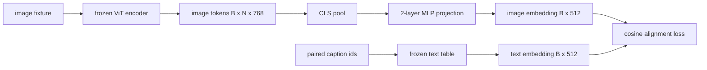

# 模态对齐的投影层

> 视觉编码器产生图像 token，文本解码器消费文本 token。两者生活在不同的向量空间。一个两层 MLP 把图像 token 投影到文本 embedding 空间，再对配对 caption 计算余弦对齐损失，把两个空间拉到一致。这个投影是视觉-语言模型中最小的部件，也是迁移时最重要的部件。

**Type:** Build
**Languages:** Python
**Prerequisites:** Phase 19 lessons 30-37 (Track B foundations)
**Time:** ~90 minutes

## 学习目标

- 构建把图像特征映射到文本 embedding 空间的两层 MLP 投影。
- 构造 mock 文本 embedding 表（不使用预训练分词器，不使用真实语料）。
- 计算投影后的图像 token 与配对 caption embedding 之间的余弦对齐损失。
- 在视觉编码器冻结、文本表冻结的条件下，只训练投影。

## 问题

你有一个视觉编码器（第 58-59 课）产生 `vision_hidden = 768` 维的 token。你想接上一个 embedding 维度为 `text_hidden = 512` 的文本解码器（其他数字同样合理）。解码器期望文本形状的 token。图像 token 不是文本形状的：它们生活在编码器视觉预训练时学到的基里，与解码器的词向量毫无关系。

两层 MLP 投影（linear、GELU、linear）弥合这一差距。它足够小（约 `768 * 1024 + 1024 * 512 = 1.3M` 参数），单张 GPU 几分钟就能训练，而且它是对齐阶段唯一需要学习的部件。视觉编码器保持冻结，文本 embedding 表保持冻结，只有投影在动。这是 LLaVA 在 2023 年发布的配方，BLIP-2 以 Q-Former 重新诠释，此后每个开放权重 VLM 都以某种形式采用。

## 概念



### 投影之前先池化

视觉编码器输出 197 个 token。文本侧只有一个 caption 级 embedding。要对齐它们，每个样本需要一个图像级向量。CLS 池化最简单：取编码器的第一个 token 做投影。对全部 197 个 token 做平均池化是另一种选择，SigLIP 用的就是它。两者都把 197 个向量池化成一个。

### 为什么两层而不是一层

单个线性投影可以旋转和缩放，但如果两个空间存在曲率不匹配，它无法修正基。两个线性层之间的 GELU 给投影一次非线性弯折，经验上足以把 CLIP 风格特征对齐到语言模型 embedding。更深的投影（LLaVA-NeXT 用了 GLU；Qwen-VL 用了注意力层堆叠）是扩展；两层 MLP 是标准基线，也是 BLIP-2 的 Q-Former 投影头在底层采用的形式。

| 层 | 形状 | 参数 |
|-------|-------|------------|
| fc1 | `(vision_hidden, projection_hidden)` | `768 * 1024 + 1024` |
| 激活 | GELU | 0 |
| fc2 | `(projection_hidden, text_hidden)` | `1024 * 512 + 512` |

对于 `768 -> 1024 -> 512` 的头，约 1.3M 参数。

### 余弦对齐损失

对齐并不意味着 `image_emb == text_emb`。对齐意味着 `image_emb` 与 `text_emb` 在联合空间中指向同一方向。余弦损失是 `1 - cos_sim(image, text)`，范围从 0（完全对齐）到 2（相反）。训练会把每对的这个值推向零。第 62 课会推广到对比 batch（InfoNCE）：每张图像必须比自己 caption 更接近 batch 中的任何其他 caption；本课用逐对版本，让动态更可见。

### 冻结编码器是关键

视觉编码器有 86M 参数，文本表还有几百万。用 mock 语料从头训练它们全部是不现实的。两边都冻结意味着投影的 1.3M 参数是唯一在变化的东西，几百步合成对就足以把损失降下去。这正是每个基于 adapter 的 VLM 的运营形态：重的部分保持冻结，轻的桥在训练。

```figure
ch-projection-bridge
```

## 构建它

`code/main.py` 实现：

- `MLPProjector(in_dim, hidden_dim, out_dim)`，带 GELU 激活的两层线性 MLP。
- `MockTextEmbedding(vocab_size, dim)`，从种子确定性初始化的冻结 embedding 表。
- `make_pair(seed, vocab_size)`，合成一个配对的（image, caption）样本。caption 是短 id 序列；caption embedding 是 token embedding 的平均池化。
- `cosine_alignment_loss(image_emb, text_emb)`，逐对的 `1 - cos_sim` 目标。
- 一个训练循环，在 32 个合成对（循环使用）上运行投影 200 步，视觉编码器和文本表冻结，每 25 步打印损失。

运行：

```bash
python3 code/main.py
```

输出：训练报告显示损失在 200 步内从初始约 1.07 降到约 0.80，说明仅靠投影就能把图像 token 拉向文本空间。每对最终的余弦相似度也会打印。

## 使用它

同样的模式出现在每个开放权重 VLM 中：

- **LLaVA 1.5。** 从 CLIP-ViT-L 隐藏维度到 LLaMA embedding 维度的两层 GELU MLP 投影。视觉编码器冻结、LLM 冻结，只训练投影（然后在第二阶段解冻 LLM）。
- **BLIP-2。** Q-Former 用 32 个可学习 query token 对图像 token 做交叉注意力，然后投影到 LLM embedding 维度。Q-Former 最末端的投影头就是本课 MLP 的对应物。
- **MiniGPT-4。** 从 BLIP-2 Q-Former 输出到 Vicuna embedding 维度的单线性投影。
- **Qwen-VL。** 多层交叉注意力 adapter，但最后一块仍然是指向 LM embedding 维度的投影。

形状各不相同，但角色一致：池化图像 token，投影到文本 embedding 维度，单独训练。

## 测试

`code/test_main.py` 覆盖：

- 投影器输出形状匹配配置的 `out_dim`
- 冻结的文本 embedding 表没有 `requires_grad` 参数
- 余弦损失在相同向量上为 0，在反平行向量上为 2
- 一次反向传播后投影器梯度流动
- 训练循环在第 0 步到第 200 步之间降低损失

运行：

```bash
python3 -m unittest code/test_main.py
```

## 练习

1. 把 CLS 池化换成对 196 个 patch token 的平均池化，比较 200 步后的最终损失。合成数据上平均池化通常训练更快；自然图像上 CLS 的样本效率更高。

2. 给余弦损失加一个可学习的标量温度（`cos / tau`），观察 `tau` 太小时（梯度噪声）或太大时（损失在高位平台）会发生什么。

3. 把两层 MLP 换成单线性层，量化损失差距。非线性在自然图像特征上更重要，在合成特征上没那么重要。

4. 给投影器权重加一个小 L2 惩罚，观察它与余弦对齐如何互动（余弦是尺度不变的，所以惩罚主要收缩未使用的方向）。

5. 持久化投影器权重，然后重新加载并在没有视觉编码器反向传播的情况下做 inference，验证部署时只需要投影器。

## 关键术语

| 术语 | 含义 |
|------|---------------|
| 模态对齐 | 让图像和文本 embedding 在同一共享空间中可比较 |
| 投影头 | 把一个空间映射到另一个空间的小模块，通常是两层 MLP |
| 余弦相似度 | 点积除以 L2 范数之积 |
| 冻结编码器 | 视觉（或文本）模型的所有参数 `requires_grad=False` |
| Mock 语料 | 合成配对，使训练不依赖数据集下载 |

## 延伸阅读

- LLaVA 论文，两阶段训练（先投影，再解冻 LM）。
- BLIP-2 论文，Q-Former 作为可学习投影的替代方案。
- Qwen-VL 技术报告，交叉注意力 adapter 作为更深的投影头。
