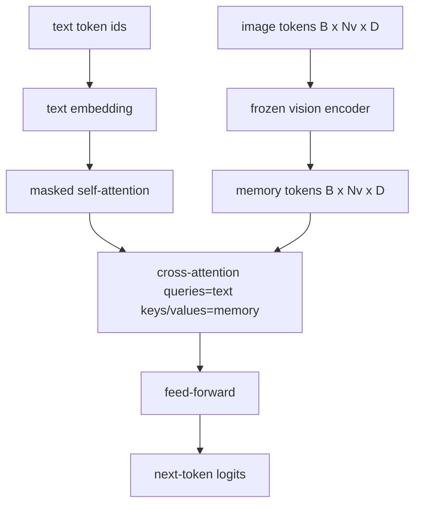
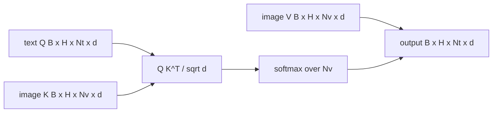

# 交叉注意力融合

> 投影层让一个图像向量与一个 caption 向量对齐。真正的视觉-语言解码器需要每个文本 token 都能关注每个 patch token，模型才能把一个词锚定到某个区域。交叉注意力就是这种锚定发生的方式。文本发出 query，视觉的 key 和 value 作答。本课构建交叉注意力块、因果文本自注意力，以及让两者都合法的掩码形状。

**Type:** Build
**Languages:** Python
**Prerequisites:** Phase 19 lessons 30-37 (Track B foundations)
**Time:** ~90 minutes

## 学习目标

- 实现多头交叉注意力，其中 query 流是文本，key/value 流是视觉。
- 组合一个解码器块：因果自注意力 + 交叉注意力 + 前馈。
- 把掩码形状弄对：自注意力用因果掩码，交叉注意力不用掩码。
- 用批量的文本 token 和固定的图像 token 池跑一次前向。

## 问题

把图像 token 和文本 token 拼进一个序列是一种融合选项（早期融合，Chameleon 和 Emu3 走的路线）。交叉注意力是另一种（晚期融合，Flamingo 引入、此后每个 Flamingo 形状的解码器都照搬的路线）。在晚期融合中，文本解码器只在文本 token 上运行，并在每一层通过交叉注意力伸手进入图像流。

晚期融合有两个优势。第一，文本流保持干净，模型保留纯文本能力。第二，图像流每张图像只计算一次，并在每个解码步骤复用，因此即使 caption 很长，生成也很便宜。代价是每块多一个注意力子层。

## 概念





### 掩码形状

解码器块内的两种注意力需要不同的掩码：

| 注意力 | Query 长度 | Key 长度 | 掩码 | 原因 |
|-----------|--------------|------------|------|-----|
| 自注意力 | `Nt`（文本） | `Nt`（文本） | 因果：下三角 `(Nt, Nt)` | 自回归时文本 token 不能向前看 |
| 交叉注意力 | `Nt`（文本） | `Nv`（视觉） | 无掩码 | 每个文本位置都能看到整幅图像 |

本课包含一个形状校验函数，让混淆两者的错误以 `ValueError` 暴露出来，而不是悄悄破坏损失曲线。

### 为什么交叉注意力不用掩码

在生成任何文本之前，图像已经被完整观察。caption 的 token `t` 可以关注图像的任意 patch；图像 patch 没有时间顺序。某些 Flamingo 变体在交错多张图像和文本片段时会加逐样本掩码模式，但对于单张图像加 caption，交叉注意力能看到一切。

### Key/value 缓存

图像的 key 和 value 在解码开始时计算一次，保存在缓存中。每个新的文本 token 直接使用缓存，无需重算。这就是 captioning 在 inference 时很快的原因：重的 ViT 只跑一次；交叉注意力在每个步骤复用它的 key 和 value。本课暴露缓存并测试缓存命中路径。

### 块组合

解码器块依次运行：pre-LN -> 自注意力 -> 残差 -> pre-LN -> 交叉注意力 -> 残差 -> pre-LN -> 前馈 -> 残差。三个子层，每个都有自己的 LayerNorm。Flamingo 论文在交叉注意力上加了可学习门控，让模型可以在训练稳定性代价下选择退出图像路径；标准基线（本课使用）没有门控。

```python
class DecoderBlock:
  def forward(self, text_tokens, image_tokens, text_mask, cross_mask):
      text_tokens = text_tokens + self.self_attn(self.ln1(text_tokens),
                                                 mask=text_mask)
      text_tokens = text_tokens + self.cross_attn(self.ln2(text_tokens),
                                                  image_tokens,
                                                  mask=cross_mask)
      text_tokens = text_tokens + self.ffn(self.ln3(text_tokens))
      return text_tokens
```

```figure
ch-crossattn-fan
```

## 构建它

`code/main.py` 实现：

- `CrossAttention(hidden, heads)`，带独立 `q` 和 `kv` 投影的多头交叉注意力。
- `CausalSelfAttention(hidden, heads)`，标准解码器中的掩码自注意力。
- `DecoderBlock`，用 pre-LN 残差组合三个子层。
- `VisionLanguageDecoder`，四层解码器，由 mock 视觉编码器输出和一个小型文本 embedding 表供给。
- `causal_mask(length)`，返回 `(length, length)` 下三角布尔张量。
- 一个 demo，输入包含两个长度为 10 的文本序列，图像 memory 长度为 197，打印输出形状、自注意力掩码形状以及交叉注意力每个位置的输出范数。

运行：

```bash
python3 code/main.py
```

输出：解码器产生 `(2, 10, text_vocab)` logit 张量。掩码形状为 `(10, 10)`。KV 缓存复用检查确认缓存与未缓存路径的 logit 完全相同。

## 使用它

交叉注意力出现在两个生产家族中：

- **Flamingo 和 IDEFICS。** 每隔 K 个语言模型块插入一个交叉注意力子层，LM 冻结。视觉-语言 adapter 就是交叉注意力块加它的门控。
- **BLIP-2。** Q-Former 用一组固定的 32 个 query token 对图像特征做交叉注意力，然后把 query 投影到 LM embedding 空间。

本课的块形状直接对应这两者。掩码纪律（自注意力因果，交叉注意力无掩码）相同。

## 测试

`code/test_main.py` 覆盖：

- 因果掩码是下三角，且匹配预期的布尔形状
- 交叉注意力输出形状为 `(B, Nt, hidden)`，与 key 长度无关
- KV 缓存路径与未缓存路径在浮点容差内一致
- 文本流与图像流形状不匹配时抛出清晰的 `ValueError`
- 完整解码器前向产生正确的 batch 和序列形状

运行：

```bash
python3 -m unittest code/test_main.py
```

## 练习

1. 给交叉注意力残差加一个可学习的 tanh 门控（Flamingo 技巧），验证训练从接近零的初始门控收敛。门控初始为 0；模型先恢复纯文本行为，再混入图像流。

2. 实现交错注意力，让同一个解码器消费多张图像加多个文本片段。构建逐样本交叉注意力掩码，阻止文本片段 2 关注图像 1。

3. 在 `Nt=64, Nv=576`（更高分辨率的 24x24 网格）下 profile 交叉注意力与自注意力层。交叉注意力成本是 `Nt * Nv`，在高图像分辨率下占主导。

4. 在交叉注意力图上加 query 侧 dropout，在 demo 上测量 caption 多样性（cross map 中的 dropout 越大，caption 采样方差越高）。

5. 把交叉注意力层换成 Q-Former 风格的注意力块，其中固定的 32-token query 池每层对图像特征做一次注意力。

## 关键术语

| 术语 | 含义 |
|------|---------------|
| 晚期融合 | 文本和视觉保持独立流；交叉注意力在每一块桥接它们 |
| 交叉注意力 | Q 来自一个流，K 和 V 来自另一个流 |
| 因果掩码 | 防止自回归时向前看的左下三角布尔掩码 |
| KV 缓存 | 图像 key 和 value 只存一次，每个解码步骤复用 |
| Memory token | 解码器伸手进入的冻结图像 token |

## 延伸阅读

- Flamingo（2022），带门控交叉注意力的经典晚期融合设计。
- BLIP-2（2023），Q-Former，本质上是打扮成可学习 query 池的交叉注意力块。
- IDEFICS（2023），Flamingo 配方的开放权重复现。
