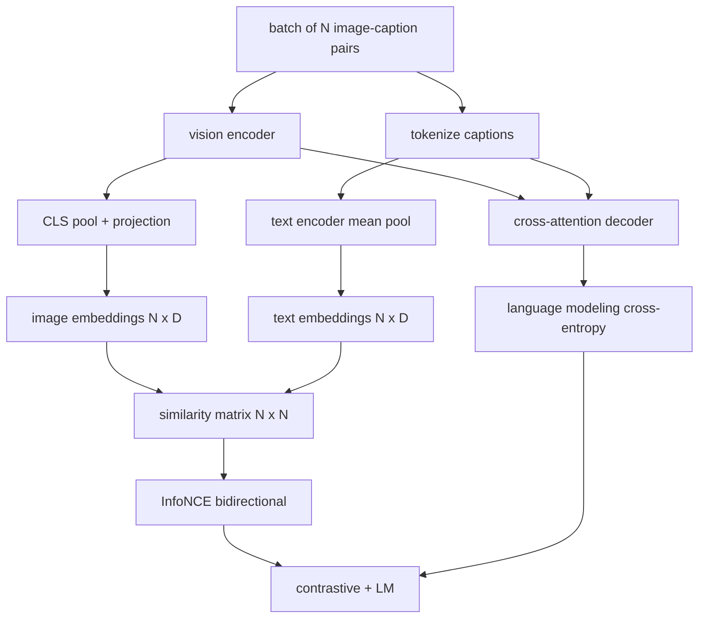

# 视觉-语言预训练

> 编码器、投影层和解码器已经接好。现在把它们一起训练。两个目标驱动学习：一个是对比图像-文本损失（InfoNCE），在联合 embedding 空间中把匹配对拉近；另一个是语言建模损失，要求解码器为每张图像写 caption。两者结合，教网络既能为一句话找到正确的图像，也能为图像写出一句 caption。

**Type:** Build
**Languages:** Python
**Prerequisites:** Phase 19 lessons 30-37 (Track B foundations)
**Time:** ~90 minutes

## 学习目标

- 在图像-caption 对 batch 上实现 InfoNCE 对比损失。
- 把对比损失与自回归语言建模损失组合。
- 合成 200 对的 mock 图像-caption 语料，不下载真实数据集。
- 运行 50 步 demo 训练循环，观察两个损失同时下降。

## 问题

视觉-语言模型需要两种技能。它必须排序：给定一句 caption，在许多图像中找到正确的那张。它必须生成：给定一张图像，写出 caption。只用一个技能预训练模型，你只能得到半个系统。CLIP 把排序做到极致但不会 caption。GPT-4V 会 caption，但排序依赖单独的检索头。多目标预训练一次得到两者。

InfoNCE 处理排序那一半。对于一个 N 对的 batch，模型把 N 个匹配对当作正样本，把 `N^2 - N` 个不匹配对当作负样本，然后在得到的 `(N, N)` 相似度矩阵上跑交叉熵损失。LM 损失处理生成那一半：以图像为条件的标准下一 token 预测。两个损失都可微，可以共享编码器、投影器和解码器权重。

## 概念



### 一段话讲清 InfoNCE

把 N 个图像 embedding 堆成行，N 个文本 embedding 也堆成行。两者都做 L2 归一化。计算 `N x N` 矩阵 `S = I T^T / tau`，其中 `tau` 是可学习温度。对角元素是匹配对；非对角元素是负样本。用交叉熵，目标沿对角线：第 `i` 行应当在第 `i` 列有最大元素。沿列方向对称地做同样的事。总损失是两者的平均。这就是八行代码的 CLIP 损失。

### 温度很重要

温度 `tau` 控制 softmax 的尖锐程度。太小（例如 `tau = 0.01`）时，梯度只来自最难的负样本，训练噪声大。太大时，softmax 变平，梯度消失。CLIP 把 `tau` 作为参数学习；这里的 demo 也一样。

### 语言建模损失

解码器通过交叉注意力消费图像 memory token，并在每个位置预测下一个文本 token。损失是带下一位置目标的标准交叉熵。padding 位置从损失中屏蔽。

### 组合损失

`total = contrastive + lm_weight * lm`，其中 `lm_weight` 是标量（通常为 1.0）。两个损失把梯度共享给编码器和投影；只有解码器接收 LM 损失的梯度。这是 CoCa、BLIP 和 SigLIP 风格模型都在用的多任务配方，只是权重不同。

| 组件 | 损失面 | 影响 |
|-----------|--------------|---------|
| InfoNCE | 联合空间中的配对排序 | 编码器 + 投影 + 文本头 |
| LM | 以图像为条件的 token 预测 | 编码器 + 投影 + 解码器 |
| 组合 | 多任务 | 整个栈 |

### 为什么 demo 用 50 步就够

mock 语料是 200 个合成对，图像和 caption id 都是随机的。batch 大小 16，50 步 SGD 后，两个损失都明显下降，即使绝对值仍高于真实数据模型。demo 的重点是确认梯度管道端到端工作，以及加入 LM 损失不会让对比目标失稳。

```figure
ch-infonce-diagonal
```

## 构建它

`code/main.py` 实现：

- `MultimodalModel`，组合小型 ViT 编码器、MLP 投影器、极小的文本侧编码器（对 embedded id 做平均池化）以及第 61 课的交叉注意力解码器。
- `info_nce_loss(image_emb, text_emb, temperature)`，双向 CLIP 风格对比损失。
- `lm_loss(logits, target_ids, padding_id)`，带掩码的下一 token 交叉熵。
- `make_mock_corpus(seed, n_pairs)`，返回 200 个确定性的（image, caption_ids）对。
- 一个训练循环，batch 大小 16、Adam 优化器、可学习 log 温度参数，运行 50 步。每 5 步打印两个损失。

运行：

```bash
python3 code/main.py
```

输出：对比损失从约 `ln(16) = 2.77` 降到约 2.4；LM 损失从随机均匀基线 `ln(512) ≈ 6.24` 降到约 4.7。两者的下降证明梯度接线正确。真实模型要训练数百万步；动态是一样的。

## 使用它

这是以下模型发布的同一套损失配方：

- **CLIP（2021）。** 只有图像-文本对比，另有一个冻结编码器的 caption 探针。
- **CoCa（2022）。** 图像-文本对比加图像 captioning LM 损失，在一个模型中。正是本课构建的模式。
- **BLIP（2022）和 BLIP-2。** 对比 + LM + 图像-文本匹配头。三个损失组合。
- **SigLIP（2023）。** 把 InfoNCE 换成 sigmoid 配对损失；对比角色相同，函数形式不同。
- **LLaVA 系列。** 两阶段训练，第一阶段是对齐（冻结 LM 上的余弦），第二阶段加入带解冻 LM 的 LM 损失。第 60 课对应第一阶段；本课对应第二阶段。

## 测试

`code/test_main.py` 覆盖：

- InfoNCE 损失在图像/文本行之间对称
- 当相似度矩阵是大的正数完美对角阵时，InfoNCE 损失返回 0
- LM 损失正确屏蔽 padding 位置
- 模型前向产生两个损失且无错误
- 5 步训练循环降低组合损失

运行：

```bash
python3 -m unittest code/test_main.py
```

## 练习

1. 把 InfoNCE 换成 SigLIP 风格 sigmoid 配对损失，比较在 mock 语料上的收敛。

2. 加入难负样本挖掘步骤：每隔一个 batch，从前一个 batch 选出最难的离对角对并追加。训练并观察对比损失是否下降更快。

3. 在联合 embedding 之上加一个图像-文本匹配二分类头（真/假：它们匹配吗？）作为第三个损失，复现 BLIP 的三头设置。

4. 把 mock 语料换成从马尔可夫链抽取的 caption-id 序列，其转移矩阵以图像哈希为条件。captioning 损失应当进一步下降，因为存在真正可学习的信号。

5. 用 `lm_weight = 0` 训练同一模型，再用 `lm_weight = 1` 训练。比较对比损失；LM 损失不应让排序目标退化。

## 关键术语

| 术语 | 含义 |
|------|---------------|
| InfoNCE | 噪声对比估计：在相似度矩阵上做交叉熵 |
| 温度 | 控制对比 softmax 尖锐程度的标量 |
| 难负样本 | 模型觉得困惑的离对角对，采样时有用 |
| LM 损失 | captioning 侧的标准下一 token 交叉熵 |
| 联合 embedding 空间 | 投影后图像和文本向量共同生活的共享空间 |

## 延伸阅读

- CLIP 论文，原始对比配方。
- CoCa 论文，在一个模型中做对比加 captioning。
- SigLIP 论文，sigmoid 配对损失变体及其为何扩展性更好。
