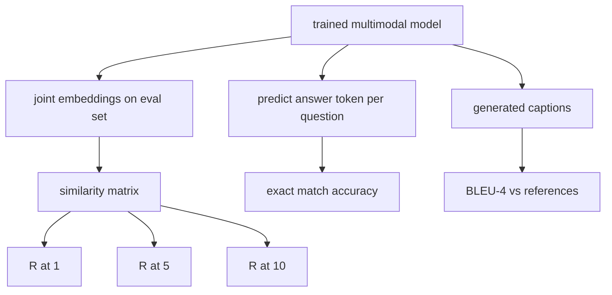

# 多模态评估

> 训练只完成了一半的闭环，另一半是度量。本节课从基础原语出发构建三个评估维度：以 R@1、R@5、R@10 报告的图文检索，以精确匹配准确率报告的视觉问答，以及以 BLEU-4 报告的图像描述。每个指标都是作用于模型输出的函数，配套的合成评估套件几秒钟就能跑完。

**Type:** Build
**Languages:** Python
**Prerequisites:** Phase 19 lessons 58-62 (Track E foundations: encoder, transformer, projection, cross-attention fusion, pretraining)
**Time:** ~90 minutes

## 学习目标

- 从图像与描述 embedding 之间的相似度矩阵计算 Recall@K。
- 从把 (image, question) 对映射到固定答案词表的模型计算精确匹配 VQA 准确率。
- 不依赖任何外部库，从生成序列与参考序列计算 BLEU-4。
- 在基于第 62 课训练模型构建的合成套件上运行这三种评估。

## 问题

人们很容易在训练损失进入平台期时就宣布一个多模态模型完工。训练损失衡量的是模型在训练分布上的拟合程度，并不衡量模型能否在一个留出的 batch 里对配对排序、回答一个问题，或写出人愿意接受的描述。三个评估维度是标准做法：

- **检索（R@1、R@5、R@10）。** 为查询描述构建联合 embedding，按余弦相似度对评估池中的每张图像排序，报告匹配图像是否落在前 1、前 5、前 10。对称的图像到文本形式同理。
- **视觉问答（精确匹配）。** 给定 (image, question)，模型输出一个答案 token。精确匹配是每个样本一比特：预测答案是否等于参考答案？在评估集上取平均。
- **图像描述（BLEU-4）。** 生成一句描述。针对参考描述计算 1-gram 到 4-gram 精确率的几何平均，并施加简短惩罚。多参考是标准形式（一张图像，多条参考描述）。

每个指标都是一个轻量函数。本节课用代码把它们全部实现出来，让数学变得具体，评估始终掌控在你手中。真实的基准套件（MS-COCO、VQA v2、GQA、OK-VQA）接入的是相同的函数形状。

## 概念



### 从相似度矩阵计算 Recall@K

在图像与描述 embedding 之间构建 `(N, N)` 余弦相似度矩阵。对每一行，按相似度降序排列各列。Recall@K 是「对角线列索引位于前 K 个位置」的行所占的比例。对称的 Recall@K（描述到图像）在转置矩阵上计算。两个数字都要报告。对于 N=100 的评估，R@1 = 0.6 表示 100 句描述中有 60 句把正确的图像检索为第一匹配。

### VQA 精确匹配

对每个 (image, question, answer)，编码图像、embed 问题、通过解码器融合，并读出下一个 token。预测的 token id 与参考 id 比较，相等即正确。在评估集上取平均。真实 VQA 数据集为每个问题附带多个人工标注答案，并使用软准确率公式（10 个标注者中至少 3 人一致记 1.0，否则按比例折算）；为清晰起见，本节课使用单答案精确匹配。

### BLEU-4

```math
\text{BLEU-4} = \text{BP} \cdot \exp\big(\text{mean}(\log p_1, \log p_2, \log p_3, \log p_4)\big)
```

其中 `p_n` 是修正后的 n-gram 精确率（生成 n-gram 在任何参考中出现的截断计数，除以生成的 n-gram 总数），`BP` 是简短惩罚：

```math
\text{BP} = \begin{cases} 1 & \text{if generated length} > \text{reference length} \\ \exp(1 - r/g) & \text{otherwise, where } r \text{ is reference length and } g \text{ is generated} \end{cases}
```

小样本中某些 `p_n` 为零时需要平滑。实现采用 Chen 与 Cherry 的「方法 1」（对任何零计数在分子和分母上各加 1），这是低计数场景下最安全的默认做法。

### 合成评估套件

一个 50 样本的评估套件在内存中构建，沿用第 62 课的模拟语料模式，但使用留出的随机种子。套件由三个列表组成：

- `pairs`：50 个 (image, caption_ids) 配对，用于检索。
- `vqa`：50 个 (image, question_ids, answer_id) 三元组。
- `caps`：50 个 (image, [reference_caption_ids, ...]) 条目，每张图像最多 3 条参考。

套件由随机种子确定，且与训练语料留出隔离，因此指标是在模型从未见过的数据上计算的。把套件持久化为 JSON 留作练习（见下文）。

| 指标 | 范围 | 随机基线（N=50） |
|------|------|------------------|
| R@1 | 0 到 1 | 0.02（1 / N） |
| R@5 | 0 到 1 | 0.10 |
| R@10 | 0 到 1 | 0.20 |
| VQA EM | 0 到 1 | 1 / vocab |
| BLEU-4 | 0 到 1 | 很小但非零 |

对于合成数据上 50 步的训练，指标不应期望很高；只应期望高于随机基线，这正是演示所检查的。

```figure
ch-recall-window
```

## 构建它

`code/main.py` 实现了：

- `recall_at_k(sim_matrix, k)`，为两个方向返回 `[0, 1]` 内的浮点数。
- `vqa_exact_match(predictions, references)`，返回 `int` 相等判断的均值。
- `bleu4(generated, references, smoothing=True)`，支持多参考。
- `build_eval_suite(seed, n_samples, vocab_size, max_len)`，返回三个确定性的评估列表。
- `evaluate(model, suite)`，运行全部三个指标并返回数值 `dict`。
- 一个演示：加载第 62 课刚初始化的多模态模型，评估它，然后训练 50 步再评估一次，打印前后指标。

运行它：

```bash
python3 code/main.py
```

输出：前后指标表显示检索从接近随机提升到模型学到的信号，VQA 高于随机，BLEU-4 也有提升（合成结构足以带来 4-gram 精确率的提升）。

## 使用它

每个指标都直接对应一个生产基准：

- **检索。** MS-COCO 5K val、Flickr30K、ImageNet zero-shot 都是同一相似度矩阵上的 R@K 问题。把合成评估换成真实文件，函数签名不变。
- **VQA。** VQA v2、GQA、OK-VQA 使用相同的精确匹配形状（VQA v2 用 soft-acc 代替单答案 EM）。
- **BLEU-4。** MS-COCO captioning、NoCaps、Flickr30K captioning 都用 BLEU-4 加上 CIDEr 和 METEOR。加 CIDEr 只是再多一个函数。

对真实基准，把 `build_eval_suite` 换成真实加载器，函数体保持不变。数学与基准无关。

## 测试

`code/test_main.py` 覆盖：

- recall@k 在完美单位相似度矩阵上返回 1.0，在翻转矩阵上（k < N 时）返回 0.0
- recall@k 遵守 `k <= N` 上界
- 生成与某条参考完全一致时 bleu4 返回 1.0
- 词表不相交时 bleu4 返回 0.0
- VQA 精确匹配等于相等对的比例
- build_eval_suite 返回预期的 pairs、vqa 项和 caption 条目数量

运行它们：

```bash
python3 -m unittest code/test_main.py
```

## 练习

1. 为描述指标加入 CIDEr。CIDEr 对 n-gram 使用 TF-IDF 加权，从而奖励信息量大的 token。

2. 实现软准确率 VQA：每个问题多个人工答案，只要有一个匹配，准确率为 `min(human_count / 3, 1)`。复刻 VQA v2。

3. 为 `bleu4` 增加 NaN 安全变体，能处理空的生成序列而不崩溃。

4. 在 R@K 之外计算平均倒数排名（MRR）。MRR 关注正确项落在前 K 之外的位置；R@K 只关注是否落在前 K。

5. 在训练过程中五个 checkpoint（step 0、10、20、30、40、50）上运行评估并绘制学习曲线。确认指标轨迹与损失轨迹一致。

## 关键术语

| 术语 | 含义 |
|------|------|
| R@K | 正确匹配落在前 K 结果中的查询比例 |
| 精确匹配（Exact match） | 最简单的 VQA 评分：预测答案等于参考 |
| BLEU-4 | 1-gram 到 4-gram 精确率的几何平均，含简短惩罚 |
| 多参考（Multi-reference） | 描述指标允许每张图像有多条参考描述 |
| 留出（Held-out） | 评估集从与训练语料不相交的随机种子采样 |

## 延伸阅读

- VQA v2 论文，关于软准确率公式与数据集统计。
- CIDEr 论文，关于 TF-IDF 加权的 n-gram 描述评估。
- BLEU 原始论文（Papineni 等，2002），关于平滑变体。
- MS-COCO captioning 评估脚本，即权威参考实现。
