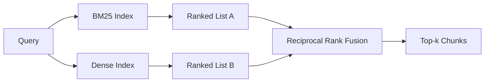

# 结合 BM25 与稠密 embedding 的混合检索

> 词法检索与语义检索在相反的查询分布上失效。采用倒数排名融合的混合检索不是插值，而是投票——而且这种投票在每一类查询上都胜出。

**Type:** Build
**Languages:** Python
**Prerequisites:** Phase 11 lessons 04 (embeddings), 06 (RAG); Phase 19 Track B foundations (lessons 20-29); Phase 19 lesson 64 (chunking strategies)
**Time:** ~90 minutes

## 学习目标
- 按 Robertson 与 Sparck Jones 的公式从零实现 BM25，含字段加权、文档长度归一化以及可调的 k1 和 b。
- 在确定性模拟 embedding 之上构建稠密检索器，使循环可离线运行。
- 完全按 Cormack、Clarke 与 Buettcher 在 2009 年发表的形式实现倒数排名融合，并解释它为何优于分数加权插值。
- 调优 RRF 的 k 常数与各模态权重，并在小型 fixture 语料上读懂权衡。

## 问题

当查询携带一个语料中逐字出现的标识符时，词法搜索胜出。查询 `AbortMultipartOnFail` 会通过 BM25 在微秒内返回正确的 Go 函数。同一个查询做 embedding 后落在三个相似簇的边界上，稠密检索器会把错误的文件排在第一。

当查询被改写、偏离语料字面 token 时，稠密搜索胜出。用户问「取消的上传我们怎么处理」，从未键入 abort 或 multipart 这两个词。BM25 因为「上传大文件」页面含有 uploads 一词而返回那个文档块。稠密检索则找到摘要中提到取消的 abort 函数。

两者之间的选择不是静态的，变量是查询分布。生产 RAG 系统从同一端点处理两类查询，因此检索必须同时兼顾两者。这就是混合检索。合并步骤是必须做对的部分。

## 概念



### 一段话讲清 BM25

BM25 对查询-文档对打分的方式是：对每个查询词，求一个 IDF 因子乘以一个饱和的词频因子，后者包含长度归一化修正。两个旋钮。`k1` 控制词频饱和；默认值 1.5 是已发表推荐值，没有基准不要动它。`b` 控制文档长度的影响程度；默认 0.75 表示较长的文档会被惩罚，但不是线性的。

IDF 公式使用平滑后的 Robertson 与 Sparck Jones 定义，即 `log((N - df + 0.5) / (df + 0.5) + 1)`。对数内的加一让 IDF 在一个词出现在超过半数语料中时仍为正。这在停用词在技术上罕见的语料里很重要。

字段加权让你告诉 BM25：命中符号名的权重高于命中正文。实现是在索引阶段对词频做乘数，而不是在打分阶段。这保持数学形式不变，也避免为每个字段单独算分。

### 一段话讲清稠密检索

用 embedding 模型把每个分块 embed 成固定维度向量。查询时 embed 查询，按相似度对所有分块做余弦排序，返回 top-k。模型是决定质量的变量。检索算法本身只有两行：点积加排序。

本课使用基于哈希的确定性 embedding，让你无需网络调用就能读懂融合数学。哈希把以 token 为键的偏移求和进一个 96 维向量并归一化。余弦排名在多次运行间确定，这正是测试套件所需的。

### 倒数排名融合：已发表的公式

两个有序列表。对出现在任一列表中的每个候选，累加其倒数排名贡献。2009 年的论文使用 `1 / (k + rank)`，k 默认等于 60。按总分排序。整个算法就是这些。

已发表的常数 k = 60 并非随意。k = 60 时，rank-1 的贡献是 1 / 61，rank-10 的贡献是 1 / 70。贡献衰减缓慢，因此靠后的候选仍能投票。较小的 k 让头部结果主导。较大的 k 压平贡献曲线。

我们的实现有两个可调旋钮。`k` 常数。以及一对按模态的权重，当你有先验证据表明某个模态在你的语料上更好时可以提升 BM25 或稠密。把排名贡献乘以权重是最简单的有原则实现；它保持排名衰减的形状，并且无量纲。

### 为什么融合优于分数加权插值

BM25 分数无上界且依赖语料。余弦相似度有界于 -1 到 1。线性组合 `alpha * bm25 + (1 - alpha) * cosine` 需要按语料调 alpha，并且每次重建索引都会失效。基于排名的融合不会。排名在两个模态之间可比。自 2010 年以来，已发表的 RRF 基线在每个公开 TREC track 上都击败分数插值。

这与你从 Vespa 和 Weaviate 文档中关于 RankFusion 与 RRF 听到的论点相同。它们得出了相同结论：除非有非常强的证据支持分数插值，否则保持基于排名。

```figure
rrf-fusion
```

## 构建它

`code/main.py` 实现：

- `tokenize(text)` —— 快速正则分词器。
- `BM25Index` —— 字段加权，提供 `add` 与 `search`，可调 k1、b。
- `mock_embed`、`DenseIndex` —— 与第 64 课相同的确定性 embedding，使分块可比。
- `rrf(rankings, k, weights)` —— 已发表的融合，带各模态权重。
- `HybridRetriever` —— 组合 BM25 与稠密。
- 演示 `main()`：加载小型 fixture 语料，运行三个分别针对各检索器强项与弱项的查询，打印每个模态的排名以及融合列表。

运行它：

```bash
python3 code/main.py
```

并排阅读演示输出。字面标识符查询在 BM25 排第 1、稠密排第 4、RRF 排第 1。改述查询在 BM25 排第 6、稠密排第 1、RRF 排第 1。歧义查询在 BM25 排第 3、稠密排第 3、RRF 排第 1。融合不是平局决胜器；它是每类查询都胜出的系统。

## 调优旋钮

| 旋钮 | 默认值 | 何时调高 | 何时调低 |
|------|--------|----------|----------|
| BM25 k1 | 1.5 | 词项在文档中重复，且你希望频率更重要 | 文档很短，词项重复是噪声 |
| BM25 b | 0.75 | 长文档确实每词信息更少 | 文档长度与主题不相关 |
| RRF k | 60 | 靠后的候选应继续投票 | top-1 应占主导 |
| BM25 权重 | 1.0 | 语料含字面标识符且查询与之匹配 | 查询经用户改述 |
| 稠密权重 | 1.0 | 查询被改述 | 查询是字面的 |

调优应在留出查询集上重跑第 68 课的评估工具，而不是凭直觉。

## 演示掩盖不了的失败模式

**词表外 token。** BM25 的 IDF 由语料计算，所以只出现在查询中的词贡献为零。稠密 embedding 会为同一个词幻觉出一个向量。对于语料外的标识符，稠密模态返回看似合理但错误的邻居。融合能吸收这一点，因为 BM25 返回空、排名贡献消失——但前提是你按文档而非按分块去重。

**停用 token 主导。** BM25 对「the」一词会在语料上产生均匀排名。在索引器中过滤停用 token，或接受高 IDF 词自然主导。

**跨模态内容相同。** 如果语料小到 BM25 的 top-1 也是稠密的 top-1，RRF 会给出相同的 top-1 和相同的邻居。这是正确行为，不是失败，但它让融合看起来不可见。在评估中加入一对对抗性查询，验证融合确实在工作。

## 使用它

生产模式：

- BM25 在进程内建索引；瓶颈是词频字典，不是向量。
- 稠密向量索引在单独的存储中（本课用平坦列表；生产中你会用 HNSW）。
- 两个查询并行执行；融合是对并集的常数时间合并。
- 持久化每个检索命中的模态，让下游重排序器能看到是哪个模态投的票。

## 交付它

第 66 课取本课的融合 top-k，用交叉编码器重排序。第 68 课用精确率、召回率、MRR 和 nDCG 评估整个 pipeline。本课的混合检索器是第 69 课端到端系统的第一阶段。

## 练习

1. 把 `mock_embed` 换为你所用提供商的真实模型。重跑演示并报告在改述查询上仅稠密的排名如何变化。
2. 增加第三个模态：把分块摘要单独索引并作为第三个有序列表融合。测量增益。
3. 让 RRF k 取 10、30、60、100、200 逐一扫描。绘制第 68 课的 recall@k 曲线。报告在你语料上曲线达到峰值的 k 值。
4. 正确实现 BM25F（按字段长度归一化，而不是乘数技巧），在符号匹配最重要的语料上对比。

## 关键术语

| 术语 | 常见说法 | 实际含义 |
|------|----------|----------|
| BM25 | 「词法搜索」 | 概率排序：idf × 饱和 tf × 长度归一化 |
| RRF | 「排名融合」 | 各有序列表上 1 / (k + rank) 的求和；k 默认 60 |
| k1 | 「TF 饱和」 | 控制重复词停止增加分数的速度 |
| b | 「长度惩罚」 | 0 表示忽略文档长度，1 表示完全归一化 |
| 字段加权（Field weighting） | 「符号加权」 | 索引时重复 token 以提升该字段匹配 |
| 基于排名 vs 基于分数的融合 | 「RRF 为何优于线性」 | 排名跨模态可比；分数不可比 |

## 延伸阅读

- Cormack、Clarke、Buettcher，"Reciprocal Rank Fusion outperforms Condorcet and individual rank learning methods"，SIGIR 2009
- Robertson、Walker、Beaulieu、Gatford、Payne，"Okapi at TREC-3"（BM25 原始论文）
- [Vespa：使用 BM25 与 embedding 的混合检索](https://docs.vespa.ai/en/tutorials/hybrid-search.html)
- [Weaviate：混合搜索](https://weaviate.io/developers/weaviate/search/hybrid)
- Phase 11 第 06 课 —— RAG 基础
- Phase 19 第 64 课 —— 其输出在此建索引的分块器
- Phase 19 第 66 课 —— 消费融合 top-k 的交叉编码器重排序器
