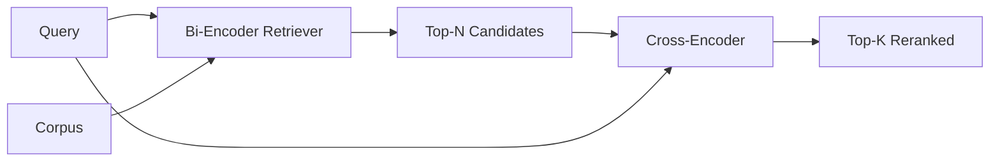

# 交叉编码器重排序器

> 双编码器分别 embed 查询和文档。交叉编码器把二者拼接，同时阅读。交叉编码器是最聪明的读者，也是最慢的。把它用作双编码器 top-k 上的第二阶段，它就能收回成本。

**Type:** Build
**Languages:** Python
**Prerequisites:** Phase 11 lesson 06 (RAG), Phase 11 lesson 07 (advanced RAG); Phase 19 Track B foundations (lessons 20-29); Phase 19 lesson 65 (hybrid retrieval feeding this stage)
**Time:** ~90 minutes

## 学习目标
- 从输入形状、参数量和单查询成本三方面区分双编码器检索器与交叉编码器重排序器。
- 从零实现一个小型交叉编码器，作为 Transformer 块消费打包的 (query, document) 序列并输出单个相关性标量。
- 接起两阶段「先检索后重排序」pipeline：用廉价检索器取 top-N，用交叉编码器把 N 重排到 top-K，返回 K。
- 在小型 fixture 语料上测量延迟与质量的权衡，并为给定延迟预算选择正确的 N。

## 问题

双编码器把查询和文档映射到同一向量空间并按余弦排序。两个编码过程从不互相看到。模型必须把关于一个文档的所有有用信息压缩进单个向量，而看不到查询。这很快——索引时每文档一次 embedding，查询时每查询一次——也是语料规模排序的唯一方式。

代价是精确率。两篇整体主题相同的文档可能有几乎相同的 embedding，即使其中一篇回答了查询、另一篇没有。双编码器无法区分它们。

交叉编码器通过同时阅读查询和文档来解决。模型接收 `[query] [SEP] [document]` 作为单个序列，在连接处运行完整注意力，并产出一个相关性标量。文档的每个 token 都能注意查询的每个 token。模型在全上下文下决定分数。

代价是吞吐量。双编码器只 embed 一次、查询无数次；交叉编码器每个 (query, document) 对运行一次。对于千万文档的语料，就是每查询一千万次前向。在请求预算内不可运行。

解决方案是分阶段。用双编码器检索 top-N。用交叉编码器把 N 重排为 top-K。N 很小（50 到 200），交叉编码器的质量提升集中在关键处。总延迟保持在请求预算内。总质量是交叉编码器的质量，但以双编码器在 N 上的召回为上限。

## 概念



### 交叉编码器的输入形状

标准打包是 `[CLS] query_tokens [SEP] document_tokens [SEP]`。CLS 位置的输出送入一个线性头，输出相关性标量。有些实现用均值池化代替 CLS；差别很小。要点是模型为每个对产出一个数。

2200 万参数的交叉编码器（已发表的 `ms-marco-MiniLM-L-6-v2` 权重级别）是典型的生产点。更小的模型损失的质量多于节省的延迟。更大的模型（如 5.68 亿参数的 `bge-reranker-v2-m3`）留给离线重排序，或 K 很小的首页重排序。

### 为什么本课训练一个小模型

真实交叉编码器是微调过的编码器 Transformer。生产中你加载 checkpoint 直接运行。本课的目标是展示模型形状与延迟-质量曲线的形状，而不是训练最先进的排序器。所以我们构建一个小 `nn.Module`：一个 Transformer 块、多头注意力（默认 4 头）、一个回归头。它由种子确定性初始化，因此演示可复现且磁盘上无需权重。

玩具模型从 fixture 语料中学到正确形状：相关查询-文档对的预测分数高于不相关对。端到端 pipeline 重排双编码器的输出，重排的 top-k 与金标相关。

### 延迟 vs 质量

两阶段 pipeline 有一个可调项：N。在留出查询集上把 N 从 5 扫到 100，就得到曲线。

| N | 阶段 2 的 Recall@1 | 每查询交叉编码器前向次数 | 延迟 |
|---|--------------------|--------------------------|------|
| 5 | 0.62 | 5 | 低 |
| 20 | 0.81 | 20 | 中 |
| 50 | 0.86 | 50 | 高 |
| 100 | 0.86 | 100 | 很高 |

上述数字说明的是曲线形状，不是本 fixture 的实测值。形状是真实的。总会在 20 到 50 个候选附近出现一个拐点，重排序增益在此饱和。过了拐点，再多投入也没有回报。

根据评估曲线加延迟预算选择 N。交叉编码器无法把召回提高到双编码器在 N 处召回之上，所以低 N 限制的不只是延迟，还有质量。

```figure
rerank-funnel
```

## 构建它

`code/main.py` 实现：

- `CrossEncoder` —— 一个小 `torch.nn.Module`：token embedding、一个带多头注意力与前馈的 Transformer 块、均值池化头，输出一个标量。
- `tokenize_pair(query, document)` —— 把两个字符串打包成单个 id 序列，用 type id 标记边界，确定性且仅用标准库。
- `train_tiny(pairs)` —— 在手标 (query, document, relevance) 三元组列表上做一轮监督训练，让模型在 fixture 上给出合理分数。
- `rerank(query, candidates, top_k)` —— 生产接口。
- `pipeline(query, retriever, top_n, top_k)` —— 两阶段流程。
- 演示 `main()`：加载第 65 课模式的语料，检索 top-N，重排到 top-K，并排打印两个列表，报告各阶段延迟。

运行它：

```bash
python3 code/main.py
```

输出显示双编码器的 top-N、交叉编码器的 top-K 以及计时摘要。交叉编码器每次调用更慢，但不在全语料上运行。两阶段总耗时保持在请求预算内，同时挑出双编码器排第二或第三的答案。

## 演示掩盖不了的失败模式

**交叉编码器不对称。** `rerank(q, d)` 与 `rerank(d, q)` 得到不同分数。始终把查询放在前面。若不小心交换，召回会崩塌。

**N 太小，暴露不了问题。** 如果设 N = K，交叉编码器无法重排，只能重新加权。提升看起来为零。N 至少取 K 的三倍。

**训练数据泄漏进评估。** 如果手标训练对包含评估查询，重排序看起来会神奇。即使在 fixture 上，也要严格分离训练与评估。

**生产权重是稠密的。** 2200 万参数的交叉编码器在 float32 下是 88MB。在承诺 p95 低于 100ms 之前，先规划模型服务器的内存。

**批处理很重要。** 真实交叉编码器把 N 个候选放在一个批次里运行。本课在 `_batch_encode` 中这样做：用 `torch.tensor(...)` 构建批量的 id 与 type-id 张量，一次前向。跳过批处理，延迟会乘以 N。

## 使用它

生产模式：

- 把双编码器、交叉编码器和 N 三者一起固定。改动任何一个都会使评估失效。
- 按 (query, document_id) 哈希缓存重排序器输出。同一查询对稳定语料重排出相同顺序；缓存命中免费换来延迟下降。
- 记录 rank-1 交叉编码器分数。top-1 分数低于语料特定阈值的查询是域外命中；向 LLM 呈现为「我没有把握」。

## 交付它

第 68 课端到端评估这个两阶段 pipeline。第 69 课把这个重排序器接在第 65 课混合检索器之后、答案生成器之前。重排序器是端到端系统的第二阶段。

## 练习

1. 把 N 从 5 扫到 50，绘制重排输出的 recall@1。找出本 fixture 上的拐点。
2. 把交叉编码器训练十轮而不是一轮。测量每一轮正负对之间的分数间隔。
3. 把均值池化换成 CLS token 头。比较在本 fixture 上的收敛。
4. 增加第二个交叉编码器头，预测二值标签「答案是否在文档中」。推理时使用两个头；一个排序，一个做阈值。
5. 用第 65 课的双编码器替换确定性模拟双编码器，串联两个阶段。测量 top-K 相对仅双编码器的变化。

## 关键术语

| 术语 | 常见说法 | 实际含义 |
|------|----------|----------|
| 双编码器（Bi-encoder） | 「向量检索器」 | 分别编码查询与文档；用余弦排序 |
| 交叉编码器（Cross-encoder） | 「重排序器」 | 联合编码 (query, doc)；输出一个相关性标量 |
| 两阶段 pipeline | 「检索再重排」 | 廉价检索器返回 N，昂贵重排序器保留 K |
| N（候选预算） | 「重排池」 | 交叉编码器每查询打分的候选数 |
| 均值池化头（Mean-pooling head） | 「最后隐状态的均值」 | 把编码器最后一层输出平均成一个向量 |

## 延伸阅读

- Nogueira、Cho，"Passage Re-ranking with BERT"，2019 —— 交叉编码器排序器的权威论文
- Reimers、Gurevych，"Sentence-BERT: Sentence Embeddings using Siamese BERT-Networks"，2019 —— 关于双编码器 vs 交叉编码器
- [SentenceTransformers 交叉编码器文档](https://www.sbert.net/examples/applications/cross-encoder/README.html)
- [BGE Reranker v2 模型卡](https://huggingface.co/BAAI/bge-reranker-v2-m3)
- Phase 19 第 65 课 —— 为本重排序阶段提供输入的混合检索器
- Phase 19 第 68 课 —— 度量本重排序带来多少提升的评估
