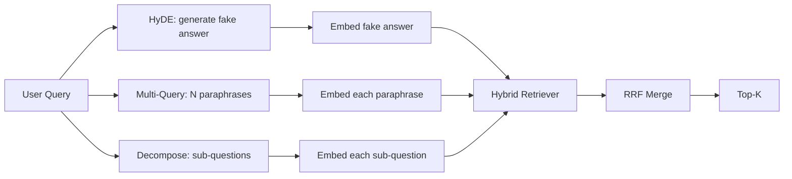

# 查询改写：HyDE、多查询与分解

> 用户键入的查询不是检索器想要的查询。改写会在检索之前架起桥梁，让索引看到更接近答案形态的东西。

**Type:** Build
**Languages:** Python
**Prerequisites:** Phase 11 lessons 04 (embeddings), 06 (RAG); Phase 19 Track B foundations (lessons 20-29); Phase 19 lessons 64 and 65
**Time:** ~90 minutes

## 学习目标
- 实现假设文档嵌入（HyDE）：生成一个假答案，embed 它，用它而不是查询向量去检索。
- 实现多查询扩展：把一个查询改写成 N 个改述，分别检索，用倒数排名融合合并并集。
- 实现查询分解：把复杂问题拆成子问题，按子问题分别检索，再合并。
- 在 fixture 上正面比较三种改写器，解释各种策略何时胜出。
- 接一个模拟 LLM，产出确定性的、贴合 fixture 的输出，使改写循环离线运行。

## 问题

用户输入「上传失败且预算耗尽时我们团队会做什么？」。语料里有一篇文档写着「AbortMultipartOnFail aborts an in-flight S3 multipart upload and decrements the per-bucket retry budget when the upload fails」。查询与文档不共享任何名词短语。BM25 错过。双编码器把该文档排到第三或第四，因为查询向量落在 embedding 空间中偏好「已取消作业」文档而非「已中止上传」文档的区域。第 66 课的两阶段重排序可以在答案位于 top-N 时挽回它，但如果它连 top-N 都进不了，重排序器永远看不到它。

修复方法是在查询接触检索器之前改写它。2023 年的论文 "Precise Zero-Shot Dense Retrieval without Relevance Labels"（Gao 等）提出了 HyDE：让 LLM 写出能回答该查询的文档，embed 这篇假设文档，并用其 embedding 作为检索向量。假设文档位于 embedding 空间的正确区域，因为它以语料的语气写成。查询向量则不是。

还有两项同源技术可与 HyDE 搭配。多查询扩展（Microsoft 的 GraphRAG 使用的术语）生成查询的 N 个改述并分别检索，然后合并。分解（2024 年斯坦福 DSPy 工作中以「子查询分解」之名推广）把「上传失败且预算耗尽时我们团队会做什么」拆成两个问题：「上传失败时会发生什么」与「重试预算耗尽时会发生什么」。两次检索，一个合并结果，答案的两部分都可达。

本课实现全部三种，并在同一 fixture 语料上运行。

## 概念



### 详解 HyDE

HyDE 用 LLM 写出的假设文档向量替换用户的查询向量。提示很短：

```
You are a domain expert. Write a one-paragraph passage that answers the question
below. Use the same vocabulary and phrasing the documentation in this domain would
use. Do not refuse. Do not say you do not know.

Question: {user_query}

Passage:
```

LLM 的回答作为事实性答案会是错的，因为 LLM 不了解你的语料。没关系。检索器不关心事实正确性，只关心 token 分布。假设段落会包含「abort」「multipart」「bucket」「budget」这些词，因为这是该主题文档段落会说的话。embed 这个段落。向量会落在真实段落附近。

生产中把假设文档限制在两句到三句。更长的假设收集更多噪声。更短的会丢失 HyDE 所需的词法信号。

### 详解多查询扩展

生成用户查询的 N 个改述。最简提示：

```
Rewrite the following question in {N} different ways. Each rewrite must preserve
the original intent. Number them 1 to {N}. Do not add explanations.
```

为每个改述检索 top-k。用 RRF（与第 65 课相同的算法）合并 N 个有序列表。廉价、并行、确定。

当用户的措辞只是众多同样合理问法之一、且任一改写都比原文问得更好时，多查询胜出。当所有改写以同样的方式糟糕时——因为原查询本身就很糟——它落败。

### 详解分解

单次检索无法满足一个多面问题。分解请 LLM 把问题拆成子问题，系统按子问题检索。提示：

```
The following question may require information from multiple distinct topics.
Decompose it into a list of sub-questions. Each sub-question must be answerable
independently. If the question is already atomic, return it unchanged.

Question: {user_query}
```

按子问题检索。合并。分解是处理含连词、多从句比较或两个不相关主题问题的正确工具。对原子问题是错误工具；此时分解器的职责是返回单个问题，而不是编造假子问题。

### 为什么三者并存

三者互补。HyDE 弥合查询与语料之间的 token 差距。多查询覆盖改述方差。分解覆盖多主题查询。生产系统三者都跑，并按查询选择策略（第 69 课的端到端系统展示了选择器）。

## 模拟 LLM

本课离线运行。模拟 LLM 是一张小查找表，以用户查询为键，并对未见过查询有回退。查找表包含：

- 对每个 fixture 查询：一段写好的假设段落、三个改述、一个分解。
- 对未知查询：确定性变换——取查询的内容词，经同义词映射扩展，返回结果。

模拟的形状才是关键，数据不是。生产中你把模拟换成真实模型调用。检索器不变。

```figure
cd-hyde-vector
```

## 构建它

`code/main.py` 实现：

- `MockLLM` —— 上述确定性替身。
- `HyDERewriter` —— 调用 LLM 写假设文档，把改写器输出作为 `RewriteResult` 返回，含假设文本与检索器应使用的查询。
- `MultiQueryRewriter` —— 调用 LLM 获取 N 个改述，返回查询列表。
- `DecomposeRewriter` —— 调用 LLM 做分解，返回子问题。
- `retrieve_with_rewriter` —— 接收改写器与检索器，运行改写，融合结果。
- 一个演示：在 fixture 上运行三个改写器，打印哪个策略最先返回金标答案文档。

检索器形状复用第 65 课（BM25 + 稠密混合）。融合是相同的 RRF。唯一的新形状是改写器接口，很小。

运行它：

```bash
python3 code/main.py
```

输出是各策略排名与最终摘要。HyDE 在措辞不匹配的查询上胜出。多查询在改述方差查询上胜出。分解在多主题查询上胜出。回退（不改写）在三个查询中至少有一个上表现更差。

## 演示掩盖不了的失败模式

**HyDE 幻觉出错误的语料特定标识符。** 模型发明一个函数名。假设文档在正确文档上的 BM25 分数崩塌，因为发明的名字成了索引中不出现的高权重 token。限制假设文档长度，并在融合中降低 BM25 权重。

**多查询改写全部收敛。** 弱模型产出三个几乎相同的改述。N 次检索返回相同 top-k。RRF 合并并不比单次检索更好。在改写提示中加入明确的多样性指令，并用 Jaccard 检测重复。

**分解过度切分。** 分解器把原子问题变成列表。多次检索都返回同一文档，但排名降低。合并结果比原文更差。在扇出前先做一次「这些子问题是否足够不同」的检查。

**延迟成倍增长。** HyDE 花一次 LLM 调用。多查询花一次 LLM 调用生成 N 个改写，再做 N 次检索。分解花一次 LLM 调用做分解，再做 M 次检索。检索并行执行；LLM 调用是下限。

## 使用它

生产模式：

- 按查询长度选择每查询策略：原子短查询用多查询，复杂的多从句查询用分解，术语密集的查询用 HyDE。
- 按查询哈希缓存改写器输出。许多查询会重复。
- 三者并行运行，用 RRF 把三个结果集融合成一个。成本是三次 LLM 调用加一次融合；质量是三种策略覆盖范围的并集。

## 交付它

第 69 课把这个改写阶段接在第 65 课检索器与第 66 课重排序器之前。第 68 课评估改写器为检索召回带来的提升。

## 练习

1. 实现 RAG-Fusion（2024 年多查询的一个变体）：改写器的改述刻意多样化，然后由重排序步骤（第 66 课）选出最终列表。
2. 增加第四种策略：退步提示（请 LLM 给出更一般的问题，据此检索，再收窄）。在 fixture 上比较。
3. 训练分解器识别原子查询：增加一个「问题是否原子」的头。测量前后过度切分率。
4. 把模拟 LLM 换成真实模型调用。在你的技术栈上测量每种策略的延迟。
5. 为每次改写增加置信度分数。丢弃低于阈值的改写。测量对召回的影响。

## 关键术语

| 术语 | 常见说法 | 实际含义 |
|------|----------|----------|
| HyDE | 「假文档检索」 | LLM 写出答案；embed 它并用它而非查询来检索 |
| 多查询（Multi-query） | 「改述扩展」 | 查询的 N 个改写；检索 N 次，按 RRF 合并 |
| 分解（Decomposition） | 「子查询拆分」 | 多主题查询拆成子问题，分别检索 |
| 原子查询（Atomic query） | 「单主题」 | 不编造假子问题就无法分解的查询 |
| 退步（Step-back） | 「抽象化查询」 | 先问更一般的问题，检索，再收窄 |

## 延伸阅读

- Gao、Ma、Lin、Callan，"Precise Zero-Shot Dense Retrieval without Relevance Labels"（HyDE），2023
- Microsoft Research，"Multi-Query Expansion for Retrieval"
- Stanford DSPy，"Subquery Decomposition for Multi-Hop QA"
- [LlamaIndex 查询变换文档](https://docs.llamaindex.ai/en/stable/optimizing/advanced_retrieval/query_transformations/)
- Phase 11 第 07 课 —— 高级 RAG 模式
- Phase 19 第 65 课 —— 接收本改写器输出的检索器
- Phase 19 第 68 课 —— 度量改写器提升的评估
