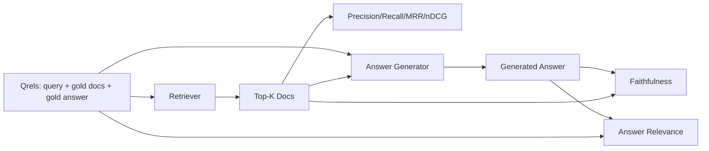

# RAG 评估：精确率、召回率、MRR、nDCG、忠实度与答案相关性

> 如果你不能同时给你的检索和答案打分，你就不能交付系统。两者不是同一个指标，同一个 prompt 在不同轴向上会失败。

**Type:** Build
**Languages:** Python
**Prerequisites:** Phase 11 lessons 06 (RAG), 10 (evaluation); Phase 19 Track B foundations (lessons 20-29); Phase 19 lessons 64, 65, 66, 67
**Time:** ~90 minutes

## 学习目标
- 从金标 qrels 计算四个检索指标：precision@k、recall@k、MRR（平均倒数排名）与 nDCG@k。
- 计算两个答案级指标：忠实度（每条论断都以检索到的上下文为依据）与答案相关性（答案是否回应问题）。
- 构建一个 fixture qrels 文件（查询、金标文档 id、金标答案文本），让评估端到端读取。
- 读懂指标数值以诊断 pipeline 哪里失败：检索、排序、生成还是依据。

## 问题

RAG 系统至少有四个活动部件：分块器、检索器、重排序器、生成器。任何一个都可能是错误答案的成因。没有分阶段指标，你就是在盲目摸索。

用户报告一个错误答案。是分块器切断了答案区间？是检索器没把该分块纳入 top-k？是重排序器把正确分块推过了第一位？是生成器忽略了分块并编造内容？仅凭答案你无法判断。你需要：

- 检索指标，给检索器的产出打分。
- 排序指标，给正确分块在顺序中的位置打分。
- 忠实度，给生成器是否停留在检索上下文内打分。
- 答案相关性，给答案是否真正回应问题打分。

本课在 fixture qrels 文件之上构建全部六项。评估离线且确定；生产中你把模拟的 LLM-as-judge 换成真实模型。

## 概念



### Precision@k

在检索器返回的 top-k 文档中，金标集合占多大比例？如果金标有三篇文档，top-3 返回其中两篇加一个错误文档，precision@3 是 2 / 3。当无关检索分块的代价很高时（生成器为它浪费 token，或分块毒化答案）使用精确率。

### Recall@k

在金标文档中，有多大比例位于 top-k？如果金标有三篇，top-5 含全部三篇，recall@5 是 1.0。当漏掉答案的代价很高时（你宁可多看到一个错误分块，也不愿完全错过答案分块）使用召回率。

生产 RAG 中人们通常引用的指标是 recall@k。生成很容易丢弃无关分块；它无法从从未见过的分块中编出答案。

### MRR（平均倒数排名）

对每个查询，找到有序列表中第一个相关文档的位置。倒数排名是 1 / 位置。在查询集上取平均。MRR 用一个数字概括检索器把最佳答案放在顶部的能力。

MRR 高度重视第 1 位。金标文档在第 1 名的查询贡献 1.0。第 2 名贡献 0.5。第 10 名贡献 0.1。该指标由列表顶部主导。

### nDCG@k

归一化折损累计增益。完整公式为每个检索文档赋予一个增益（相关记 1，不相关记 0），按位置的对数折损，求和，再除以理想 DCG（完美排序下的 DCG）。范围 0 到 1。

nDCG 支持分级相关性：金标可以说「文档 A 为 3，文档 B 为 2，文档 C 为 1」。MRR 和 recall@k 把所有情况压平为二值。当语料中每个查询有多个部分相关文档时使用 nDCG。

### 忠实度

对生成答案中的每条论断，检查它是否被检索上下文支持。标准实现使用 LLM-as-judge 提示，接收 (claim, context) 并返回是或否。指标是通过的论断所占比例。

忠实度捕捉生成器编造内容的失败模式。即使检索器返回了正确分块，产生幻觉的生成器同样是有问题的。忠实度也称为 groundedness、support、attribution。

本课用确定性模拟评判器实现忠实度：检查每条论断的 token 与检索上下文的重叠是否超过阈值。生产中换成真实模型调用。指标形状相同。

### 答案相关性

答案是否真正回应了问题？忠实度问「答案是否以上下文为依据？」。答案相关性问「答案是否以问题为依据？」。一个忠实但跑题的答案在忠实度上高分、相关性上低分。一个简短、切题但忽略上下文的答案在相关性上高分、忠实度上低分。

标准实现同样使用 LLM-as-judge：接收 (question, answer)，询问答案是否回应问题。本课实现一个结合 token 重叠与评判器的替身。

## fixture qrels

```python
{
  "qid": "q1",
  "query": "what is the abort threshold for multipart uploads",
  "gold_doc_ids": ["d1", "d3"],
  "gold_answer_substring": "three failed parts",
  "graded_relevance": {"d1": 3, "d3": 2},
}
```

每个查询携带：
- 查询字符串，
- 一组金标文档 id（用于精确率 / 召回率 / MRR），
- 分级相关性字典（用于 nDCG），
- 金标答案子串（作为每个 qrel 上的参考 metadata；本课的忠实度通过用检索上下文评判抽取的论断来计算，而不是与该子串比较）。

生产中这些由你标注。本课附带手工构建的 fixture，让评估开箱即用。

```figure
ci-rag-metric-ladder
```

## 构建它

`code/main.py` 实现：

- `precision_at_k(retrieved, gold, k)` —— 按定义实现。
- `recall_at_k(retrieved, gold, k)` —— 按定义实现。
- `mean_reciprocal_rank(retrieved_list_of_lists, gold_list)` —— 在查询上取平均。
- `ndcg_at_k(retrieved, graded_relevance, k)` —— DCG / IDCG，支持二值或分级增益。
- `extract_claims(answer)` —— 把答案拆成句子形态的论断。
- `faithfulness(claims, context_texts, judge)` —— 被判定为有支持的论断比例。
- `answer_relevance(question, answer, judge)` —— 评判答案是否回应问题。
- `MockJudge` —— 确定性 token 重叠评判器，让评估离线运行。
- `evaluate_pipeline(pipeline_fn, qrels, ks)` —— 运行每个指标的编排器。
- 一个演示：对 qrels 运行三个 pipeline 变体（分块器基线、混合检索、混合 + 重排序），打印指标表。

运行它：

```bash
python3 code/main.py
```

输出在一张指标表中显示每个变体的 precision@k、recall@k、MRR、nDCG@k、忠实度与答案相关性。混合检索行在召回上胜过分块器基线；重排序行在 MRR 上胜过混合。

## 读懂指标以诊断失败

| 症状 | 可能原因 | 要修什么 |
|------|----------|----------|
| 低 recall@k、低 precision@k | 分块器切断了答案，或检索器找不到 | 分块边界（第 64 课）或检索模态（第 65 课） |
| recall@k 尚可、MRR 低 | 正确分块在 top-k 中但不在第 1 位 | 重排序器（第 66 课） |
| MRR 高、忠实度低 | 生成器无视正确上下文编造内容 | 生成 prompt；强制引用或拒答 |
| 忠实度高、相关性低 | 答案有依据但跑题 | 查询改写器（第 67 课）或生成 prompt |
| 四项都高、用户仍抱怨 | 评估集不具代表性 | 用真实用户查询扩充 qrels |

## 演示掩盖不了的失败模式

**LLM-as-judge 偏差。** 模型会把自己输出评判得比实际更忠实。评判器与生成器使用不同模型族，或人工抽检评分。

**qrels 腐化。** 金标答案随语料变化而漂移。2024 年 1 月对 q1 是金标的文档，到 2024 年 10 月因团队重命名函数而不再是正确答案。安排季度 qrels 评审。

**忠实度的微观检查漏掉宏观论断。** 逐句忠实度可以通过，而整体答案结构具有误导性。在自动指标之上增加样本级定性评审。

**Recall@k 掩盖单查询失败。** 90% 的平均召回可能掩盖某一类查询总是失败。按查询类别（字面、改述、多主题）切分 qrels 并分片报告。

## 使用它

生产模式：

- 每次检索器或生成器变更都跑评估。把 recall@k 回归当作测试失败处理。
- 持久化每查询的指标轨迹。用户抱怨时，查找匹配的 qrels 条目，看它是否本应被捕获。
- 对 qrels 分层：20 条查询的 smoke 集在 CI 运行；200 条的回归集每晚运行；2000 条的深度集每周运行。

## 交付它

第 69 课接起整个 pipeline（分块器、检索器、重排序器、生成器），并对端到端系统运行本评估。

## 练习

1. 增加第五个检索指标：hit-rate@k。与 recall@k 比较。解释它们何时不同。
2. 实现分级忠实度：0（无支持）、1（部分支持）、2（完全支持）。相应更新指标。
3. 把模拟评判器换成真实模型调用。测量模拟与真实评判器在 fixture 上的分歧。
4. 增加查询类别切片（「字面」「改述」「多主题」）。报告分片指标。
5. 增加「答案长度」指标并与忠实度关联。绘制曲线。

## 关键术语

| 术语 | 常见说法 | 实际含义 |
|------|----------|----------|
| Precision@k | 「检索结果中的命中率」 | top-k 中金标所占比例 |
| Recall@k | 「金标中的命中率」 | 金标位于 top-k 中的比例 |
| MRR | 「首次命中位置」 | 第一个相关文档排名倒数的均值 |
| nDCG@k | 「分级排序质量」 | top-k 的 DCG 除以理想 DCG |
| 忠实度（Faithfulness） | 「有依据性」 | 答案论断中被检索上下文支持的比例 |
| 答案相关性（Answer relevance） | 「它回答问题了吗？」 | 答案是否匹配问题意图 |
| Qrels | 「金标」 | 带标签的查询集合及其金标文档与答案 |

## 延伸阅读

- Buckley、Voorhees，"Evaluating Evaluation Measure Stability"，SIGIR 2000 —— 排序指标的权威论文
- Jarvelin、Kekalainen，"Cumulated Gain-based Evaluation of IR Techniques" —— nDCG 论文
- [Ragas：RAG pipeline 的自动评估](https://docs.ragas.io)
- [Anthropic，Introducing Contextual Retrieval](https://www.anthropic.com/engineering/contextual-retrieval) —— 用 1 减去 recall@20 给检索打分
- Phase 11 第 10 课 —— 评估框架基础
- Phase 19 第 64-67 课 —— 在此被评估的组件
- Phase 19 第 69 课 —— 本评估所打分的端到端 pipeline
