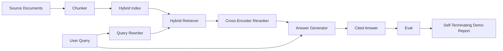

# 端到端 RAG 系统

> 六节课的组件，一条 pipeline，一个 eval 循环，一个自终止 demo。这就是你要交付的系统。

**Type:** Build
**Languages:** Python
**Prerequisites:** Phase 11 lessons 06 (RAG), 10 (evaluation); Phase 19 Track B foundations (lessons 20-29); Phase 19 lessons 64, 65, 66, 67, 68
**Time:** ~90 minutes

## 学习目标
- 把 chunker、混合检索器、查询改写器、cross-encoder 重排序器和答案生成器组合成一条端到端 pipeline。
- 实现一个答案生成器，用 chunk 锚点引用其论断，并在置信度低时拒绝作答。
- 对组装好的 pipeline 运行第 68 课的 eval，证明分阶段构建在每一项指标上都胜过相同组件单独使用。
- 构建一个自终止的 CLI demo，摄入固定语料，运行固定查询集，以零退出码结束并打印摘要报告。

## 问题

六个组件单独运行时什么都证明不了。chunker 可以在语料上的 recall@5 中获胜，却在系统的 recall@5 上落败，因为检索器无法对 chunker 输出的内容排序。重排序器可以在合成候选池上提升 MRR，却在真实的 bi-encoder 候选上失败，因为 bi-encoder 在重排序预算内的召回率太低。查询改写器可以在单个查询上把黄金文档提到前面，却在下一个查询上崩掉，因为 LLM mock 返回了一个退化的假设文本。

集成测试是把整条 pipeline 端到端跑在相同的 fixture qrels 上，使用相同的指标，并由一个 orchestrator 文件把一切连接起来。这就是本课要构建的东西。如果集成 pipeline 上的指标胜过每个阶段孤立 demo 的指标，你就证明了整个系统。

## 概念



### 连接方式

pipeline 是一张小图。每个阶段都是一个签名清晰的函数。

| 阶段 | 输入 | 输出 |
|-------|-------|--------|
| Chunker | 文档文本 | Chunk 记录列表 |
| Retriever | 查询字符串 | Top-N Chunk 记录 |
| Rewriter（可选） | 查询字符串 | 改写列表 + 假设文本 |
| Reranker | 查询、候选 | 带 cross 分数的 Top-K Chunk 记录 |
| Generator | 查询、Top-K Chunk 记录 | 带引用的答案字符串 |

当每个签名都稳定时，组合就很直接。本课的 `Pipeline` 类持有五个阶段，以及一个按顺序运行它们的 `query` 方法。每个阶段都可替换：传入不同的 chunker、retriever、rewriter、reranker 或 generator，pipeline 仍然能运行。

### 带引用的答案生成器

生成器是最后一个阶段，也是最容易出问题的阶段。本课提供一个确定性的 mock 生成器，它：

1. 取重排序后的前 K 个 chunk。
2. 最多选择两个 chunk，其文本与查询的内容 token 重叠度最高。
3. 输出一个答案，由每个选中 chunk 中的一句话拼接而成，每句后面跟一个 `[doc_id:chunk_index]` 锚点。
4. 如果没有 chunk 的重叠度超过拒绝阈值，就输出 "I do not know"，不带引用。

生产环境中，你会把 mock 换成带以下 prompt 模板的真实 LLM 调用：

```
You are answering a question using only the snippets below.
Cite every claim with the anchor in parentheses.
If the snippets do not answer the question, say "I do not know".

Question: {query}

Snippets:
{enumerated chunks with anchors}

Answer:
```

低置信度拒绝路径正是记录 cross-encoder rank-1 分数的全部理由。如果该分数低于语料阈值，生成器就拒绝作答。这是防止幻觉答案的安全阀。

### 自终止 demo

demo 端到端运行所有内容。它打印一个查询的分阶段明细，对四条 fixture qrels 运行 eval，打印指标表；如果第 68 课的所有指标都满足 demo 中设定的阈值，就以状态零退出。如果任何指标低于阈值，demo 以非零状态退出，并打印一条指出失败指标的消息。

这就是 CI 冒烟测试的形状。pipeline 离线、快速、确定性地运行。fixture 上的阈值刻意设得很紧，这样六节课中任何一个出现回归都会让 demo 失败。

```figure
rag-pipeline-flow
```

## 构建它

`code/main.py` 实现了：

- `Chunk` —— 贯穿所有阶段的记录（在第 64 课的形状上扩展了 chunk_index 和源 doc_id）。
- `Chunker` —— 从第 64 课选择一种策略（默认递归切分）。
- `HybridIndex` —— 打包第 65 课的 BM25 + dense + RRF。
- `Rewriter`（可选）—— 根据查询长度和连词的存在情况，从第 67 课的 HyDE、multi-query、decomposition 中选择一种。
- `Reranker` —— 第 66 课训练好的 cross-encoder，使用更小的 fixture 训练集以便在几秒内收敛。
- `Generator` —— 带引用和低置信度拒绝的确定性 mock 生成器。
- `Pipeline` —— 组合五个阶段，提供 `query(question)` 方法，返回 `Result(answer, top_k, latency_ms_per_stage)`。
- `run_demo()` —— 摄入语料，运行三条 fixture 查询，运行 eval，打印结果，按阈值设置退出码。

运行：

```bash
python3 code/main.py
```

输出是一条打印的查询追踪、完整的 eval 表格，以及最终的通过/失败状态。在 fixture 上返回退出码 0。

## demo 会掩盖的失败模式

**chunker 边界漂移。** 如果你在 eval qrels 标注阶段和 demo 之间更换 chunker 策略，黄金文档 id 就对不上了。把 chunker 策略锁定在 qrels 文件中。demo 包含一个声明 chunker 的头部。

**重排序器训练集泄漏到 eval。** 第 66 课的 14 条训练三元组包含与 eval 查询相似的查询。生产中要严格留出 eval 查询。demo 的 eval 查询与重排序训练集刻意不相交。

**mock 生成器掩盖了幻觉风险。** mock 无法产生幻觉，因为它只输出检索到的 chunk 中的文本。本课指出了这一点，并给出了替换为真实模型的生产路径。

**没有流式输出。** pipeline 在每个阶段结束时返回完整答案。生产系统会流式输出生成器的结果。流式不在本课范围内；无论哪种方式，答案级指标都作用于最终字符串。

**延迟是离线的。** mock LLM 调用是常数时间。真实的 LLM 调用占主导。在请求范围内规划延迟预算；本课的分阶段计时只测量 CPU 工作。

## 使用它

生产模式：

- 把 pipeline 文件放在一个 orchestrator 下，使用显式的阶段接口。避免把连接逻辑散布在整个仓库中。
- 每次触及某个阶段的合并之前都运行 eval。如果 eval 下降，合并就不能落地。
- 按 CI 运行持久化指标追踪，这样你可以把回归归因到某个阶段替换。
- 添加一个 20 条查询的冒烟集（回归集的子集），在 30 秒内运行；完整的回归集每晚运行。

## 交付它

本课的 pipeline 文件是 Phase 19 Track F 其余课程所假设的形状。后续课程会在其上添加摄入自动化、增量重建索引、遥测和服务层。检索、重排序、改写和 eval 这几部分在这里已经完整。

## 练习

1. 在改写器内部添加按查询的策略选择器：用第 67 课的启发式（长度、连词、术语比例）选择 HyDE、multi-query 或 decomposition。
2. 在环境开关后面为生成器添加真实 LLM 调用。默认使用 mock。测量延迟差值。
3. 扩展 demo，接受 `--corpus path` 标志来加载真实语料。重新运行 eval 和阈值检查。
4. 给 chunker 添加 `--strategy` 标志。测量每种策略对端到端召回的贡献。
5. 添加流式生成器接口并接入 eval。确认忠实度是在最终字符串上计算，而不是在流式前缀上。

## 关键术语

| 术语 | 人们怎么说 | 实际含义 |
|------|-----------------|------------------------|
| Pipeline | "RAG pipeline" | 从摄入到带引用答案的组合阶段 |
| Citation anchor | "Source link" | 附加到每个论断的 (doc_id, chunk_index) 引用 |
| Refuse-on-low-confidence | "I do not know" | 当重排序器 top-1 分数低于阈值时，生成器不返回答案 |
| Smoke set | "CI eval" | 每次 PR 检查中运行的最小 qrels 子集 |
| Stage interface | "Function signature" | 每个 pipeline 阶段的稳定输入和输出类型 |

## 延伸阅读

- [Anthropic, Building search and retrieval](https://www.anthropic.com/news/contextual-retrieval)
- [Pinterest, MCP internal search](https://medium.com/pinterest-engineering) —— 参考生产架构
- [Ragas: Automated Evaluation of RAG Pipelines](https://docs.ragas.io)
- Phase 11 第 06 课 —— RAG 基础
- Phase 19 第 64-68 课 —— 此处组合的组件
