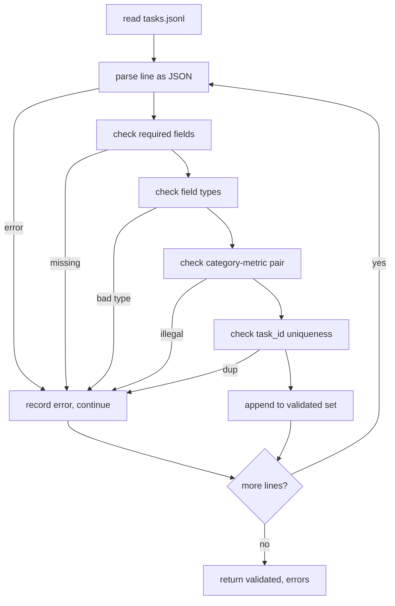

# 任务规范格式

> eval harness 的好坏取决于它的任务所遵守的契约。在写下第一个评分函数之前，先冻结 JSONL 形状和指标词汇表。

**Type:** Build
**Languages:** Python
**Prerequisites:** Phase 19 Track B foundations
**Time:** ~90 min

## 学习目标

- 定义一个 JSONL 任务记录 schema，用同一种形状覆盖算术、选择题、代码执行、分类和自由文本摘要。
- 固定一组封闭的指标名称词汇，让后续课程（71-73）可以只根据一个字段进行分派。
- 把 few-shot 示例和后处理规则作为任务的一部分来指定，而不是 runner 的一部分，这样同一个 prompt 在不同模型上产生相同的目标。
- 实现一个严格的验证器，在畸形记录到达 runner 之前将其拒绝。
- 交付一个 10 任务的 fixture 集，覆盖规范的每个分支，让验证器有真实的东西可以检验。

```figure
ci-task-spec-gate
```

## 为什么需要冻结的规范

研究型代码库积累 eval 脚本的速度会超过积累测试的速度。六个月后，每个 notebook 都有自己的 JSON 形状，每个指标都被重新实现两次，任何东西都无法跨运行比较。修复方式很无聊。选一个 schema。写一个验证器。拒绝其他一切。这就是本课要做的。

这个形状借鉴了 BIG-bench、HELM 和 lm-eval 风格 harness 的想法，但字段名是我们自己的。每个字段只有一个所有者。runner 读取任务。指标读取目标。后处理步骤规范化生成结果。没有任何字段在 pipeline 中途可变。

## 记录形状

一个任务是一行上的 JSON 对象。harness 读取 `tasks.jsonl` 并独立验证每一行。坏行只会中止该记录，而不是整个运行。

```json
{
  "task_id": "arith_001",
  "category": "arithmetic",
  "prompt": "Compute the result. Question: 17 + 24\nAnswer:",
  "targets": ["41"],
  "metric_name": "exact_match",
  "few_shot_examples": [
    {"prompt": "Question: 2 + 2\nAnswer:", "completion": "4"}
  ],
  "post_process": "strip_whitespace",
  "metadata": {"difficulty": "easy"}
}
```

必填字段是 `task_id`、`category`、`prompt`、`targets`、`metric_name`、`post_process`。`few_shot_examples` 和 `metadata` 是可选的。未知的顶层字段会导致验证失败。

## 字段规则

`task_id` 是不含空白的字符串。验证器在整个文件中强制唯一性。

`category` 是 `arithmetic`、`mcq`、`code_exec`、`classification`、`summary` 之一。类别约束了哪些指标和后处理对是合法的。`code_exec` 任务必须使用 `metric_name = code_exec`，而 `mcq` 任务必须对单字母目标使用 `metric_name = exact_match`。

`prompt` 是非空字符串。验证器禁止尾随空白，并拒绝 prompt 正文中已包含 few-shot 块的记录。few-shot 渲染发生在 runner 中，而不是作者那里。

`targets` 是非空字符串列表。对于 `exact_match`，任何匹配的元素都算数。对于 `f1` 和 `rouge_l`，得分最高的目标获胜。对于 `mcq`，列表恰好包含一个元素。

`metric_name` 是 `exact_match`、`f1`、`bleu_4`、`rouge_l`、`accuracy`、`code_exec` 之一。词汇表是封闭的。新指标需要新课程和此处的新条目。

`few_shot_examples` 是 `{prompt, completion}` 对的列表。验证器将列表限制为最多八条，以保持 prompt 有界。

`post_process` 是 `none`、`strip_whitespace`、`lower`、`extract_letter`、`extract_code_block`、`extract_first_line` 之一。每条规则都有一个确定性的行为。验证器禁止组合规则。

## 验证器行为



验证器返回两个列表：已验证记录和错误记录，错误记录包含违规行、违反的规则以及出错的字段。如果错误列表非空，runner 拒绝启动，除非设置了显式的 `--allow-bad-tasks` 标志。

## Few-shot 渲染

runner 用空行分隔符把 few-shot 示例拼接在 prompt 前面。每个模型运行相同的代码路径，因此唯一的方差来源是模型本身。作者只写一次示例，而不是每个供应商写一次。

```python
def render(task):
    parts = []
    for ex in task.get("few_shot_examples", []):
        parts.append(ex["prompt"] + " " + ex["completion"])
    parts.append(task["prompt"])
    return "\n\n".join(parts)
```

## 后处理规则

后处理步骤在生成之后、指标之前运行。它是确定性的和无状态的。

- `none` 原样返回字符串。
- `strip_whitespace` 去除首尾空白。
- `lower` 将字符串转为小写。
- `extract_letter` 返回第一个匹配 `[A-E]` 的字符，用于选择题。
- `extract_code_block` 返回第一个三反引号围栏块的主体，用于代码执行。
- `extract_first_line` 返回第一个非空行，用于摘要分类。

需要此列表之外规则的任务属于新课程。

## 本课不做什么

它不评分。它不调用模型。它不运行代码。这些出现在第 71、72 和 75 课。本课冻结所有课程都遵守的契约。

10 任务 fixture 覆盖两个算术条目、两个选择题条目、两个代码执行条目、两个分类条目和两个摘要条目。验证器全部 10 条通过。一个单独的 fixture（`tasks_bad.jsonl`）触发每条规则，验证器返回恰好那么多错误。

## 如何阅读代码

`main.py` 定义了 `TaskSpec`、`validate_task`、`validate_file` 和一个 CLI 入口点。fixture 加载器是 `load_fixtures`。渲染和后处理辅助函数与验证放在一起，这样第 75 课的 runner 只需导入一个模块。

从上到下阅读 `main.py`。然后阅读 `code/tests/test_spec.py`。测试固定了每条验证规则和每个后处理行为。`main.py` 底部的 demo 验证捆绑的 fixture 并打印摘要。

## 更进一步

真实 eval 套件扩展类别的方式就像 schema 扩展列。清醒的做法是：拒绝在没有同时添加指标、后处理规则和至少一个 fixture 任务的情况下添加类别。像对待数据库迁移一样对待规范。每个更改都要审查、版本化，并附带测试。本课的验证器就是那道门。
