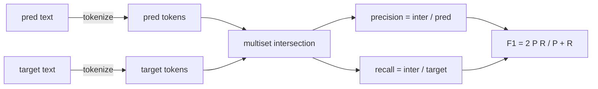
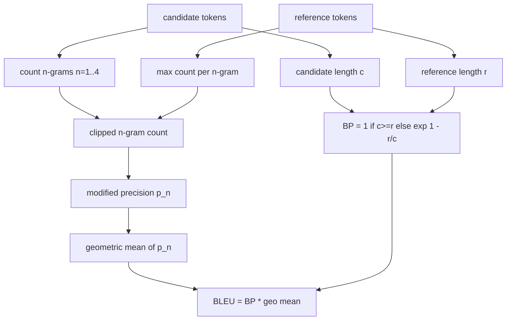

# 经典指标

> BLEU、ROUGE-L、F1、exact-match、accuracy。这五个指标仍然构成了大多数已发表 LLM eval 数字的基础。从第一性原理实现每一个，这样你才知道数字意味着什么。

**Type:** Build
**Languages:** Python
**Prerequisites:** Phase 19 Track B foundations, lesson 70
**Time:** ~90 min

## 学习目标

- 用明确的 tokenisation 规则实现 token 级的 exact-match、F1 和 accuracy。
- 从头实现 BLEU-4：修改后的 n-gram 精确率、n 从 1 到 4 的几何平均、简洁惩罚。
- 用最长公共子序列实现 ROUGE-L，并用 F-beta 组合精确率和召回率。
- 按第 70 课的 metric_name 字段进行分派，让 runner 保持指标无关。
- 用来自演算示例的参考向量固定行为，而不是来自第三方库。

```figure
cd-bleu-overlap
```

## 为什么重新实现

你会读到一篇报告 BLEU 28.3 的论文，另一篇报告 BLEU 0.283。你会发现两个库的 ROUGE-L 分数相差十分，因为一个截断为小写而另一个没有。停止困惑的最快方法就是自己写这些指标，然后指出 tokenizer 决定的那一行和平滑应用的那一行。之后，跨论文比较数字就变成阅读指标设置的问题，而不是争论库的问题。

stdlib 加 numpy 就够了。BLEU 是计数加一次钳制。ROUGE-L 是动态规划。F1 是 token 上的集合交集。最难的部分是选择 tokenizer 并坚持使用它。

## 分词

tokenizer 是 `re.findall(r"\w+", text.lower())`。小写、字母数字串、丢弃标点。本课的每个指标都使用这个精确的 tokenizer。runner 没有选择权。如果你换了 tokenizer，你就在运行不同的基准。

```python
TOKEN_RE = re.compile(r"\w+", re.UNICODE)
def tokenize(text):
    return TOKEN_RE.findall(text.lower())
```

这是一个刻意的简化。生产环境会关心 CJK、缩写和代码标识符。本课的要点是：tokenizer 是契约，不是旋钮。

## 精确匹配

```python
def exact_match(pred, targets):
    return float(any(pred.strip() == t.strip() for t in targets))
```

每个任务返回 1.0 或 0.0。数据集上的聚合是均值。这是算术、选择题和短分类任务的主力。

## Token 级 F1

为预测和目标建立 token 多重集。精确率是多重集交集除以预测的多重集。召回率是相同的交集除以目标的多重集。F1 是调和平均。实现处理空预测和空目标的边界情况。



对于多目标任务，我们取目标列表上的最佳 F1。这与文献中广泛报告的 SQuAD 风格行为一致。

## BLEU-4

BLEU 是规范的机器翻译指标，它仍然出现在摘要工作中。我们使用的公式是语料级 BLEU-4，带标准的简洁惩罚和对修改后 n-gram 计数的加一平滑，这样单个缺失的 4-gram 不会把分数推到零。

对于每个候选-参考对，我们计算 n 等于 1、2、3、4 的修改后 n-gram 精确率。修改后精确率用该 n-gram 在任何参考中的最大计数来裁剪候选 n-gram 计数，这样候选无法通过重复一个短语来抬高分数。四个精确率的几何平均由简洁惩罚包裹。



平滑规则是 Lin 和 Och 称之为 method 1 的那一个：在取对数之前，给每个 n-gram 精确率的分子和分母都加一。这避免了参考没有匹配 4-gram 时的 `log 0`，并且在长候选上接近未平滑的值。

## ROUGE-L

ROUGE-L 比较候选和参考 token 序列的最长公共子序列。LCS 捕捉词序而不强制连续性，这就是它成为默认摘要指标的原因。我们用标准的动态规划表计算 LCS 长度，然后推导召回率为 `lcs / reference length`，精确率为 `lcs / candidate length`，并用 F-beta 组合，其中 beta 等于 1 即对称的 F1 形式。

```python
def lcs_length(a, b):
    n, m = len(a), len(b)
    dp = numpy.zeros((n + 1, m + 1), dtype=int)
    for i in range(n):
        for j in range(m):
            if a[i] == b[j]:
                dp[i+1, j+1] = dp[i, j] + 1
            else:
                dp[i+1, j+1] = max(dp[i+1, j], dp[i, j+1])
    return int(dp[n, m])
```

numpy 表让实现更易读；纯 Python 列表也可以。选择 ROUGE-L 的任务要为每个任务支付 $O(n m)$ 的代价。对于典型的摘要长度，这保持在毫秒以下。

## 准确率

对于多目标分类任务，准确率简化为对单个规范化目标的精确匹配。我们将其暴露为单独的函数，这样分派器可以对 `metric_name` 分派，而不必在 runner 内部进行字符串比较。

## 分派契约

单一入口点是 `score(metric_name, prediction, targets)`。它返回 `[0, 1]` 中的浮点数。runner 不根据指标名称分支。它把调用交出去并写入结果。这是第 75 课将粘接到第 70 课任务规范的接口。

```python
def score(metric_name, pred, targets):
    if metric_name == "exact_match":
        return exact_match(pred, targets)
    if metric_name == "f1":
        return max(f1_score(pred, t) for t in targets)
    if metric_name == "bleu_4":
        return max(bleu4(pred, t) for t in targets)
    if metric_name == "rouge_l":
        return max(rouge_l(pred, t) for t in targets)
    if metric_name == "accuracy":
        return accuracy(pred, targets)
    raise ValueError(f"unknown metric_name: {metric_name}")
```

`code_exec` 在第 72 课处理，并在那里插入分派器。

## 本课不做什么

它不调用模型。除了第 70 课后处理规则已经做的之外，它不规范化生成结果。它不计算置信区间。它不做 BLEURT 或 BERTScore（那些需要模型，属于另一课）。要点是地板：五个指标、一个 tokenizer、一个分派表。

## 如何阅读代码

`main.py` 将每个指标定义为自由函数，再加上分派器。参考向量位于文件底部的 `_reference_examples` 块中。demo 对八个示例运行分派器并打印每个指标的分数。`code/tests/test_metrics.py` 中的测试固定参考向量并压力测试每个边界情况（空预测、空参考、无共享 token、精确匹配、重复短语裁剪）。

从上到下阅读 `main.py`。函数按复杂度排序。exact_match 和 accuracy 各一行。F1 是六行。BLEU 和 ROUGE-L 是重的部分，它们包含关于平滑规则和 LCS 递推的详细注释。

## 更进一步

经典指标是必要的，但不是充分的。它们奖励表面重叠而错过含义。修复方法是在你信任经典地板之后，把基于模型的指标（BLEURT、BERTScore、GEval）分层放在上面。那是后面的一课。现在：让这五个工作，用测试固定它们，你就有了一个可审计、快速且可复现的指标栈。
