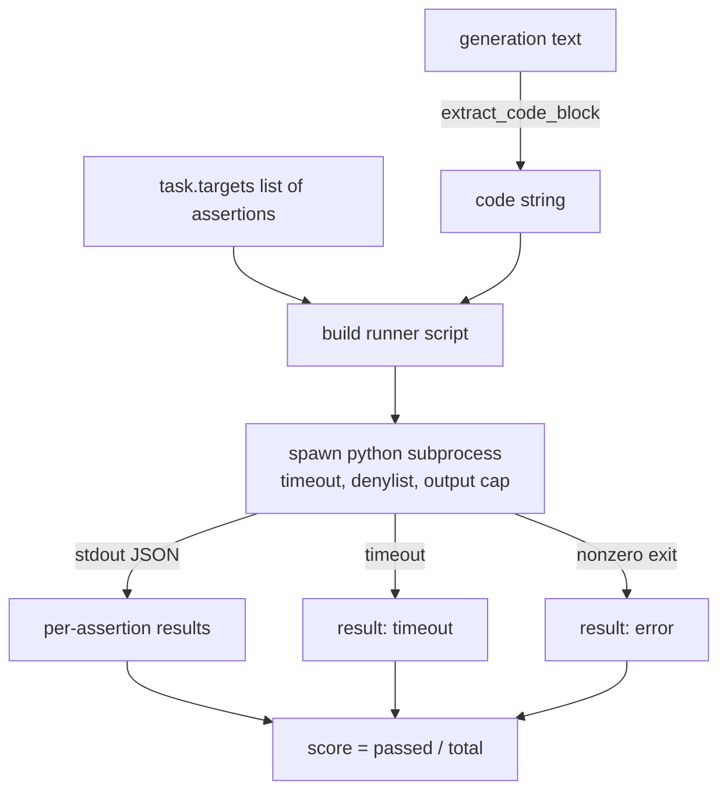
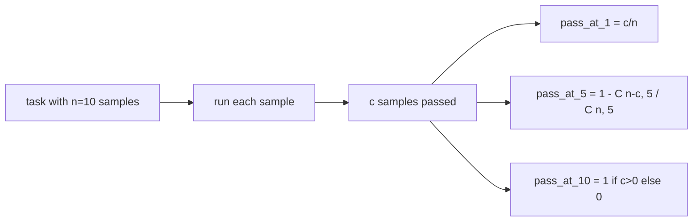

# 代码执行指标

> 生成的代码通过测试时才是对的。eval harness 必须提取代码、在不搞垮宿主的情况下运行它，并诚实地统计通过率。本课构建这个接口。

**Type:** Build
**Languages:** Python
**Prerequisites:** Phase 19 Track B foundations, lessons 70 and 71
**Time:** ~90 min

## 学习目标

- 以匹配第 70 课后处理规则的方式，从自由形式的生成中提取代码块。
- 在隔离的子进程中执行候选代码，带有墙钟超时、输出上限和导入拒绝列表。
- 将一个任务的分数计算为所提供的断言字符串中通过的比例。
- 对于从一个模型采样多次生成的任务，计算 pass-at-k。
- 将沙箱崩溃、语法错误和超时作为一级失败模式处理，带有 runner 可以记录的独立退出码。

```figure
sandbox-runner
```

## 为什么用隔离子进程

内联 `exec` 是安全和稳定性隐患。生成的 `while True: pass` 会永远阻塞 eval。生成的 `import shutil; shutil.rmtree('/')` 就和听起来一样灾难性。修复方法是：每个候选生成一个新的 Python 解释器，通过 stdin 传递代码，将断言结果写到 stdout，如果超时就杀死进程。宿主 eval 进程继续运行。

HumanEval、MBPP、BigCodeBench 和 LiveCodeBench 等真实 eval 都使用子进程沙箱。有些在上面再叠一层 Docker。我们停在子进程是有原因的：它可移植，它属于 stdlib，它能捕获对教学 eval 重要的失败模式。生产部署会添加 seccomp、网络隔离和只读文件系统。关于加固的下一课在本 track 之外。

## 代码执行任务的形状

`code_exec` 任务在 `targets` 中携带断言字符串。runner 从生成中提取围栏代码块，围绕它构建测试 harness，并运行结果。



分数是 `[0, 1]` 中的比例。一个有三个断言、其中两个通过的任务得分为 0.667。无论什么失败，runner 都返回相同的形状：子进程崩溃被映射到规范化的错误码，而不是向上冒泡到 harness 的 Python traceback。

## 拒绝列表

拒绝列表基于导入。在运行候选代码之前，runner 脚本将危险模块的导入重写为抛出 `ImportError("denied")` 的桩。列表刻意保守：`os.system`、`subprocess`、`socket`、`requests`、`urllib`、`urllib.request`、`urllib.error`、`urllib.parse`、`ctypes`、`shutil`、`http.client`、`asyncio.subprocess`。

我们不假装这是无懈可击的。坚定的对抗性代码可以逃逸任何 Python 进程内沙箱。拒绝列表是后备措施。墙钟超时和输出上限才是承重的控制。

```python
DENIED = {
    "os.system": True,
    "subprocess": True,
    "socket": True,
    "shutil": True,
    "requests": True,
    "urllib": True,
    "ctypes": True,
}
```

我们通过在前面加上 `import sys` 和一个把 `os.system` monkey-patch 为抛出的守卫来包裹候选代码。完整模板在 `main.py` 中。

## 墙钟超时

每个子进程获得默认三秒的墙钟预算。runner 使用 `subprocess.run(..., timeout=t)`。如果超时触发，runner 捕获 `TimeoutExpired`，杀死进程，并为该任务记录 `timeout` 退出原因。该任务的分数为零。runner 继续。

超时可通过 `task.metadata.timeout_s` 按任务配置。长时间运行的单元测试可以要求更多；第 70 课的验证器将该值上限定为三十秒，以保持套件有界。

## 输出上限

子进程可能淹没 stdout，耗尽宿主内存。runner 将 stdout 流式写入缓冲区，并在运行总量超过 256 KB 时立即杀死子进程。结果记录为 `exit_code = error`，详情字符串为 `"output overflow"`。这在实践中出现于生成意外写了一个不断打印的无限循环时。

## Pass-at-k

Pass-at-k 是 HumanEval 及其同类使用的无偏估计器。给定每个任务 `n` 个独立样本，其中 `c` 个通过，从 `n` 中抽取大小为 `k` 的样本至少包含一个通过解的概率是：

```
pass_at_k(n, c, k) = 1 - C(n - c, k) / C(n, k)
```

当 `n - c < k` 时，分子未定义，值为 `1`。实现直接处理这个边界情况。我们暴露 `pass_at_k(n, c, k)` 供第 74 课的排行榜层使用。



## 退出码

runner 为每个任务返回五种结果之一：

- `pass` —— 每个断言都通过。
- `assertion_fail` —— 代码运行了，但至少一个断言失败。
- `syntax_error` —— 代码无法导入或有 SyntaxError。
- `timeout` —— 墙钟时间耗尽。
- `error` —— 任何其他崩溃，包括拒绝列表命中和输出溢出（溢出以详情 `"output overflow"` 出现）。

分数仍然是一个比例。退出码是元数据。下游课程可以决定把超时算作零还是算作缺失数据。

## 本课不做什么

它不给你真正的沙箱。它不运行来自开放网络的不可信代码。它不处理有状态任务，比如文件 I/O 或网络调用。那些需要容器或 microVM。本课的要点是契约：隔离子进程、拒绝列表、超时、输出上限、干净的退出码词汇表和 pass-at-k 数学。

## 如何阅读代码

`main.py` 定义了 `extract_code`、`run_candidate`、`score_code_exec` 和 `pass_at_k`。子进程 runner 脚本构建为字符串，作为 `-c` 传递给新的 Python 解释器。`code/tests/test_exec.py` 中的测试针对从 HumanEval 风格演算出的示例，演练四种退出码以及 pass-at-k。

从上到下阅读 `main.py`。runner 模板是承重的部分。盯着断言循环，直到你能预测它写回父进程的 JSON 信封。

## 更进一步

一旦子进程形状能工作，下一个关注点是可移植性。不同 Python 版本在 Windows 上对 SIGKILL 的处理不同。最干净的修复是把 runner 放进 Docker 镜像。再之后是把断言字符串替换为真实的单元测试文件，让 eval 与生产 CI 一致。到那时就不要再把断言字符串称为测试；它们是玩具测试，有玩具失败模式。
