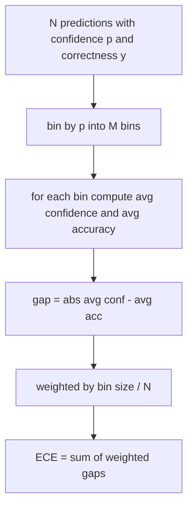
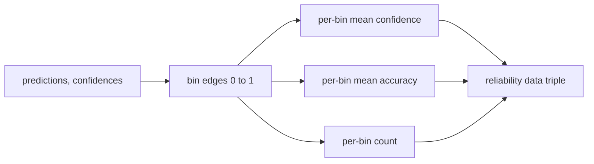

# 困惑度与校准

> 如果你的模型对一千个答案声称 90% 的置信度，却只答对六百个，那它校准得并不好。校准是可信 eval 的一半。另一半是困惑度，它告诉你模型是否认为留出文本合理。

**Type:** Build
**Languages:** Python
**Prerequisites:** Phase 19 Track B foundations, lessons 70 and 71
**Time:** ~90 min

## 学习目标

- 从模型适配器提供的 token 负对数概率，计算留出语料上的 token 级困惑度。
- 从分箱的预测概率，计算分类器或多选题 eval 的期望校准误差（ECE）。
- 计算 Brier 分数（对正确性指示变量的均方误差），并解释它在何时做 ECE 不做的事。
- 构建绘制置信度对准确率曲线所需的可靠性图数据。
- 将三者接入 eval harness，使 runner 能把 `perplexity`、`ece` 和 `brier` 数字附加到模型报告上。

```figure
cd-reliability-diagram
```

## 困惑度告诉你什么

困惑度是每个 token 的平均负对数似然的指数。越低越好。困惑度为 1 意味着模型给每个实际 token 分配概率 1。困惑度等于词汇表大小意味着模型是均匀的，什么也没学到。真实数字介于两者之间：一个强大的 2026 基础模型在 WikiText-103 上大约在 8 到 12 之间。差的模型在相同文本上则在 50 以上。

harness 不自己计算对数概率。它们来自模型适配器。harness 只做聚合：它接收每个 token 对数概率的列表、每个序列的 token 计数列表，返回语料困惑度。

```python
def perplexity(neg_log_probs, token_counts):
    total_nll = sum(neg_log_probs)
    total_tokens = sum(token_counts)
    return math.exp(total_nll / total_tokens)
```

实现处理零 token 的边界情况，并断言负对数概率是非负的。一个常见错误是忘记取负：返回 `log p` 而不是 `-log p` 的适配器会产生小于 1 的困惑度，这是不可能的。函数将其捕获为契约违规。

## ECE 测量什么

期望校准误差按置信度将预测分组到固定数量的箱中，然后测量各箱中置信度与准确率之间的平均差距，按箱大小加权。



标准公式在 `[0, 1]` 上使用十个等宽箱。实现支持任何正整数计数。我们暴露 `bins` 参数，让 runner 可以在发布惯例（10）和比较惯例（15）之间选择。

ECE 受箱数和样本大小的影响而有偏差。十个箱和一百个预测，你无法区分 0.02 的 ECE 和随机噪声。实现返回填充箱的数量以及 ECE，这样 runner 可以在样本太少时拒绝报告单个数字。

## Brier 分数做了 ECE 不做的事

ECE 只关心平均差距。一个在一半箱上过度自信、在另一半箱上信心不足的模型，可以有很低的 ECE，但局部校准很差。Brier 分数测量每个预测对真实结果的平方误差，因此它直接惩罚分散。

对于二元结果，Brier 是 `mean((p_i - y_i)^2)`。它分解为可靠性、分辨率和不确定性。我们计算分数和分解。runner 报告标量，但为仪表盘记录分解。

```python
def brier(p, y):
    return float(np.mean((p - y) ** 2))
```

## 可靠性图数据

可靠性图在每个箱中绘制预测置信度对经验准确率。对角线代表完美校准。函数返回三个数组：每箱平均置信度、每箱平均准确率和每箱计数。绘图代码在下游；本课停在数据形状。



返回的元组正是调用层绘制图表或计算自定义 ECE 变体（adaptive ECE、sweep ECE 等）所需的东西。我们返回 numpy 数组，这样下游代码不必转换。

## 置信度来源

harness 不假设置信度来自 softmax。它接受每个预测在 `[0, 1]` 中的任何数字。对于选择题任务，自然的置信度是 `softmax over option log-likelihoods`。对于自由文本，自然的置信度是模型自报的概率或平均对数似然的指数。eval 只消费数字。它从哪来是适配器的工作。

## 边界情况

- 所有预测错误：ECE 是平均置信度，Brier 高，困惑度则是模型对文本的看法。
- 所有预测正确且高置信度：ECE 接近零，Brier 接近零。
- 在 p=0.5 处完全不确定的预测器：ECE 是 0.5 减去准确率，Brier 是 0.25 减去一个修正项。
- 空输入：ECE、Brier 和可靠性返回 `0.0`（或零填充数组）。困惑度对零 token 情况返回 `NaN`。这些路径都不会发出警告；runner 检查值并决定报告还是跳过。

这些情况被写进测试。真实基准上的真实模型不会遇到它们，但有 bug 的适配器或微小的样本会遇到，runner 不应该崩溃。

## 分派

校准不像 F1 那样是逐任务指标。它是逐模型报告。runner 在整个 eval 中累积 `(confidence, correct)` 对，并一次性计算 ECE、Brier 和可靠性数据。困惑度在留出文本语料上计算，与逐任务评分分开。

接口是：

```python
report = CalibrationReport.from_predictions(confidences, correct)
report.ece          # float
report.brier        # float
report.reliability  # tuple of three numpy arrays
report.populated_bins  # int
```

`PerplexityResult.from_token_nll(neg_log_probs, token_counts)` 返回困惑度和每个 token 的平均负对数似然。

## 本课不做什么

它不调用模型。它不实现 softmax。它不从输出 token 估计置信度；那是适配器的工作。它不做温度缩放或 Platt 缩放；那些是事后修复，属于另一课。本课的要点是让三个数字（困惑度、ECE、Brier）可信且可复现。

## 如何阅读代码

`main.py` 定义了 `perplexity`、`expected_calibration_error`、`brier_score`、`reliability_diagram` 以及 `CalibrationReport` / `PerplexityResult` 数据类。demo 在已知真实情况的合成预测上运行：一个校准良好的模型、一个过度自信的模型和一个信心不足的模型。`code/tests/test_calibration.py` 中的测试固定每个边界情况以及合成预测器的参考值。

从上到下阅读 `main.py`。函数顺序从标量到向量再到报告。每个函数都有一个简短的 docstring，包含数学和契约。

## 更进一步

校准是已发表 eval 中最被忽视的维度。大多数排行榜报告单个准确率数字就完事了。一个在准确率上获胜但在 Brier 上落败的模型，是比一个准确率低几分但能可靠报告其不确定性的模型更差的生产部署。一旦校准管道就位，在留出的验证切片上添加温度缩放，重新计算 ECE，看着差距缩小。那是单独的一课，但地板在这里。
