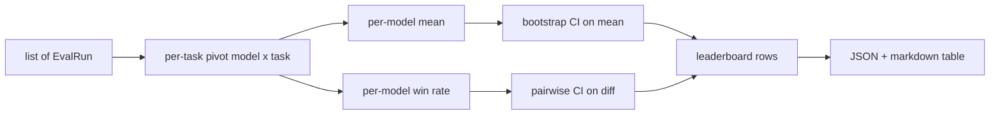
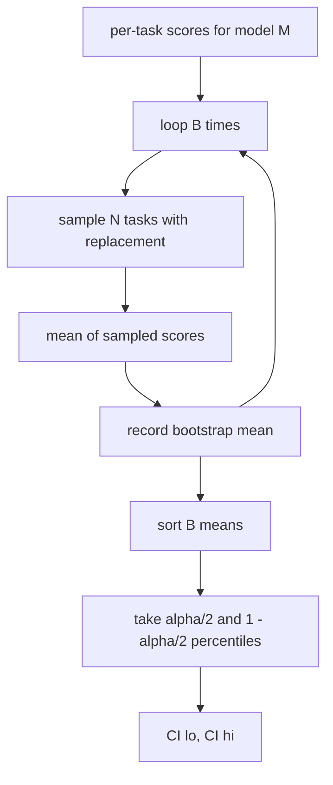

# 排行榜聚合

> 逐任务分数很容易。跨异构任务的逐模型排名更难。在一千条预测的排行榜上做统计显著性，是所有人都跳过的部分。本课不跳过它。

**Type:** Build
**Languages:** Python
**Prerequisites:** Phase 19 Track B foundations, lessons 70, 71, 73
**Time:** ~90 min

## 学习目标

- 将多个模型和多个任务的逐任务分数，聚合为整洁的逐模型行。
- 规范化异构分数，使通过率和 BLEU 值不会过度影响聚合结果。
- 按均值和胜率对模型排名，并解释何时每种汇总方式是正确的。
- 计算每个模型平均分数的 bootstrap 置信区间，以及成对差异的置信区间。
- 将排行榜输出为 JSON 报告和 markdown 表格，第 75 课的 runner 可以将其粘贴到 CI 评论中。

```figure
ci-leaderboard-ci
```

## 输入的形状

聚合器消费 `EvalRun` 记录的列表：

```python
@dataclass
class EvalRun:
    model_id: str
    task_id: str
    metric_name: str
    score: float          # in [0, 1]
    category: str
```

第 75 课的 runner 为每个 `(model, task)` 对发出一条记录。聚合器不关心分数是如何产生的。它期望规范化已经发生：每个分数都在 `[0, 1]` 中。

## 输出

输出三张表：



排行榜行包含：`model_id`、`mean_score`、`mean_ci_lo`、`mean_ci_hi`、`win_rate`、`tasks_completed`，以及一个可选的 `categories` 映射用于逐类别均值。

## 规范化

如果一个任务在 `[0, 1]` 中评分，另一个在 `[0, 100]` 中评分，后者会悄悄主导均值。聚合器验证每个输入分数都在 `[0, 1]` 中，否则拒绝该运行。修复在上游：指标应该已经返回比例。第 71 到 73 课强制执行该契约。

## 均值和胜率

两种排名方案服务于不同的目标。

平均分数是一个模型逐任务分数的平均值。它是排行榜报告的头条数字。它对异常值和任务不平衡很敏感。

胜率统计一个模型在同一任务上击败所有其他模型的频率。对于每个任务，得分最高的模型获胜（平局拆分）。胜率等于胜场数除以该模型有分数的任务数。它对异常值和尺度差异不那么敏感，但会丢失信息。

```python
def win_rate(model_id, runs_by_task, all_models):
    wins, total = 0, 0
    for task_id, runs in runs_by_task.items():
        scores = {r.model_id: r.score for r in runs if r.model_id in all_models}
        if model_id not in scores:
            continue
        total += 1
        best = max(scores.values())
        if scores[model_id] >= best:
            wins += 1
    return wins / total if total else 0.0
```

harness 两者都报告。第 75 课的 runner 默认按均值排名；胜率的 markdown 列就在那里，以防用户更喜欢它。

## Bootstrap 置信区间

逐模型均值附带一个通过对任务进行 bootstrap 重采样估计的置信区间。我们有放回地重采样任务 id，计算重采样集上的均值，重复 `B` 次，并在 `alpha` 水平上取百分位区间。



对于成对比较，我们对逐任务差异 `score_A - score_B` 进行 bootstrap，取百分位区间并报告。用户读出区间是否排除零。如果排除，差异在 alpha 水平上显著。如果不排除，排行榜将模型视为平局。

低级辅助函数（`bootstrap_mean_ci`、`bootstrap_pairwise_diff`）默认 `B=1000`；公共聚合器（`aggregate`、`pairwise_diffs`）默认 `b=500`，这样 demo 和测试保持快速。默认 alpha 是 0.05。本课让 bootstrap 保持纯 numpy，不用 scipy。

## 类别

如果设置了 `EvalRun.category`，聚合器还会报告逐类别均值。这是每个排行榜上都有的列，标明 `math`、`reasoning`、`code`、`safety`。它让 runner 能发现一个模型是否整体很好但在代码上很弱，这是头条均值隐藏的信息。

## Markdown 渲染

排行榜渲染为 markdown 表格：

```text
| Rank | Model | Mean | 95% CI | Win rate | Tasks |
|------|-------|------|--------|----------|-------|
| 1    | gpt   | 0.78 | 0.74-0.82 | 0.62 | 50 |
| 2    | claude| 0.75 | 0.71-0.79 | 0.34 | 50 |
| 3    | random| 0.10 | 0.07-0.13 | 0.04 | 50 |
```

表格按平均分数排序。置信区间渲染为两位小数。长模型 id 截断为二十个字符。

## 本课不做什么

它不运行模型。它不调用指标层。它不实现 adaptive ECE 或其他校准变体；那些是第 73 课。它不实现任务加权。这里每个任务的计数都相同。生产排行榜会对任务加权；我们通过 `weight` 字段留下这个钩子，但在聚合器中忽略它。如果需要，在后续课程中添加加权。

## 如何阅读代码

`main.py` 定义了 `EvalRun`、`LeaderboardRow`、`aggregate`、`bootstrap_mean_ci`、`bootstrap_pairwise_diff` 和 `render_markdown`。demo 构建一个包含三个模型和十二个任务的合成套件，进行聚合，并打印排行榜以及成对差异表。`code/tests/test_leaderboard.py` 中的测试固定 bootstrap、markdown 渲染、胜率的边界情况和空输入行为。

从上到下阅读 `main.py`。数据形状（EvalRun、LeaderboardRow）先出现，然后是聚合器，第三是 bootstrap，最后是渲染。每个函数都有一个聚焦的契约。

## 更进一步

自然的下一步是配对任务显著性，而不是非配对 bootstrap。如果模型 A 和 B 都跑了同样的一百个任务，合适的检验是对逐任务差异做配对 bootstrap，我们实现了这一点。除此之外，你会想要一个尊重任务族的层次化 bootstrap（数学问题彼此并不独立；一个算术错误模式会影响其中十个）。那是后续工作。本课的要点是把地板做对，让 eval 报告一个你可以辩护的数字。
