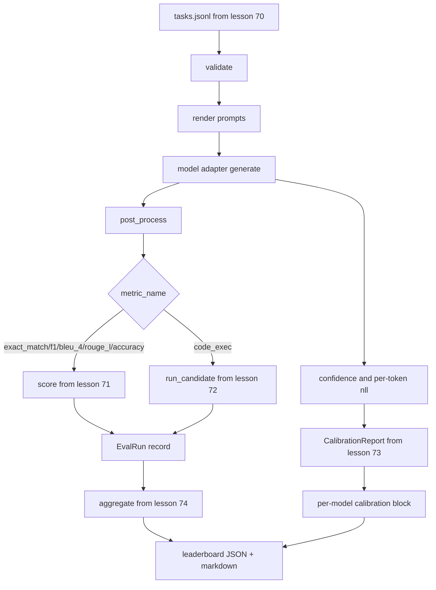

# 端到端评测运行器

> 五节课的管道工作，再由这一课把它们粘合起来。运行器读取第 70 课的任务规格（task spec），通过适配器调用模型，用第 71 课和第 72 课的方法打分，附加第 73 课的校准报告，并输出第 74 课的排行榜。演示会自动终止。

**Type:** Build
**Languages:** Python
**Prerequisites:** Phase 19 Track B foundations, lessons 70 through 74
**Time:** ~90 min

## 学习目标

- 定义一个 `ModelAdapter` 接口，任何模型（mock、本地、API）都能用很小的方法面满足它。
- 在 fixture JSONL 文件上运行评测，通过 worker 池并行执行任务。
- 在一次遍历中组合指标层（exact_match、F1、BLEU-4、ROUGE-L、code_exec）与校准层。
- 输出每个模型的 `EvalRun` 记录，并直接送入排行榜聚合器。
- 同时输出 JSON 报告和 markdown 表格；干净运行以退出码 0 自终止，验证或运行时失败则返回非零。

```figure
eval-grid
```

## Pipeline



运行器是集成点。第 70 课到第 74 课各自拥有一个模块，由运行器组合。运行器不重复这些模块中的任何逻辑：它导入它们。

## 适配器接口

适配器是运行器与任何模型之间的接缝。接口刻意做得很小。

```python
class ModelAdapter:
    model_id: str

    def generate(self, prompt: str, task: TaskSpec) -> Generation: ...
```

`Generation` 是一个 dataclass，包含：

- `text`：模型的自由形式输出
- `confidence`：`[0, 1]` 之间的浮点数，表示模型对答案自报的概率
- `token_nll`：可选，生成 token 上负对数似然之和
- `token_count`：可选，生成的 token 数

运行器中的 mock 适配器提供三种风格：`RuleBasedAdapter`（确定性、近乎完美）、`NoisyAdapter`（过度自信、经常出错）和 `BiasedAdapter`（擅长某一类别，在另一类别上表现极差）。演示在第 70 课的 fixture 上运行这三种适配器。

## 并行执行

运行器使用 `concurrent.futures.ThreadPoolExecutor` 按模型并行运行任务。worker 数默认取 8 与任务数中的较小者。线程足够，因为真实模型调用的瓶颈是网络 I/O。code-exec 路径在任务内部启动自己的子进程，执行器只负责调度等待。

为了保证测试的确定性，运行器提供 `run_eval(adapters, tasks, parallel=False)`，让测试可以固定执行顺序。

## 单遍评分循环

对每个任务：

1. 渲染 prompt（few-shot 前缀加上 prompt 正文）。
2. 调用适配器并记录调用耗时。
3. 按任务的规则对生成结果做后处理。
4. 分派到指标层。
5. 构建包含分数和指标元数据的 `EvalRun` 记录。
6. 把 `(confidence, correct)` 对追加到校准缓冲区。

`correct` 信号对于 exact_match 风格的指标（`exact_match`、`accuracy`、`code_exec`）是 `score >= 1.0`，对于分级指标是 `score >= 0.5`。阈值位于 `_correct_from_score`，运行器不暴露公开的覆盖方式。

## 聚合

每个任务都有结果之后，运行器调用第 74 课的 `aggregate` 和 `pairwise_diffs`，以及第 73 课的 `CalibrationReport.from_predictions`。输出是一个 JSON 信封：

```json
{
  "leaderboard": [...],
  "pairwise": [...],
  "calibration": {
    "model_id_a": {"ece": 0.04, "brier": 0.10, "populated_bins": 8, ...},
    ...
  },
  "summary": {
    "tasks": 10,
    "models": 3,
    "wall_seconds": 1.2
  }
}
```

运行器还会把 markdown 表格写到 stdout，方便用户把结果粘贴到 PR review 中。

## 自终止演示

演示在第 70 课的十个 fixture 任务上运行三个 mock 适配器。实际耗时应在十秒以内。干净运行时退出码为零。

干净运行的标准是：

- 每个任务都通过第 70 课的验证。
- 每个任务都用第 71 课和第 72 课的方法打分。
- 校准报告按第 73 课聚合且无错误。
- 排行榜把基于规则的适配器严格排在随机适配器之上。

如果其中任何一项不成立，运行器以非零退出码结束，并在 JSON 信封中给出结构化错误。

## 本课不做什么

它不调用真实模型。它不实现 API key 流程或速率限制处理。它不实现流式或部分生成；适配器每次调用返回一个完整生成。它不做重试或缓存。这些关注点属于适配器层；运行器与指标无关、与提供商无关。

## 如何阅读代码

`main.py` 是集成点。它通过一个小的 `_load_sibling` 辅助函数按相对路径导入其他五个课程的模块。dataclass `Generation`、`EvalReport` 和 `ModelAdapter` 在本地定义。mock 适配器位于文件底部。

从头到尾阅读 `main.py`。先浏览导入，然后看 `run_eval`，再看 `_score_one`，最后看适配器。末尾的演示是入口点。

`code/tests/test_runner.py` 中的测试固定了适配器接口、单遍循环、并行与串行的等价性、校准缓冲区以及 JSON 信封的形状。

## 更进一步

这个运行器只是下限。生产级评测系统还会增加：以 `(task_id, model_id, model_version)` 为键的结果缓存；跟踪每次运行美元与 token 成本的账本；在速率限制时退避的重试层；pass-at-k 任务的采样策略；以及面向长套件的流式输出格式。每一项都是单一关注点，包裹运行器而不改动指标层或聚合层。这种分离正是契约的意义所在。

在 mock 正常工作之后，为真实提供商添加一个适配器。选一个有免费额度的，写三十行胶水代码，看着排行榜亮起来。然后添加第二个提供商，让 harness 完成其余工作。
