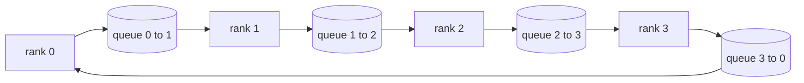

# 从零实现集合通信原语

> 支撑分布式训练的四种集合操作是 allreduce、broadcast、allgather 和 reduce_scatter。训练框架提供的其他所有原语都是它们的包装。在 `multiprocessing.Queue` 网格上构建一次，并用参考实现验证，之后整条路线剩下的部分就只是管道工作。

**Type:** Build
**Languages:** Python
**Prerequisites:** Phase 19 Track C lessons 42-49
**Time:** ~90 min

## 学习目标

- 用两趟（先 reduce-scatter 再 allgather）实现 ring allreduce，并证明每个 rank 的通信量为每元素 2(N-1)/N 字节。
- 在 `multiprocessing.Queue` 的点对点发送之上构建 broadcast、allgather 和 reduce_scatter。
- 对每个原语，用相同输入与 `torch.distributed` 的 gloo 参考实现做验证。
- 能根据集群形状、延迟下限和带宽上限，论证选择 ring 还是 tree。

## 问题

在 N 个 rank 上做朴素 allreduce，需要把张量发送 N 次到根节点，再广播 N 次回来。每个 rank 的带宽按 $O(N)$ 扩展，根节点成为瓶颈，墙钟时间下限是最慢链路乘以 N。Ring allreduce 把它摊平成 $2(N-1)$ 个大小为 $T/N$ 的块，因此每个 rank 的字节数降到 $2T(N-1)/N$，与集群规模无关。Tree allreduce 在小 N 和高延迟链路上占优，因为深度是 $\log_2(N)$ 跳而不是 $2(N-1)$ 跳。为集群形状选错拓扑，最慢的 GPU 就会决定每步时间。

本路线中你会读到的每个分布式训练框架都依赖这四个原语。PyTorch DDP 对每个参数 bucket 做一次 allreduce 来同步梯度。ZeRO 用 reduce_scatter 分片优化器状态，用 allgather 广播更新后的参数。FSDP 把完整的 forward 变成 allgather 加 reduce_scatter。流水线并行需要 broadcast 在阶段组之间传递激活。如果你无法实现这四种集合操作，就无法推理训练为何停滞、为什么第 3 个 rank 出现梯度不匹配，或者为什么换拓扑后流水线气泡翻倍。

## 概念



### 两趟 ring allreduce

把张量切成 N 个等大的块，索引 0..N-1。每个 rank 拥有索引等于其 rank 的块。第 1 趟 reduce-scatter 运行 N-1 步。在第 s 步，rank r 把块 (r - s) mod N 发给 rank (r + 1) mod N，并从 rank (r - 1) mod N 接收块 (r - s - 1) mod N，把收到的块累加到本地副本。N-1 步之后，rank r 拥有块 r 的完整和。第 2 趟 allgather 再运行 N-1 步，让完成的块沿环旋转，直到每个 rank 持有每个块的完整和。

| 原语 | 每个 rank 的字节数 | 步数 | 使用场景 |
|-----------|---------------|-------|-------------|
| Ring allreduce | 2T(N-1)/N | 2(N-1) | 大 T、胖管道同构集群 |
| Tree allreduce | T log2(N) | 2 log2(N) | 小 T 或高延迟链路 |
| Broadcast | T | log2(N) 树 | 参数初始化、标量配置 |
| Allgather | T(N-1)/N | N-1 | 分片 forward、ZeRO unshard |
| Reduce_scatter | T(N-1)/N | N-1 | ZeRO 梯度分片 |

### 用 Queue 网格替代 NCCL

NCCL 运行在 PCIe 和 NVLink 上，带有硬件卸载的归约。在 CPU 上你没有这些。每条环边的 `multiprocessing.Queue` 提供有序的点对点交付，只有一个生产者和一个消费者。归约发生在用户空间，因此要付出 Python 开销，但线路模式与 NCCL ring allreduce 完全相同。只要在 queue 版本上把正确性推理清楚，集群行为自然随之而来。

### 对照 gloo 验证

每个原语都配一个单元测试，在相同 world size 下，用 gloo 后端初始化的 `torch.distributed` 对相同张量运行，并比较输出。如果你的 ring allreduce 与 gloo 的偏差超过 float32 epsilon，测试就失败。对照参考实现验证不可妥协；没有它，原语看起来正确，直到真实训练的第 10000 步才暴露问题。

```figure
ci-ring-allreduce
```

## 构建它

`code/main.py` 实现：

- `Mesh` 类：把 N 个 `multiprocessing.Queue` 实例连成一个环，并为每个 rank 暴露 `send(dst, tensor)` 和 `recv(src)`。
- `ring_allreduce(mesh, rank, world_size, tensor)`：运行两趟算法。
- `broadcast(mesh, rank, world_size, tensor, src)`：在对数树上广播。
- `allgather(mesh, rank, world_size, tensor)`：使用 N-1 次旋转。
- `reduce_scatter(mesh, rank, world_size, tensor)`：作为 allreduce 的前半部分。
- `_gloo_reference(op, world_size, tensor)`：把相同输入通过 gloo 后端的 `torch.distributed` 运行，用于逐字节比较。

运行：

```bash
python3 code/main.py
```

输出：逐原语的验证表，比较 queue 网格与 gloo 的输出，随后是每个 rank 的字节计数器，证明 2T(N-1)/N 的扩展关系。

## 生产环境中的模式

有三种模式能让原语达到可交付的强度。

**在 allreduce 之前对梯度分桶。** 一个 10 亿参数的模型有数万个梯度张量。每个张量一次 allreduce 要付 N 次延迟下限。DDP 把梯度分桶到约 25 MB 的块，每个桶发一次 allreduce；小张量搭大张量的便车。不分桶的话，延迟开销会主导整个 step。

**让通信与计算重叠。** 反向传播按逆序逐层计算梯度。最后一层的梯度一就绪，就启动它的 allreduce，同时下一层继续计算。PyTorch DDP 用 bucket-ready 钩子实现这种重叠。当网络有余量时，重叠能把可见通信时间减半。

**按消息大小选 ring 或 tree，而不是按信仰。** NCCL 附带拓扑检测器：消息超过约 1 MB 用 ring，低于则用 tree。交叉点由带宽与延迟的权衡决定：超过 1 MB 时，带宽项 2T(N-1)/N 占主导，ring 胜出；低于 1 MB 时，log2(N) 的跳数胜出。硬编码一种拓扑会在错误的消息大小上损失吞吐量。

## 使用它

生产实现：

- **PyTorch DDP。** 在 backward 之后对分桶的梯度调用 `dist.all_reduce`。桶大小可调；默认 25 MB 对 100Gbit 以太网是合理值。
- **DeepSpeed ZeRO。** 发 reduce_scatter 来分片梯度，发 allgather 在 forward 前重建完整参数。本课的原语正是 ZeRO 发出的调用。
- **FSDP。** forward 以 allgather 开始，unshard 该层，计算后用 reduce_scatter 归约并丢弃 unshard。同样的原语，不同的调度。

## 交付它

在第 77 到 81 课中使用这个 queue 网格原语。第 77 课把 allreduce 接进 DDP。第 78 课把 reduce_scatter 接进 ZeRO。第 79 课把 broadcast 接进流水线激活。第 81 课把四者组合成端到端演示。

## 练习

1. 添加 tree allreduce 变体，并按消息大小在 ring 和 tree 之间切换。测量交叉点。
2. 添加 `recv_timeout_ms`，让停滞的 rank 抛出截止时间错误，而不是永远挂起。
3. 用 TCP socket 替换 `multiprocessing.Queue` 实现四个原语。同样的测试，真实的线路。
4. 添加带宽插桩钩子，把每个 rank 的字节计数写入 JSONL。
5. 在 4 个 rank 上比较 ring 与 tree 对 1KB、1MB、16MB 张量的墙钟时间。用实测数据论证交叉点。

## 关键术语

| 术语 | 人们怎么说 | 实际含义 |
|------|----------------|------------------------|
| Allreduce | 「跨 rank 求和」 | 调用后每个 rank 持有相同的归约张量 |
| Ring | 「最快的拓扑」 | N-1 个大小为 T/N 的块沿环流动两圈 |
| Tree | 「对数拓扑」 | 归约沿二叉树进行；深度为 log2(N) 跳 |
| Allgather | 「拼接分片」 | 每个 rank 最终拿到其他所有 rank 的分片 |
| Reduce_scatter | 「拆分求和」 | 每个 rank 最终只持有一个块的和 |
| Bucket | 「融合小张量」 | 把 N 次小 allreduce 合并成一次大 allreduce |

## 延伸阅读

- [PyTorch Distributed: NCCL collectives](https://pytorch.org/docs/stable/distributed.html#collective-functions)
- [Horovod ring allreduce paper](https://arxiv.org/abs/1802.05799)
- [NCCL topology and algorithm selection](https://docs.nvidia.com/deeplearning/nccl/user-guide/docs/index.html)
- [Patarasuk and Yuan, Bandwidth optimal allreduce algorithms](https://www.cs.fsu.edu/~xyuan/paper/09jpdc.pdf)
- 第 10 阶段第 05 课 - 分布式训练概览
- 第 19 阶段第 77 课 - 在这些原语之上接入 DDP
