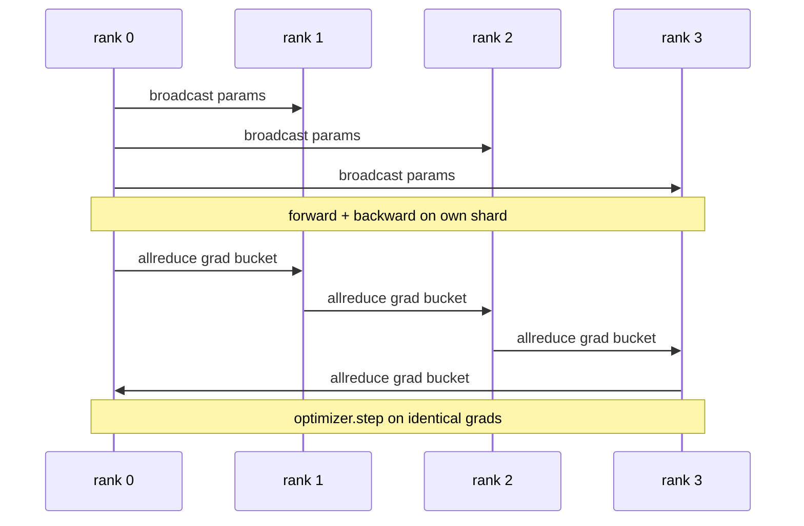

# 从零实现数据并行 DDP

> DistributedDataParallel 是叠在 allreduce 之上的钩子。包住模型，从 rank 0 广播初始参数让每个 rank 从完全相同的状态开始，为每个参数安装 backward 钩子发出梯度 allreduce，剩下的就是梯度下降。整个模式 200 行。

**Type:** Build
**Languages:** Python
**Prerequisites:** Phase 19 Track C lessons 42-49
**Time:** ~90 min

## 学习目标

- 实现一个 `DistributedDataParallel` 形状的包装器：广播初始参数，并在 backward 之后 allreduce 梯度。
- 通过 `torch.multiprocessing.spawn` 在 gloo 后端上以基于文件的 rendezvous 启动 N 个 CPU rank。
- 用同一模型、同一数据做串行训练，并展示每步参数等价，证明梯度同步正确。
- 能论证 bucket（梯度融合）和 overlap（backward 期间通信）是把可工作的 DDP 变成生产级 DDP 的两项改动。

## 问题

一个有 12 GB 激活的 10 亿参数模型装不进一张消费级 GPU。即使装得下，训练也要数周。数据并行把 batch 切分到 N 个 rank，每个 rank 在自己的分片上计算 forward 和 backward，每一步把所有 rank 的梯度求和，让 N 个副本保持一致。优化器在求和后的梯度上更新。

没有梯度同步，N 个副本到第 2 步就发散了。模型不再是「一个用更多数据训练的模型」，而是 N 个恰好共享初始权重的独立模型。梯度同步做得很差时（每个参数一次 allreduce、无重叠、不分桶），网络成为瓶颈，GPU 空等线路。DDP 的工艺在于让梯度同步相对计算几乎免费。标准 PyTorch DDP 通过梯度分桶、让 allreduce 与下一层 backward 重叠、以及在 NVLink 上使用 NCCL 来实现。我们可以在 CPU 上用 gloo 做这三件事，学到同样的教训。

## 概念



### DDP 需要的三个操作

| 阶段 | 集合操作 | 原因 |
|-------|-----------|-----|
| 初始化 | 从 rank 0 广播 | 每个 rank 从相同参数开始 |
| backward 之后 | 对每个梯度 allreduce | 优化器在平均梯度上更新 |
| 有时 | 广播 buffer | BatchNorm 的运行统计保持同步 |

### 为什么用均值而不是求和

allreduce-SUM 除以 world_size 得到平均梯度。均值对 world_size 不变：在单 rank 上调好的学习率在四个 rank 上依然有效，因为每步梯度幅值不变。不做除法的 allreduce-SUM 会迫使你每次改变集群规模都重新调学习率。DDP 封装 SUM 并做除法；本课也这样做。

### 为什么要对梯度分桶

Transformer 有数千个参数张量。每个张量一次 allreduce 要付数千次 gloo 延迟下限。DDP 把梯度分组成约 25 MB 的桶，每桶发一次 allreduce。线路上传输的总字节相同，但延迟被摊到整个桶上。本课的小模型把所有东西放进一个桶；真正可迁移的是结构。

### 为什么固定随机种子

每个 rank 必须用 `torch.manual_seed(seed + rank)` 做 shuffle，但参数初始化要用 `torch.manual_seed(seed)`。单一共享种子会让每个 rank 看到相同的 batch 顺序（数据并行失效）；参数用 rank 相关种子会让初始参数出现浮点 epsilon 级别的差异，梯度同步再也无法让副本完全相同。种子模式弄错的话，参数等价测试在第 1 步就失败。

```figure
ci-ddp-grad-sync
```

## 构建它

`code/main.py` 实现：

- `MiniMLP`：3 层 MLP，小到几秒内收敛，大到足以暴露接线。
- `DistributedDataParallel(model, world_size)`：构造时广播参数，返回一个包装器，其 `sync_grads` 把累加的 allreduce 求和梯度除以 world_size。
- `worker(rank, world_size, ...)`：完整训练循环，包含 gloo 上的 `torch.distributed` 初始化、forward、backward、sync、step。
- `_reference_single_process_loop(...)`：在单个 rank 上串行训练同一模型、同一数据，测试用它验证每步后参数的逐字节等价。

运行：

```bash
python3 code/main.py
```

输出：逐 step 的训练表，比较单进程 loss 和参数校验和与 4 个 rank 上 DDP 运行的结果。两条路径产生到浮点 epsilon 相同的 loss 曲线，证明梯度同步正确。

## 生产环境中的模式

有三种模式能让 DDP 达到可交付的强度。

**找出未使用的参数。** 有些 forward 路径会条件性地跳过参数（early exit、mixture-of-experts 路由）。被跳过的参数没有梯度，但 DDP 的 bucket-ready 钩子仍在等它们，allreduce 死锁。`find_unused_parameters=True` 让 DDP 在归约前检查哪些参数拿到了梯度。代价是每步一次图遍历，所以除非 forward 有分支，否则保持关闭。

**静态图优化。** 当 forward 在各步间稳定时，`static_graph=True` 让 DDP 预计算桶调度。这个优化在规模上很重要：预计算每步省几毫秒，在 10000 步上累积起来可观。

**梯度累积需要小心。** 在 K 个 microbatch 上累积梯度、不逐 microbatch 同步，能带来 10 倍吞吐提升。DDP 以 context manager 形式暴露 `no_sync()`，暂停 backward 后的 allreduce。忘了这个 manager，就会白白 allreduce K 次；吞吐掉到下限。

## 使用它

生产实现：

- **PyTorch DDP。** 标准实现。`torch.nn.parallel.DistributedDataParallel(model)` 接入分桶、重叠和 no_sync 上下文。
- **HuggingFace Accelerate。** 增加一个启动器，处理 `torchrun` 环境变量和模型包装。底层仍是同一个 DDP。
- **Megatron-LM data parallel。** 大模型上把 DDP 与张量并行结合；数据并行部分仍是同样的 backward 后 allreduce 模式。

## 交付它

第 78 课（ZeRO 分片）用 reduce_scatter 替换逐参数 allreduce，使每个 rank 只存优化器状态的分片。第 81 课把 DDP 与 ZeRO 组合成端到端演示。

## 练习

1. 添加可配置大小的梯度桶，在更深的模型上测量相对逐参数 allreduce 的加速。
2. 把 `no_sync()` 实现为 context manager，验证 K 个 microbatch 上的梯度累积与单进程基线一致。
3. 添加 `find_unused_parameters` 模式，让 forward 有时跳过一个 MLP 层；没有该标志时运行应死锁。
4. 用只含 `torch.distributed.barrier()` 的同步替换 gloo，感受基于 allreduce 与基于 barrier 的同步差异。
5. 对 batch size 1、16、256 测量梯度同步开销占 step 时间的比例，并解释其扩展规律。

## 关键术语

| 术语 | 人们怎么说 | 实际含义 |
|------|----------------|------------------------|
| DDP | 「数据并行」 | 每步广播参数并 allreduce 梯度的包装器 |
| Bucket | 「融合梯度」 | 把 N 次小 allreduce 合并成一次大的 |
| Overlap | 「隐藏通信」 | 在后续层仍做 backward 时启动 allreduce |
| no_sync | 「累积」 | 为梯度累积跳过 backward 后的 allreduce |
| find_unused | 「分支 forward」 | 归约前检测没有梯度的参数 |

## 延伸阅读

- [PyTorch DistributedDataParallel docs](https://pytorch.org/docs/stable/generated/torch.nn.parallel.DistributedDataParallel.html)
- [PyTorch DDP internals tutorial](https://pytorch.org/tutorials/intermediate/ddp_tutorial.html)
- [Li et al, PyTorch Distributed: Experiences on Accelerating Data Parallel Training](https://arxiv.org/abs/2006.15704)
- 第 19 阶段第 76 课 - DDP 所依赖的集合操作
- 第 19 阶段第 78 课 - ZeRO 分片用 reduce_scatter 替换逐参数 allreduce
