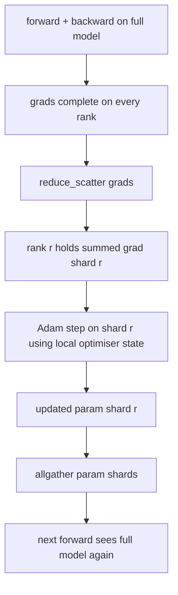

# ZeRO 优化器状态分片

> Adam 为每个参数存储两个矩估计，都是 float32。一个 7B 参数的模型带有 56 GB 的优化器状态。ZeRO 第 1 阶段把它分片到 N 个 rank 上；每个 rank 拥有优化器的 1/N。本地 step 之后，更新后的参数分片广播回去，每个 rank 重建完整模型，下一步开始。收益是训练栈中最大单块分配的线性内存下降。

**Type:** Build
**Languages:** Python
**Prerequisites:** Phase 19 Track C lessons 42-49
**Time:** ~90 min

## 学习目标

- 把优化器状态（一阶矩、二阶矩、fp32 主副本）分片到 N 个 rank 上，使每个 rank 拥有 1/N。
- 用 reduce_scatter 只把每个 rank 自己分片的梯度和交给它，再用 allgather 广播更新后的参数分片。
- 计算 stage 1、stage 2、stage 3 相对原生 DDP 的内存节省表。
- 能根据模型大小和带宽预算，论证选择 stage 1、2 还是 3。

## 问题

原生 DDP 复制一切：参数、梯度和优化器状态在每个 rank 上都是完整的。对 fp16 的 7B 参数模型，这意味着每个 rank 14 GB 参数、14 GB 梯度、28 GB 优化器状态。优化器状态是最大项，也最容易分片，因为它只在 step 期间被访问，forward 和 backward 都不碰。

ZeRO 第 1 阶段分片优化器状态。每个 rank 持有 1/N 的 Adam 矩。backward 之后，不是 allreduce 完整梯度再本地 step，而是 reduce_scatter，让每个 rank 只收到自己分片的梯度和。该 rank 对主参数分片执行优化器 step。更新后的参数分片再 allgather 回来，让每个 rank 在下一次 forward 前拥有完整模型。优化器内存下降为 1/N。每步线路流量与 DDP 相同：一次 reduce_scatter 加一次 allgather，按带宽等于一次 allreduce。内存赢了，吞吐保持。

## 概念



### ZeRO 的阶段

| 阶段 | 分片内容 | 每个 rank 的内存 | 每步通信 |
|-------|----------------|------------------|---------------|
| DDP | 无 | 参数 + 梯度 + 优化器 | 1x allreduce |
| ZeRO-1 | 优化器状态 | 参数 + 梯度 + 优化器/N | 1x reduce_scatter + 1x allgather |
| ZeRO-2 | 优化器 + 梯度 | 参数 + 梯度/N + 优化器/N | 1x reduce_scatter + 1x allgather |
| ZeRO-3 | 优化器 + 梯度 + 参数 | 参数/N + 梯度/N + 优化器/N | 每层 1x allgather + 每层 1x reduce_scatter |

Stage 1 是最便宜的收益，因为优化器状态主导预算。Stage 2 需要梯度分片累积逻辑，但带宽相同。Stage 3（FSDP）为每次 forward 和 backward 付逐层通信，换取参数分片带来的内存下降。本课完整实现 stage 1。

### 内存计算，真实数字

对用混合精度 Adam 训练的 P 参数模型：

| 项 | 原生 | ZeRO-1 | 原因 |
|------|---------|--------|-----|
| fp16 参数 | 2P 字节 | 2P 字节 | forward 需要 |
| fp16 梯度 | 2P 字节 | 2P 字节 | backward 需要 |
| fp32 主副本 | 4P 字节 | 4P/N 字节 | 只有优化器使用 |
| fp32 一阶矩 | 4P 字节 | 4P/N 字节 | 只有优化器使用 |
| fp32 二阶矩 | 4P 字节 | 4P/N 字节 | 只有优化器使用 |
| 合计 | 16P 字节 | 4P + 12P/N 字节 |   |

N=8 时：原生 16P，ZeRO-1 5.5P，下降 65%。N=64 时：原生 16P，ZeRO-1 4.19P，下降 74%。

### 为什么 reduce_scatter 优于 allreduce 后再分片

Allreduce 让每个 rank 拿到完整的求和梯度。如果你只需要分片 r，那么被归约的 (N-1)/N 梯度在 rank r 上是浪费的。Reduce_scatter 只交付每个 rank 拥有的分片；每个 rank 的字节数与 allreduce 相同（因为 allreduce 就是 reduce_scatter + allgather），但后半部分之后被参数分片 allgather 取代。净线路流量与 DDP 相同，内存被除尽。

```figure
cd-zero-shard
```

## 构建它

`code/main.py` 实现：

- `flatten_params(module)` 和 `unflatten_into(module, flat)`：把模型参数打包成一个连续张量再拆回去。扁平布局让按 rank 分片变成简单的切片。
- `ZeroOptimizer(model, world_size, rank, lr)`：拥有该 rank 的主副本分片和 Adam 矩。
- `step()`：对扁平梯度运行 reduce_scatter，对 rank 的分片应用 Adam，再 allgather 更新后的参数。
- 一个演示：训练 3 层 MLP 20 步，打印每步内存预算，并对比原生 DDP 基线。

运行：

```bash
python3 code/main.py
```

输出：每步 loss 和内存表，显示 ZeRO-1 在每个 rank 上持有优化器状态的 1/N，而 DDP 持有完整副本。

## 生产环境中的模式

有三种模式能让 ZeRO 达到可交付的强度。

**分片 checkpoint 很重要。** ZeRO-1 的优化器状态分散在各 rank 上；checkpoint 必须记录哪个 rank 拥有什么。第 80 课构建分片 checkpoint 清单，使 ZeRO 运行能在相同 world size 上恢复。没有它，保存的状态在重启时不可读。

**混合精度才是重点。** ZeRO 是一种混合精度技术；被分片的是 fp32 主副本。不用混合精度运行 ZeRO，会为 fp32 主副本付出内存税，却拿不到相应的 fp16 forward 收益。生产运行总是把 ZeRO 与 autocast 或 bf16 权重配对。

**Stage 1 是近乎免费的收益。** 按带宽算，通信与 DDP 相同。内存节省随 N 线性增长。唯一成本是优化器分片的记账。生产栈默认 stage 1，除非参数分片内存也是问题；那时 stage 2 或 3 用通信换内存。

## 使用它

生产实现：

- **DeepSpeed ZeRO。** 参考实现。`deepspeed_config.json` 选择 stage 1/2/3 和分区大小。
- **PyTorch FSDP。** PyTorch 原生等价物。`ShardingStrategy.SHARD_GRAD_OP` 是 ZeRO-2；`FULL_SHARD` 是 ZeRO-3。
- **HuggingFace Accelerate。** 在统一配置下包装 DeepSpeed 和 FSDP。

## 交付它

第 79 课（pipeline 并行）是正交的分片轴：不是在同一模型上分片优化器状态，而是把层分片到各 rank。第 81 课在端到端演示中组合 DDP + ZeRO。

## 练习

1. 扩展到 ZeRO-2，对梯度分片：每个 rank 只存自己分片的梯度，通过在 backward 后将非分片部分置零实现。
2. 添加内存分析器，打印 rank 0 上实际的 fp32 字节用量，并与公式预测对比。
3. 测量原生 DDP 与 ZeRO-1 的每步墙钟时间，分解为 forward、backward、通信。
4. 在 ZeRO-1 下实现梯度裁剪：L2 范数必须通过对本地范数平方做 allreduce 来跨所有分片计算。
5. 实现一个用 allreduce 替代 reduce_scatter 的「朴素 ZeRO」，测量线路时间差。用数字论证 reduce_scatter 的选择。

## 关键术语

| 术语 | 人们怎么说 | 实际含义 |
|------|----------------|------------------------|
| ZeRO-1 | 「分片优化器」 | 每个 rank 持有 1/N 的 fp32 主副本 + Adam 矩 |
| ZeRO-2 | 「梯度也分片」 | 每个 rank 在 reduce_scatter 后也丢弃非分片梯度 |
| ZeRO-3 | 「分片参数」 | 每个 rank 持有 1/N 的 fp16 参数；forward 中逐层 allgather |
| Master copy | 「fp32 权重」 | 优化器更新的高精度参数副本 |
| Reduce_scatter | 「拆分求和」 | 只把每个 rank 自己分片的梯度和交给它 |

## 延伸阅读

- [Rajbhandari et al, ZeRO: Memory Optimizations Toward Training Trillion Parameter Models](https://arxiv.org/abs/1910.02054)
- [DeepSpeed ZeRO documentation](https://www.deepspeed.ai/tutorials/zero/)
- [PyTorch FSDP documentation](https://pytorch.org/docs/stable/fsdp.html)
- 第 19 阶段第 76 课 - 本课所依赖的 reduce_scatter 和 allgather
- 第 19 阶段第 80 课 - ZeRO 状态必须使用的分片 checkpoint
