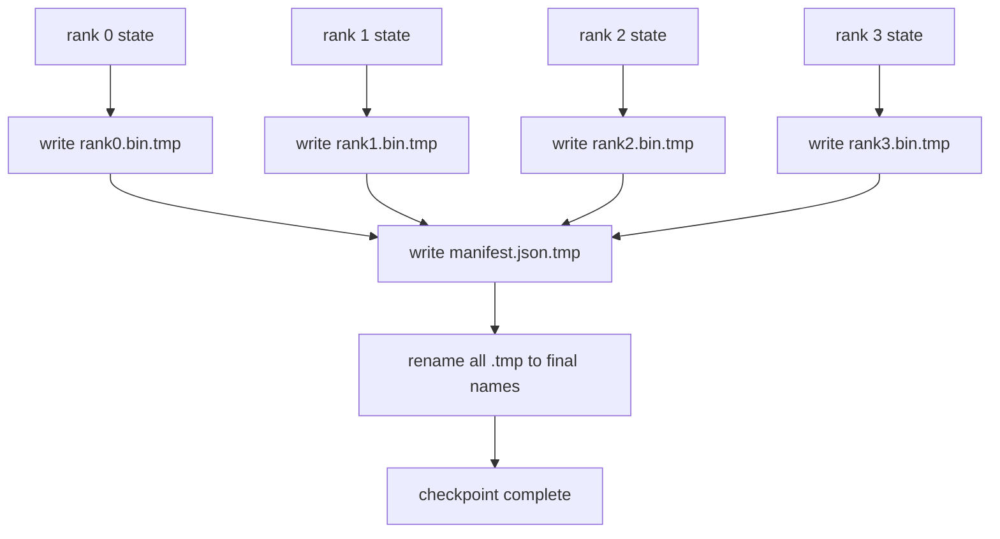

# 分片 checkpoint 与原子恢复

> 一个 70B 参数的训练任务每隔几小时就会因节点故障暂停。checkpoint 格式决定你损失 30 分钟还是 30 小时。分片 checkpoint 并行写入每个 rank 的分片，并在清单中记录所有权。恢复时从各自的文件加载每个 rank 的分片，在相同 world size 上重建状态，优化器像什么都没发生一样继续 step。原子写入防止半完成的 checkpoint 毒害下一次恢复。

**Type:** Build
**Languages:** Python
**Prerequisites:** Phase 19 Track C lessons 42-49
**Time:** ~90 min

## 学习目标

- 把多 rank checkpoint 保存为逐 rank 分片文件加一个记录哪个 rank 拥有什么的清单。
- 使用原子写入模式（写入临时路径再重命名），让写入中途崩溃永远不会产生半完成的 checkpoint。
- 从清单恢复，验证每个 rank 上 fp16 参数和 ZeRO 优化器状态的逐字节一致。
- 针对三种故障模式论证清单 schema：world size 变化、分片数量不匹配、部分写入。

## 问题

原生 checkpoint 把所有参数和优化器状态读入 rank 0，聚合后写一个文件。对 70B 模型，这是 1.1 TB 状态流经单个 rank 的网络端口。写入阻塞其他所有 rank，因为它们空闲等待聚合。IO 带宽是最慢单张 GPU 的网络链路，而不是聚合带宽。在真实集群上，先聚合再写入的步骤可能比前一小时训练还长，这意味着任务每个训练日保存不到一个 checkpoint。

分片 checkpoint 翻转这个模式：每个 rank 并行把自己的分片写到自己的文件。清单记录哪个 rank 拥有哪个分片，恢复时把每个分片放回原处。聚合写入带宽随集群扩展。一个通过单 rank 需要 4 小时的 1 TB checkpoint，通过 64 个 rank 只需 4 分钟。此外，清单为不兼容的恢复提供契约：world size 变化可检测，部分写入可检测，加载路径可以大声失败，而不是悄悄使用陈旧数据。

## 概念



### 清单 schema

```json
{
  "world_size": 4,
  "step": 1234,
  "wall_clock_seconds": 4521,
  "shards": [
    {"rank": 0, "path": "rank0.bin", "sha256": "...", "param_shard_offset": 0, "param_shard_numel": 65536},
    {"rank": 1, "path": "rank1.bin", "sha256": "...", "param_shard_offset": 65536, "param_shard_numel": 65536}
  ],
  "schema_version": 1
}
```

有三个字段是关键。`world_size` 让不同规模的恢复大声失败，而不是悄悄损坏。逐分片的 `sha256` 捕获部分或损坏的写入。逐分片的 `param_shard_offset` 和 `param_shard_numel` 让加载器把扁平参数张量重建到正确位置。

### 原子写入

标准模式：把每个分片写到 `<name>.tmp`，把清单写到 `manifest.json.tmp`，逐个 fsync，然后重命名。同一文件系统内的 POSIX 重命名是原子的；要么新文件完整存在，要么旧文件仍在。最终重命名前崩溃，前一个 checkpoint 仍是活动版本。没有原子写入，崩溃可能留下部分分片和一个指向它的现存清单，恢复时加载会损坏优化器状态。

### schema 必须防御的三种故障模式

| 故障 | 症状 | 防御 |
|---------|---------|---------|
| world size 变化 | 用 N=4 的清单在 N=8 上恢复 | 清单中的 world_size 不匹配，大声失败 |
| 分片数量不匹配 | 恢复时看到的 rank*.bin 文件少于清单中的分片数 | 枚举分片，验证每个都存在 |
| 部分写入 | 分片文件在 flush 中途被截断 | 加载时做 sha256 验证 |

每种防御都尽早拒绝错误加载；替代方案是静默损坏，100 步后 loss 变成 NaN 时才浮现。

### 为什么用逐 rank 文件，而不是一个大文件

通过 `O_APPEND` 并发写一个文件在 POSIX 上对字节对齐写入可行，但实践中一个分片内的偏移跨越 MB 级区域，锁竞争占主导。逐 rank 文件没有竞争，并在底层文件系统是并行的时候（Lustre、GPFS）受益于条带化。生产栈（DeepSpeed、FSDP、NeMo）都因此使用逐 rank 文件。

```figure
ci-sharded-checkpoint
```

## 构建它

`code/main.py` 实现：

- `ShardManifest` dataclass：上述 schema 加 `to_json`/`from_json`。
- `save_sharded(state_dict_per_rank, dir, step)`：用原子先临时后重命名模式把每个 rank 的二进制状态写到自己的文件，然后写清单。
- `load_sharded(dir, expected_world_size)`：读取清单，验证每个分片的 sha256，返回逐 rank 的 state dict。
- 一个往返测试：构建逐 rank 状态，保存，加载，断言逐字节一致。

运行：

```bash
python3 code/main.py
```

输出：写入 4 个分片文件加清单，然后重新加载并做逐字节验证。

## 生产环境中的模式

有三种模式能让 checkpoint 达到可交付的强度。

**异步写入。** 生产栈在单独线程或进程中发起 checkpoint 写入，让训练继续。屏障在下一个 checkpoint：上一个保存完成前不要开始下一个保存。DeepSpeed 的 `async_io` 标志正是这样做的。本课保持同步写入，让步骤可见。

**先写本地快盘，再异步上传。** 写入本地 NVMe（快），再异步上传到 S3 或 GCS。两级模式让集群内 checkpoint 保持快速以用于恢复，同时向集群外投递持久副本用于归档。清单携带本地路径；上传清单携带远程路径。

**轮转很重要。** 生产运行保留最近 K 个 checkpoint（通常是 3-5 个）并轮转最旧的。不轮转的话磁盘会在运行中途写满，下一次 checkpoint 失败。有轮转的话，下一次保存先删除最旧的，释放预算。

## 使用它

生产实现：

- **DeepSpeed checkpointing。** `deepspeed.save_checkpoint(tag=step)` 写逐 rank 文件，以及一个指向活动 tag 的 `latest` 文件。
- **PyTorch FSDP checkpointing。** `torch.distributed.checkpoint` 保存分片状态，并用 `Planner` 决定逐 rank 布局。
- **NeMo。** 用统一的 `save_to_checkpoint` API 包装 DeepSpeed 和 FSDP，并添加元数据。

## 交付它

第 81 课保存端到端 DDP+ZeRO 运行的分片 checkpoint，并在相同 world size 上重新加载，证明恢复契约成立。

## 练习

1. 添加异步写入：在线程中发起保存，让训练继续。上一个保存完成前阻塞下一个保存。
2. 添加 `last_5_steps` 轮转：保留最近 5 个 checkpoint，保存新 checkpoint 前删除最旧的。
3. 为内循环重载添加仅 CRC 的快速验证路径（轮转让某个 checkpoint 成为新的活动版本，无需完整 sha256）。
4. 添加跨 world size 加载：通过读取清单、拼接、重新分片，把分片从 N=4 重新平衡到 N=8。
5. 上传到假 S3（第二个目录）并写入上传清单。论证两级存储策略。

## 关键术语

| 术语 | 人们怎么说 | 实际含义 |
|------|----------------|------------------------|
| Sharded checkpoint | 「逐 rank 保存」 | 每个 rank 并行写自己的分片文件 |
| Manifest | 「索引」 | 记录分片路径、偏移和 sha256 的 JSON 文件 |
| Atomic write | 「先 tmp 再 rename」 | 写入 .tmp 后 POSIX 重命名，崩溃时旧文件仍活动 |
| Partial write | 「截断的分片」 | 写入时崩溃产生损坏分片；sha256 捕获它 |
| Rotation | 「保留最近 K 个」 | 写新 checkpoint 前删除最旧的，以限制磁盘用量 |

## 延伸阅读

- [DeepSpeed checkpointing](https://deepspeed.readthedocs.io/en/latest/model-checkpointing.html)
- [PyTorch torch.distributed.checkpoint](https://pytorch.org/docs/stable/distributed.checkpoint.html)
- [POSIX rename atomicity](https://pubs.opengroup.org/onlinepubs/9699919799/functions/rename.html)
- 第 19 阶段第 78 课 - 本 checkpoint 所保存的 ZeRO 状态
- 第 19 阶段第 81 课 - 端到端演示对保存状态做往返验证
