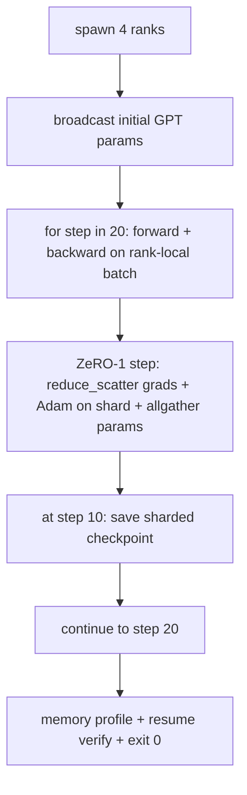

# 端到端分布式训练

> 第 76 到 80 课各自构建了一个部件。本课是组装：一个小型 GPT 在 4 个模拟 rank 上训练，用 DDP 同步梯度，用 ZeRO-1 分片优化器状态，并在中途保存一个分片 checkpoint。演示运行 20 步后自行终止，打印损失曲线和内存画像，并写出可恢复的 checkpoint。

**Type:** Build
**Languages:** Python
**Prerequisites:** Phase 19 Track C lessons 42-49
**Time:** ~90 min

## 学习目标

- 把 DDP（第 77 课）、ZeRO-1（第 78 课）和分片 checkpoint（第 80 课）组合进同一个训练循环。
- 在小型合成语料上，用 4 个模拟 rank 训练一个 2 层 transformer 语言模型，共 20 步。
- 打印每步损失表、每 rank 内存画像，以及能在相同 world size 下按字节等价恢复的 checkpoint manifest。
- 为这种组合辩护：每个部件在之前的课程中都可独立测试，而本课证明它们可以组合。

## 问题

结业项目就是各部件能拼在一起的证明。第 76 课实现了集合通信原语。第 77 课把它们封装成 DDP。第 78 课用 reduce_scatter 分片优化器状态。第 79 课分析了 pipeline。第 80 课保存了分片 checkpoint。每节课都独立存在，有自己的测试。真实的训练运行会同时使用所有原语；如果组合方式有误，损失会发散、checkpoint 无法恢复，或者每 rank 的内存本应下降却在增长。

本课运行端到端演示并验证四条不变量：(a) 在浮点噪声范围内，损失在 20 步中单调下降；(b) 每一步每个 rank 持有相同的参数范数；(c) 每 rank 的优化器内存等于 ZeRO-1 公式 12P/N 字节；(d) 第 10 步的 checkpoint 在重启时按字节等价重新加载。演示自行终止：20 步，一条命令，退出码 0。

## 概念



### 迷你 GPT

模型是刻意做小的：2 个 transformer 块、embed 维度 32、4 个注意力头、词表 64、序列长度 16、batch 4。几千个参数。它大到足以检验每一个接线决策（多头注意力走标准的带掩码路径；LayerNorm 有权重要同步；LM head 是一个独立的线性投影，映射回词表），又小到 4 个 CPU rank 上的 20 步几秒钟就能跑完。

### 组合规则

| 课程部件 | 它负责什么 | 它留给训练循环什么 |
|--------------|--------------|----------------------------|
| DDP 广播 | 初始参数同步 | 构造时调用一次 |
| ZeRO-1 步 | 梯度同步、master 副本更新、参数广播 | 每步调用一次，替代 optimiser.step |
| 分片 checkpoint | 持久化每 rank 状态、带 sha256 的 manifest | 在 rank 0 上用 allgather 收集的状态调用 |
| 训练循环 | 前向、反向、损失记录 | 按顺序调用上述三者 |

训练循环不知道 reduce_scatter 或 rendezvous 文件。ZeRO 和 checkpoint 模块暴露窄接口，由循环来组合。

### 为什么用迷你 GPT 而不是简单的 MLP

第 77 课的 MLP 足以验证梯度同步。迷你 GPT 多了三样东西：词表上独立的 LM head（本课为了清晰不做权重绑定；完整的 GPT 通常把 head 与 token embedding 绑定）、softmax + 交叉熵作为损失（比 MSE 有更多数值边界情况），以及非对称的前向计算（每层先 embedding，再注意力，再 MLP）。结业项目如果继续用 MLP，就会掩盖组合是否能正确处理 LayerNorm 或 embedding 层的梯度形状。

### 自行终止意味着退出码 0

训练循环运行固定的 20 步然后退出。没有 `while True`，不需要人工干预，不从外部状态恢复。一个可以无人值守运行、结束时能找到完整日志的结业项目，才是证明系统接线正确的结业项目。任何一个部件死锁，演示就永远不会返回，测试装置会捕获它。

```figure
ci-distributed-assembly
```

## 构建它

`code/main.py` 实现：

- `MiniGPT`：带掩码自注意力和独立 LM head 的 2 层 transformer。
- `make_corpus(seed, total_tokens)`：确定性的下一 token 预测数据。
- `_train_worker`：每个 rank 派生一个；广播初始参数，运行循环，调用 ZeRO 步，在第 10 步写分片 checkpoint。
- `verify_resume`：主运行结束后，在进程内重新加载第 10 步的 checkpoint，断言保存的 master 分片与内存快照逐字节一致。
- `main`：编排整个演示，打印损失表、内存画像和验证结果。

运行它：

```bash
python3 code/main.py
```

输出：一张 20 行损失表、4 行每 rank 内存画像、一个 checkpoint manifest，以及成功时的 "RESUME VERIFIED" 一行。

## 真实生产中的模式

三条模式让真实运行的组合更完整。

**按 K 分钟而非 K 步保存 checkpoint。** 步耗时随序列长度和微批数量变化。10 分钟的 checkpoint 节奏无论模型大小都能覆盖相同的计算量。本课为简单起见按步数；生产环境按挂钟时间。

**尽早检测发散。** 生产运行会在反向传播后加 NaN 守卫和损失尖峰检测器；如果损失在一步内跳升超过 2 倍，就回滚到上一个 checkpoint，而不是让优化器一路走进退化状态。本课的损失曲线平滑，所以守卫用不上，但钩子保留。

**跨 rank 聚合内存画像。** 真实运行中每 rank 内存不同（持有最大 pipeline stage 的 rank 保留更多激活值）。生产环境记录跨 rank 的最大值和均值；本课打印每 rank 数值以展示公式吻合。

## 使用它

生产模式：

- **DeepSpeed。** 在一个配置下组合 DDP + ZeRO + pipeline + 激活 checkpoint。本课的组合就是缩小版的 DeepSpeed 形态。
- **PyTorch FSDP。** 原生等价物。带 `ShardingStrategy.SHARD_GRAD_OP` 的 `FullyShardedDataParallel` 就是 ZeRO-2。
- **NeMo 和 Megatron-LM。** 为超大规模模型增加张量并行；除此之外组合形态相同。

## 交付它

整条轨道在这里结束。6 节课合在一起，就是真实团队在采用 DeepSpeed 之前会构建的分布式训练子系统；抽象已在 gloo 上验证，故障模式也已演练过。第 17 阶段（基础设施与生产）是把这套东西带到真实集群的地方。

## 练习

1. 增加注意力头的张量并行切分，验证损失与单 rank 基线一致。两个 rank：每个 rank 一半的头，注意力输出做 allreduce。
2. 增加跨 4 个微批的梯度累积，证明梯度等于一个大 batch 的梯度。
3. 增加从第 10 步恢复的路径，真正继续训练到第 20 步，并产生与原始运行相同的最终损失。
4. 增加指标导出（损失、梯度范数、步耗时）到 JSONL，以便事后可视化。
5. 增加 NaN 守卫，在损失尖峰时回滚到上一个 checkpoint，并用一步 LR 乘数强制制造尖峰来演练回滚。

## 关键术语

| 术语 | 人们怎么说 | 实际含义 |
|------|----------------|------------------------|
| 端到端 | "全部接起来" | 一次运行组合所有部件，而不是每个部件一个单元测试 |
| 内存画像 | "每 rank 多少 GB" | 每个 rank 上参数、梯度、优化器状态占用的字节 |
| 恢复契约 | "保存和加载" | checkpoint 往返后每 rank 状态逐字节相等 |
| 自行终止 | "有界运行" | 固定步数，完成时退出码 0，循环中无人工干预 |

## 延伸阅读

- [DeepSpeed end-to-end training tutorial](https://www.deepspeed.ai/getting-started/)
- [PyTorch FSDP advanced tutorial](https://pytorch.org/tutorials/intermediate/FSDP_advanced_tutorial.html)
- [Megatron-LM training script reference](https://github.com/NVIDIA/Megatron-LM)
- Phase 19 Lessons 76-80 - 本课组合的各个部件
- Phase 17 - 把组合搬到真实集群
