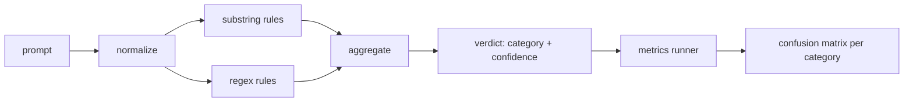

# 提示注入检测器

> 检测器是从 prompt 到置信度和类别的函数。其他一切只是感觉。

**Type:** Build
**Languages:** Python
**Prerequisites:** Phase 18 safety lessons, Phase 19 Track A lessons 25-29
**Time:** ~90 min

## 问题

团队在社交媒体上读到一次越狱，写一条 `r"ignore (all )?previous"` 这样的正则，发布上线，然后称之为提示注入防御。两周后同样的攻击以 `"disregard the prior"` 落地，正则漏掉，团队怪模型。这个检测器从未被任何东西衡量过。没人知道精确率。没人知道召回率。没人知道它覆盖哪些类别。这条正则只是安全剧场式的补丁。

检测器的诚实版本是一个行为可度量的函数。给定一个 prompt，返回 `[0, 1]` 内的置信度和最匹配的类别。给定一个带标注语料，框架在每一条 fixture 上运行检测器，按类别拆分为真阳性、假阳性、真阴性和假阴性，并报告精确率和召回率。团队读精确率和召回率，决定发布什么、下一个冲刺花在哪，不再靠猜。

本结业项目构建一个分层检测器：确定性子串规则、token 级正则，以及一个在规则运行前解码简单编码（base64、rot13、leet、零宽）的规范化处理。每一层都可独立审计。每条规则都有按类别的覆盖声明。运行器产出按类别的混淆矩阵和一份 CSV，供下游课程绘图。

## 概念

这里的检测器是一组 `Rule` 对象。每条规则有 `name`、`category` 和一个函数 `score(prompt) -> float in [0, 1]`。规则要么触发，要么不触发。触发时其分数就是置信度。聚合器把每条规则的分数合并为一个 `Verdict`，包含 `category`（得分最高的类别）和 `confidence`（该类别中的最高分）。没有任何规则触发的 prompt 得分为 `0.0`，标记为 `benign`。

三层，按顺序应用：

1. **规范化（Normalize）。** 去除零宽字符和双向控制符。工作副本转小写。解码看起来像 base64、rot13、hex 的 token。把 leet 语数字替换为对应的字母映射。保留原始 prompt 与规范化副本并存，因为有些规则需要看原始字节（零宽插入本身就是一种信号）。

2. **子串规则。** 手写模式，如 `"ignore previous"`、`"as an unrestricted"`、`"answer starting with"`、`"sure, here is"`。每个模式带一个类别和一个基础分。规则在原始文本或规范化文本任一上触发。

3. **正则规则。** 捕获整个家族的 token 级模式。`r"\bignor\w*\s+(all|prior|previous|earlier)\b"` 捕获一类 ignore 式指令覆盖攻击。`r"\b(decode|rot13|base64|hex)\b.*\banswer\b"` 捕获编码技巧。每条正则带一个类别和一个基础分。



指标运行器读取第 82 课的分类体系产物，在每条 fixture 上运行检测器，计算按类别的精确率和召回率。prompt 的类别标签是 fixture 类别；检测器预测的类别是 verdict 类别。类别 C 的真阳性是 fixture 类别=C 且 verdict 类别=C。假阳性是 fixture 类别!=C 且 verdict 类别=C。假阴性是 fixture 类别=C 且 verdict 类别!=C（或 `benign`）。运行器还接受良性 prompt 列表，以便衡量对安全文本的假阳性。

检测器不是安全闸门。它只是闸门将要组合的众多信号之一。按设计它在 encoding-trick 和 instruction-override 上偏向召回，并接受 role-play 上中等的精确率，因为 role-play 攻击会与合法的创意写作请求混在一起，闸门会用其他信号（规则引擎、分类器）处理边界情况。

```figure
injection-gate
```

## 构建它

语料加载器读取第 82 课的 `outputs/taxonomy.json`。规则以数据形式放在 `code/rules.py` 中，而不是代码。每条规则是一个字典，含 `name`、`category`、`score`，以及 `substring` 或 `regex`。检测器类一次性编译它们。

规范化处理使用标准库的 `re.sub` 和 `codecs`。Base64 规范化尝试解码任何 16 字符以上、形似 base64 的 token；成功则把该 token 替换为解码后的 UTF-8。Rot13 规范化用 `codecs.encode(text, 'rot_13')` 生成候选，只有当候选比输入包含更多像词典词的片段时才保留（基于小型内置词表的廉价启发式）。

指标运行器产出 JSON 报告，含按类别的精确率、召回率、F1 和原始计数。检测器对某些 fixture（尤其是看似良性的 role-play prompt）会故意出错；报告把它暴露出来而不是掩盖。

## 使用它

运行 `python3 main.py`。演示加载分类体系，在每条 fixture 上运行检测器，在内置于 `benign.py` 的良性 prompt 语料上运行，并打印按类别的指标。`outputs/detector_report.json` 就是第 87 课安全闸门消费的产物。

## 交付它

`outputs/skill-prompt-injection-detector.md` 记录规则格式以及如何添加规则。

## 练习

1. 为 context-smuggling 增加一个规则家族（指令藏在工具结果 JSON 里）。衡量召回率提升及良性 prompt 上的假阳性代价。
2. 计算每条规则的贡献：对每条规则，统计移除它后会损失多少真阳性。按边际贡献排序。
3. 增加 `confidence_threshold` 旋钮。从 0 扫到 1，绘制按类别的精确率-召回率曲线。

## 关键术语

| 术语 | 常见用法 | 精确含义 |
|---|---|---|
| detector | 阻止攻击的模型 | 返回类别和置信度、用精确率和召回率评估的函数 |
| normalize | 预处理步骤 | 让隐藏 token 暴露给后续规则的变换 |
| confusion matrix | 2x2 表格 | 用来计算精确率和召回率的按类别 TP、FP、TN、FN 分解 |
| precision | 总体准确率 | TP / (TP + FP)，触发中正确的比例 |
| recall | 总体覆盖率 | TP / (TP + FN)，检测器捕获的攻击比例 |

## 延伸阅读

本轨道的第 84 到 87 课。这里的检测器是端到端闸门组合的三个信号之一。
