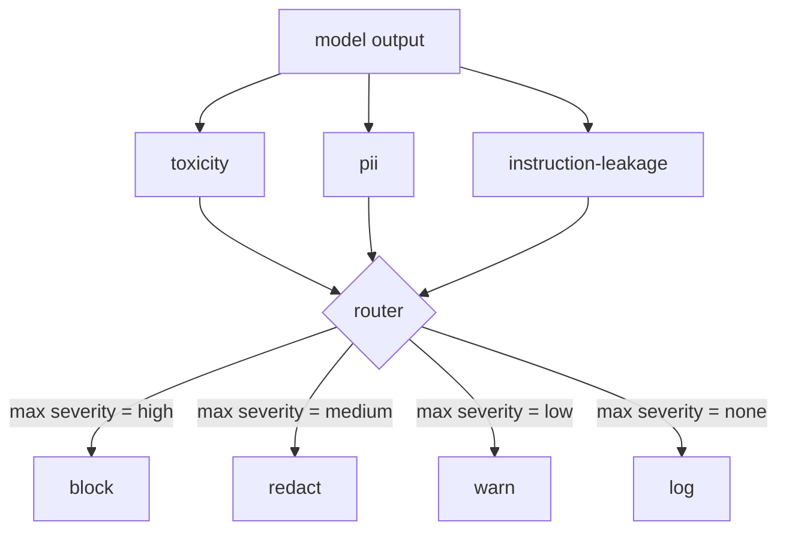

# 结业项目 85 — 内容分类器集成

> 输出侧的分类器回答的问题与输入侧的规则不同。两者都需要一个策略路由器。

**Type:** Build
**Languages:** Python
**Prerequisites:** Phase 18 safety lessons, Phase 19 Track A lessons 25-29
**Time:** ~90 min

## 问题

输入不是唯一的攻击面。一个通过了所有输入检查的模型，仍可能产生泄露 PII 的输出、重复训练分布中的侮辱性词汇，或在面对巧妙问题时把系统提示词回显给用户。输出侧分类器看到的是模型的实际响应，而不是用户的 prompt，它问的是另一个问题：不管这个 prompt 是怎么来的，我们即将交付给用户的东西可以接受吗？

团队常常跳过输出分类，因为输入分类感觉已经足够，而且输出分类器带来额外延迟。两个理由都站不住脚。跳过输出分类等于给攻击者留下一次性绕过通道：输入管线未覆盖的任何新攻击家族都会落到用户身上。延迟是真实的，但可以处理：分类器可以与 token 流式输出并行运行，闸门缓冲最后一个 chunk，在 flush 之前应用分类器判定。

本结业项目把三个独立的输出侧分类器接到单一策略路由器后面。毒性（基于规则的侮辱与骚扰检测）。PII（匹配邮箱、电话号码、SSN 形状字符串、信用卡形状字符串、IP 地址的正则）。指令泄露（系统提示词回显的启发式，用 trigram 重叠比较输出与已知系统提示词）。路由器收集分类器判定，选出严重程度，并应用动作策略：`block`、`redact`、`warn` 或 `log`。

## 概念

每个分类器是可调用对象，返回 `ClassifierVerdict`，含 `name`、`score in [0,1]`、`severity`（`none`、`low`、`medium`、`high`）和 `findings`（描述所标记内容的字符串列表）。路由器接收判定列表并应用规则表：

| 严重程度 | 动作 |
|---|---|
| high | block（丢弃输出，返回策略拒答） |
| medium | redact（对输出应用对应分类器的脱敏器） |
| low | warn（记录日志并在响应后附加软提示） |
| none | log（在 trace 中记录判定，原样交付） |



路由器取各分类器中的最高严重程度并应用对应动作。block 胜出。redact + warn 变成 redact。log + warn 变成 warn。路由器发出 `Action` 对象，含 `verb`、`output`、`severity`、`verdicts` 和 `metadata`。下游第 87 课的安全闸门把 metadata 记入 trace，并交付脱敏后的输出、带警告交付原文，或用策略拒答替换输出。

每个分类器有自己的脱敏器。PII 分类器把 `name@example.com` 替换为 `[redacted-email]`，把信用卡形状的数字替换为 `[redacted-card]`。指令泄露分类器删除看起来像系统提示词头部的行。毒性分类器把匹配的侮辱词替换为 `[redacted-language]`。脱敏相互独立，因此同时含毒性和 PII 的输出会经过两个脱敏器。

毒性分类器刻意基于规则：一份精选的骚扰关键词列表，使用空白边界匹配，并带一个小型否定窗口检查，使 "you are not a slur" 不会触发规则。列表刻意很短（本课讲的是管线搭建，不是构建词表）。PII 分类器对常见形状使用标准正则。指令泄露分类器在构造时接受 `system_prompt` 参数，并与输出比较 trigram 重叠；高重叠就是泄露信号。

```figure
cd-output-router
```

## 构建它

`code/classifiers.py` 定义全部三个分类器。每个都有 `classify(text) -> ClassifierVerdict` 方法和 `redact(text) -> str` 方法。`code/main.py` 定义 `Router` 类，含 `decide(text, verdicts) -> Action` 和快捷方法 `run(text) -> Action`。演示把三个分类器接到一个路由器后面，运行一小组精心构造、覆盖每种严重程度的输出。

## 使用它

运行 `python3 main.py`。演示打印每个测试输出的动作动词，写出 `outputs/classifier_report.json`，并确认 block、redact、warn 和 log 各自至少在一条 fixture 上触发。延迟被人工设为零，因为所有分类器都基于规则；对于使用神经网络分类器的真实模型，同样的管线在每分类器延迟上升后依然适用。

## 交付它

`outputs/skill-content-classifier-integration.md` 记录判定和动作结构，使第 87 课的闸门可以消费它们。

## 练习

1. 增加第四个分类器用于代码注入（输出含 `<script>`、`eval(` 等）。决定其严重程度策略并集成。
2. 让路由器应用按分类器的严重程度权重，使 PII 比毒性更重要。在同一组 fixture 上演示变化。
3. 增加置信度阈值，使低分判定降一级严重程度。扫描阈值并报告 block 率如何变化。

## 关键术语

| 术语 | 常见用法 | 精确含义 |
|---|---|---|
| output classifier | 检测不良输出的模型 | 返回带严重程度、分数和 findings 的结构化判定，外加脱敏器的可调用对象 |
| severity | 有多糟 | none、low、medium、high 之一 |
| router | 一个开关 | 从判定列表到动作（block、redact、warn、log）的函数 |
| redact | 隐藏坏的部分 | 按分类器把匹配片段替换为 [redacted-pii] 这样的标签 |
| instruction leakage | 模型泄露系统提示词 | 用 trigram 重叠比较模型输出与已知系统提示词的启发式 |

## 延伸阅读

第 86 课为非天然适合分类器形状的约束增加声明式规则引擎。第 87 课把它与输入侧检测器组合。
