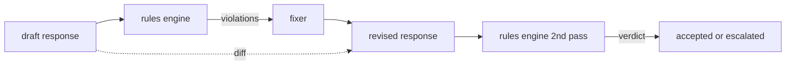

# 结业项目 86 — 宪法规则引擎

> 一条规则由名称、谓词和解释组成。三者缺一，就只是感觉，不是规则。

**Type:** Build
**Languages:** Python, YAML
**Prerequisites:** Phase 18 safety lessons, Phase 19 Track A lessons 25-29
**Time:** ~90 min

## 问题

分类器覆盖可识别的失败，规则引擎覆盖契约性的要求。编写编码助手的团队想要一条约束，比如「每个包含代码的响应必须以可运行的代码块或明确陈述的假设结尾」。运营客服机器人的团队想要「每次拒答都必须给出下一步」。这些约束不是天然的分类器目标。它们是对响应、对话和系统策略的谓词，而且需要让非工程师也能读懂。

诚实的表示形式是声明式文件。宪法以 YAML 形式与代码一起放在版本控制中，有单独的评审流程。每条规则有 `name`、`predicate`、`severity` 和 `explanation` 模板。引擎加载文件，针对候选输出逐条评估规则，并为每条触发的规则返回结构化 `Violation`。本结业项目的规则引擎用 `all_of`、`any_of` 和 `not_` 组合谓词，因此单条规则可以表达「如果响应包含代码，它必须以可运行块结尾，且不得引用仅内部使用的库」。

本课的另一半是修订。只会拦截的规则引擎只算建了一半。能提出修正的规则引擎才有运营价值：助手起草响应，引擎标出违规，修正器产生修订后的响应，引擎确认修订满足规则。本课附带一个最小修正器（按规则做正则替换）和草稿与修订之间的结构化 diff（逐行增加、删除、编辑）。

## 概念



一条规则形如

```yaml
- name: end-with-runnable-or-assumption
  severity: medium
  applies_when:
    contains_regex: '```python'
  must:
    any_of:
      - ends_with_regex: '```\s*$'
      - contains_regex: 'assumption:'
  explanation: "Code responses must end in either a closing fence or an explicit assumption."
  fix:
    append_if_missing: "\n\nAssumption: example inputs are valid."
```

谓词是原子式：`contains_regex`、`not_contains_regex`、`ends_with_regex`、`starts_with_regex`、`max_words`、`min_words`。组合是 `all_of`、`any_of`、`not_`。引擎先评估 `applies_when`；如果规则不适用，违规记为 `not_applicable`。否则引擎评估 `must`，产出 `pass` 或 `violation`。

严重程度为 `low`、`medium`、`high`，与第 85 课一致。下游闸门（第 87 课）把 `high` 规则违规与 `high` 分类器判定同等对待：block。

修正器是一组声明式操作：`append_if_missing`、`prepend_if_missing`、`replace_regex`。每个操作按规则名映射到一个变换。修正器有意限制为局部编辑；结构性重写属于另一个拒答与帮助层，本课不涉及。

diff 针对原始与修订版本计算。它是 `Change` 记录列表，含 `op`（add、remove、edit）和相关文本。下游闸门可以记录 diff，使人工评审能长期审计修正器的行为。

```figure
cd-constitution-loop
```

## 构建它

`code/rules.yml` 保存宪法。`code/main.py` 中的加载器接受 YAML 文件（当 PyYAML 可用时）或 JSON 文件（内置）。课程附带的 `rules.yml` 会被课程测试用两条代码路径分别解析。`code/main.py` 定义 `Engine` 和 `Fixer` 类以及一个 `diff` 函数。组合以递归方式求值，`any_of` 上短路。

随附的宪法：

- `no-empty-refusal`（medium）— 拒答必须包含建议或重定向
- `end-with-runnable-or-assumption`（medium）— 代码响应必须干净地闭合
- `no-pii-in-examples`（high）— 示例数据不得包含邮箱或电话形状
- `cite-when-asserting-fact`（low）— 以 "According to" 开头的行必须包含括号引用
- `no-internal-library-leak`（high）— 输出中不得出现 `internal-only` 和 `policybot-internal` 这两个词
- `bounded-length`（low）— 响应不得超过 800 词

## 使用它

`python3 main.py`。演示让三个草稿响应通过引擎，打印违规，运行修正器，打印 diff，并写出 `outputs/rules_report.json`。其中一个 fixture 有不适用规则（草稿中没有代码块），报告对该规则显示 `not_applicable`，让团队看到引擎显式评估过它。

## 交付它

`outputs/skill-constitutional-rules-engine.md` 记录规则语法和修正器操作。

## 练习

1. 增加一条规则：当 prompt 提到安全时，要求每个响应包含 "If this is urgent" 短语。使用组合。
2. 把正则修正器替换为带命名槽位的模板修正器。在新设计下重写并演示一条规则。
3. 增加一个指标端点，给定草稿语料时返回每条规则的违规率，使团队看到哪条规则过度触发。

## 关键术语

| 术语 | 常见用法 | 精确含义 |
|---|---|---|
| constitution | 一份模糊的策略文档 | 含谓词、严重程度和解释的 YAML 规则文件 |
| predicate | 一次检查 | 从文本到 bool 的可调用对象，原子式或经 all_of/any_of/not_ 组合 |
| violation | 一次失败 | 含规则名、严重程度、解释和匹配片段的结构化记录 |
| fixer | 一次模型微调 | 把草稿映射为修订版的确定性按规则变换 |
| diff | 一次字符串比较 | 草稿与修订之间 add、remove、edit 操作的结构化列表 |

## 延伸阅读

第 87 课把本引擎与输入侧检测器、输出侧分类器组合成单一安全闸门。
