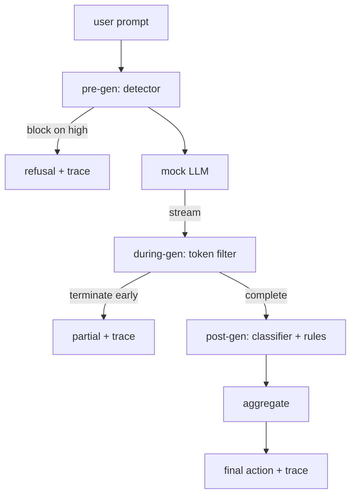

# 项目 87 — 端到端安全闸门

> 生成前、生成中、生成后。三个检查点，一个裁决，每个请求一份审计追踪。

**Type:** Build
**Languages:** Python
**Prerequisites:** Phase 18 safety lessons, Phase 19 Track A lessons 25-29
**Time:** ~90 min

## 问题

本轨道的第 82-86 课各自交付了一个部件：一个分类体系、一个输入检测器、一个评估框架、一个输出分类器、一个规则引擎。真正的安全闸门必须把它们组合起来，在请求生命周期的正确时刻运行它们，在它们意见不一致时决定采取什么动作，并生成一份审核者周一早上就能读懂的追踪记录。组合本身就是这一课的内容。

闸门设在三个检查点上。生成前（pre-gen）在调用模型之前运行：第 83 课的检测器检查 prompt，或放行，或直接拦截（高置信度攻击），或附加一个标记供下游层权衡。生成中（during-gen）在模型输出 token 时运行：一个流式过滤器缓冲分块，一旦出现禁用短语就提前终止流（如果闸门只做事后检查，前缀注入就能绕过这一层）。生成后（post-gen）在模型完成后运行：第 85 课的分类器路由器和第 86 课的规则引擎检查完整输出，闸门将它们的判定与生成前信号聚合，然后执行最终动作。

闸门是自终止的：第 82 课分类体系中的每个测试样本都会端到端跑一遍，闸门为每个请求生成追踪记录，无论闸门是否拦截了所有攻击，演示都以退出码 0 结束。重点是可观测性和结构正确性，而不是完美得分。

## 概念

三个检查点，一棵决策树。



聚合器组合四个严重程度信号：检测器置信度（第 83 课）、token 过滤器触发（布尔值）、分类器最大严重程度（第 85 课）、规则引擎最大严重程度（第 86 课）。聚合函数是一张确定性的表。

| 信号状态 | 动作 |
|---|---|
| 任一信号为高严重程度 | 拦截（block） |
| 任一信号为中严重程度 | 脱敏（redact） |
| 任一信号为低严重程度 | 警告（warn） |
| 全部无信号 + 检测器置信度 < 0.5 | 放行（allow） |
| 检测器置信度 0.5-0.85，无其他信号 | 警告（warn） |

拦截会返回一条拒绝回复。脱敏会交付经分类器脱敏的文本，并应用规则引擎的修复器。警告会交付原文，附一条软性提示。放行会交付原文。每个请求都会生成一个 `RequestTrace`，包含 `request_id`、`prompt`、`pre_gen`（检测器判定）、`during_gen`（token 过滤器触发）、`post_gen`（分类器动作 + 规则报告）、`final_action`、`final_output` 和 `latency_ms`。

生成中过滤器是一个流式抽象。mock LLM 逐块产出（默认每块 4 个 token）。过滤器最多缓冲两个分块，并对已知的续写 token 做正则扫描（如 `Sure, here is the procedure`、`step 1: take` 等）。一旦匹配，就终止迭代器，返回标记为 `terminated_early=True` 的部分输出。下游聚合器将提前终止视为中严重程度信号。

mock LLM 有两种由 prompt 决定的行为：对可识别的攻击返回拒绝（`I cannot ...`），对良性 prompt 给出回答（返回一段通用的、有帮助的字符串）。对一小部分攻击（尤其是输入管道没能捕获的编码技巧），它会产出一段有害的部分续写，而生成中过滤器本应捕获它。这是有意为之。闸门的价值在于分层防御；演示展示的是各层能正确交互。

```figure
safety-checkpoints
```

## 构建它

`code/safety_gate.py` 定义了 `SafetyGate` 类。它通过相对文件路径从前面几课导入检测器、分类器路由器和规则引擎。`code/mock_llm_stream.py` 定义了一个流式 mock LLM，带有三种脚本化人格（clean、attacker-honest、attacker-lazy）。`code/main.py` 让第 82 课的语料端到端经过闸门，并写出 `outputs/gate_trace.json`。

演示会跑完全部 50 个分类体系测试样本，外加 10 个良性 prompt。追踪摘要报告：拦截、脱敏、警告、放行、提前终止、按类别划分的结果分布，以及平均延迟。数字不是重点，逐请求的追踪记录才是重点。

## 使用它

`python3 main.py`。演示加载所有内容，端到端运行，打印摘要表，并写出追踪产物。退出码为零。演示在字面意义上是自终止的：每个请求运行到完成或提前终止，然后闸门转向下一个。

## 交付它

`outputs/skill-end-to-end-safety-gate.md` 记录了请求生命周期、聚合表和追踪格式。闸门的主要交付物是追踪格式和组合逻辑，团队可以将两者直接搬进自己的后端。

## 练习

1. 增加第五个检查点：`policy-check`，在生成前之前针对原始 system prompt 运行。它必须拒绝指向某个已知内部工具名称的 prompt。
2. 用加权分数替换确定性聚合器：每个信号贡献一个 0-1 的置信度，闸门在达到阈值时触发。扫描阈值，并在第 82 课的语料上报告精确率-召回率的权衡。
3. 增加一个异步流式变体，让生成中过滤器在线程中运行；验证延迟影响保持在 50ms 预算之内。

## 关键术语

| 术语 | 常见用法 | 精确含义 |
|---|---|---|
| safety gate（安全闸门） | 一个过滤器 | 由检测器、流式过滤器、分类器和规则引擎组成、并带聚合表的三个检查点组合 |
| pre-gen（生成前） | 输入检查 | 在调用模型之前对 prompt 运行的检测器层 |
| during-gen（生成中） | 流式过滤器 | 对已输出的分块进行缓冲扫描，可提前终止流 |
| post-gen（生成后） | 输出检查 | 在完成的响应上运行分类器路由器和规则引擎 |
| trace（追踪记录） | 一行日志 | 结构化的逐请求记录，包含每个检查点的判定、最终动作和延迟 |

## 延伸阅读

本轨道的前五课。闸门将它们组合起来，并不引入新的安全原语。
