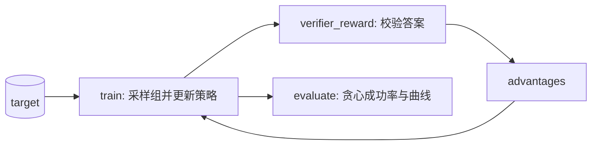

# GRPO from Scratch — Training a Reasoning Policy End to End

> 围绕一个微型神经网络策略构建完整的 GRPO 闭环：对一组算术表达式进行采样，用程序化验证器打分，在多轮 epoch 上裁剪重要性比率，对冻结参考策略施加 KL 惩罚，并加入 k1.5 长度项。你将看到一个冷启动的 MLP 从随机 token  soup 逐渐变成贪心的求解器，能够选择正确的表达式长度并命中目标。

**Type:** Build
**Languages:** Python
**Prerequisites:** Phase 9 · 13 (GRPO and RLVR), Phase 10 · 04 (Pre-Training mini-GPT)
**Time:** ~120 minutes

## Learning Objectives
- 从零实现一个字符级 MLP 策略，并让它以提示目标与 one-hot 前缀均值嵌入作为条件。
- 组装完整的 GRPO 训练闭环：组采样、组内归一化优势、PPO 式裁剪比率、多轮 epoch 更新，以及对冻结参考策略的 k3 KL 惩罚。
- 在一个可验证的算术任务上训练策略，并解读成功率、组奖励与回复长度曲线。
- 运行受控消融实验，说明 KL 锚点与每组基线为何是不可省略的工程选择。
- 解释函数式策略相比 09/13 表格课中的表格策略如何在状态间泛化。
- 将 GRPO 系统拆分为验证器、训练器与评估器三个模块，并说明每个边界的理由。

## The Problem

09/13 课围绕一个表格型 token 策略构建 GRPO。每个状态 `(target, position, numbers used so far)` 都有自己的 logits。这种设计非常适合教学：目标中的每个符号都对应命名字典里的一项，梯度更新只有一行。但它不是工程师部署推理模型的方式。

**表格无法泛化。** 如果提示目标或可用数字发生变化，表格策略没有可共享的参数；它必须为每个未见过前缀分配新的 logits 向量。真正的 LLM 是一个函数逼近器：同一组权重对从未见过的提示也能产生合理的下一 token 分布，因为“前缀包含 `+`”和“目标较大”这类表示在不同样本间复用。

**单体脚本无法在生产环境中存活。** 在参考级 GRPO 代码库中，验证器是单独进程，负责输出奖励；训练器管理 rollout 缓冲区与优化；评估器运行贪心解码与指标记录。因此 capstone 把同样的数学拆成模块：`verifier_reward`、`train` 和 `evaluate`。每个模块职责单一、有独立测试，并可以独立替换。

本课以两种方式升级 09/13 的配方：用**两层 MLP 策略**取代表格，并把代码组织成以后可以放到不同机器上的模块。

## The Concept

### 从表格到函数逼近器

策略是一个带一个隐藏层的微型神经网络：

```math
x = \big[\underbrace{\frac{1}{t}\sum_{j=1}^{t} \text{onehot}(y_j)}_{\text{prefix mean embedding}} \;\|\; \underbrace{\text{onehot}(\text{target})}_{\text{prompt condition}}\big]
```

```math
h = \tanh(W_1 x + b_1), \qquad \text{logits} = W_2 h + b_2
```

词表是 `{"2", "3", "5", "+", "*"}`。自回归解码与 LLM 完全一致：在每个位置模型输出词表上的分布，语法掩码将非法 token 置零（数字位不能选运算符，数字不能重复使用），然后采样或贪心取 token。输入维度是 `5 + |TARGETS|`，隐藏层 48 个单元，输出维度是 5。整个网络用普通 SGD 训练。

因为同一组权重为每个前缀打分，模型可以迁移结构：学会 `2*3` 对目标 6 成立，有助于它在目标 7 出现时避开同一前缀。

### GRPO：函数策略上的同一目标

验证器与 09/13 保持一致。它支付格式奖励、在真实运算符优先级下命中目标的准确率奖励，以及 Kimi k1.5 长度控制项：

```math
r(x, y) = 0.1 + \mathbf{1}[\text{eval}(y) = \text{target}] + r_{\text{len}}(|y|, \text{correct})
```

```math
r_{\text{len}}(L, c) = \begin{cases} \lambda \cdot \dfrac{L_{\max} - L}{L_{\max} - L_{\min}} & \text{if } c \\[6pt] -\lambda \cdot \max\!\Big(0, \dfrac{L - L_{\text{target}}}{L_{\max} - L_{\text{target}}}\Big) & \text{otherwise} \end{cases}
```

对每个提示，训练器采样 $G = 8$ 条回复，并把奖励归一化为优势：

```math
\hat A_i = \frac{r_i - \operatorname{mean}(r_1, \dots, r_G)}{\operatorname{std}(r_1, \dots, r_G) + \varepsilon}
```

优化目标是 PPO 裁剪代理目标加上对初始化冻结副本的 $k_3$ KL 惩罚：

```math
\mathcal{L}(\theta) = -\frac{1}{\sum_i |y_i|} \sum_i \sum_t \Big[ \min\big( \rho_{i,t} \hat A_i,\; \operatorname{clip}(\rho_{i,t}, 1-\epsilon, 1+\epsilon) \hat A_i \big) \Big] + \beta\, \mathbb{D}_{KL}\!\big[\pi_\theta \| \pi_{\text{ref}}\big]
```

```math
\rho_{i,t} = \frac{\pi_\theta(y_{i,t} \mid x, y_{i,<t})}{\pi_{\theta_{\text{old}}}(y_{i,t} \mid x, y_{i,<t})}, \qquad \mathbb{D}_{KL}[\pi_\theta\|\pi_{\text{ref}}] = \frac{\pi_{\text{ref}}}{\pi_\theta} - \log\frac{\pi_{\text{ref}}}{\pi_\theta} - 1
```

与 09/13 唯一的区别是 $\pi_\theta$ 现在是一个 MLP。梯度通过反向传播 `coeff * (onehot(token) - probs)` 穿过两层得到，其中 `coeff = adv * rho - beta * (1 - exp(log_ref - log_new))`。

### 为什么要拆成模块

代码被组织成三个可分离的关注点：



- **Verifier（验证器）** 是从 `(target, tokens)` 到标量的纯函数。它没有参数、没有梯度，可以被单元测试运行器或 JSON-schema 验证器替换，而无需改动训练器。
- **Trainer（训练器）** 拥有 rollout 缓冲区、组基线、裁剪代理目标与参数更新。它不知道表达式如何求值，只消费奖励。
- **Evaluator（评估器）** 进行贪心解码，并报告成功率、组奖励均值与回复长度均值。在真实训练任务中，你会每隔 $N$ 步运行一次这个 harness。

这种拆分让消融实验成为可能：训练器可以单独关闭 KL 惩罚或组归一化，而验证器和评估器完全无感知。

## Build It

实现位于 `code/main.py`。它有意保持小巧——MLP、验证器、训练器、评估器与消融 harness 都在一个文件里——但目标中的每个 GRPO 符号在文件顶部都有命名常量。

**运行标准配置：**

```console
python3 main.py
```

你会看到逐轮统计与最终的贪心评估。脚本随后用相同种子和相同迭代预算运行两次消融，并打印对比结果。

**运行消融：**

```console
python3 main.py --ablation=no-kl
python3 main.py --ablation=no-group-norm
```

- `no-kl` 把 `beta` 设为 0。策略可以追逐奖励，而不再受初始化锚点约束。观察 KL 到参考策略的上升，以及格式/成功率相比标准运行的下降。
- `no-group-norm` 用全局运行平均奖励替换每组基线。策略仍会学习，但基线更嘈杂、更慢；在相同迭代数后，贪心成功率落后于标准 GRPO。

## Verify It

`code/tests/test_main.py` 锁定了让这个 capstone 成为 capstone 的关键部件：

- 验证器尊重运算符优先级并拒绝畸形表达式；
- 组优势零均值，且所有奖励相同时恰好为零；
- $k_3$ 估计器非负，且策略相同时为零；
- MLP 策略在拷贝后确定性一致，贪心输出格式合法，且 token 对数概率之和为 1；
- 确定性端到端训练将贪心成功率从冷启动提升；
- 移除 KL 惩罚会导致到参考策略的 KL 漂移显著增大；
- 移除组归一化后，在相同迭代预算下贪心成功率更低；
- 命令行消融参数被正确解析。

## Why This Matters for Engineers

- **泛化是神经策略的核心意义。** 表格课证明了数学；MLP 版本证明数学可以在状态间共享参数，这正是 LLM 规模 GRPO 可行的唯一原因。
- **可验证奖励仍是默认选择。** 数学、代码、schema、可检索事实都应由程序检查。只有真正开放式的质量才需要学习奖励模型。
- **KL 系数是安全旋钮，不是累赘。** `no-kl` 表明即使在玩具任务上，优化器也会漂向 KL 更高的分布。在生产中，这种漂移就是“推理”与“恰好通过检查器的胡言乱语”之间的分界线。
- **组大小是基线的分辨率。** `no-group-norm` 表明远离当前提示计算的全局基线会稀释信号。每组归一化不是装饰性归一化，而是价值网络的替代品。
- **模块化边界在测试和维护中会带来回报。** 可替换的验证器、可离线运行的训练器、可放入 CI 的评估器，是每个生产 RLVR 系统的形态。

## Hints

- 如果 200 轮后成功率停滞在 0.5 以下，提高 `GROUP` 或降低 `LR`。稀疏二元奖励需要每条提示有足够样本，或更小的步长。
- 如果组奖励均值为负但格式违规接近零，通常说明策略找到了一类永远不会命中目标但格式合法的表达式。提高 `BETA` 把它拉回参考策略。
- 长度膨胀会先出现在平均回复长度曲线上，然后才反映在准确率上。k1.5 项正是为了让这条曲线保持平稳。
- 在 `no-group-norm` 模式下，前几个提示会初始化全局基线；如果第一个提示全部失败，之后每个高奖励 rollout 都会获得过大的优势，策略可能超调。

## Key Terms

| 术语 | 人们常说 | 实际含义 |
|------|---------|---------|
| MLP policy | "微型神经策略" | 将 `(前缀均值嵌入, 目标 one-hot)` 映射到词表 logits 的两层网络，在所有状态间共享参数。 |
| Frozen reference | "SFT checkpoint" | 初始化策略的副本，从不更新；KL 惩罚让训练后的策略不要离它太远。 |
| Group baseline | "GRPO 技巧" | 用同一提示下 $G$ 条回复的奖励均值与标准差替代价值网络进行优势估计。 |
| $k_3$ estimator | "KL 惩罚" | 非负、无偏的 KL 样本估计：$\pi_{\text{ref}}/\pi_\theta - \log(\pi_{\text{ref}}/\pi_\theta) - 1$。 |
| Length control | "k1.5 技巧" | 奖励塑形：短且正确得更高分，长且错误受更重惩罚，以阻止回复膨胀。 |
| Ablation | "受控失败" | 去掉某个组件的训练运行，用于证明该组件确实在发挥作用。 |
