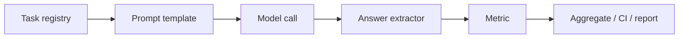

# 从零实现评估框架 —— 构建你自己的评测栈

> 排行榜上的数字只有在产生它们的 harness 是公开、固定且可审计的时才有意义。本课先绘制现有评测栈的地图，再构建一个 200 行左右的迷你 harness，把 prompt 模板、few-shot 数量、答案抽取器这些隐藏自由度全部显式化并做成可替换组件。你会看到同一个 seeded `MockModel` 在切换这些开关时分数发生漂移，并带走一个可以跑在自己预训练语料上的污染检测器。

**Type:** Build
**Languages:** Python
**Prerequisites:** Phase 10 · 10 (Evaluation), Phase 9 · 13 (GRPO and RLVR)
**Time:** ~110 minutes

## 学习目标

- 绘制五大主流开源评测栈的地图，并解释它们各自优化的场景。
- 构建可复用的 `Task` 注册表，在一个 dataclass 中封装 prompt 模板、few-shot 上下文、答案抽取器和评估指标。
- 从零实现三种评分模式：精确匹配、多选题字母抽取、短问答 token 级 F1。
- 用 seeded `MockModel` 跑通 harness，并量化模板、few-shot 数量、抽取器选择会如何改变报告分数。
- 在 harness 输出中加入 bootstrap 置信区间和 8-gram 污染检查。
- 解释为什么一个自研的小型 harness 是抵御 benchmark 过拟合与厂商排行榜操纵的唯一长期手段。

## 问题

你终于有一个想上线的模型。你在几个公开 benchmark 上跑了一下，把数字截图放进发布 deck。一个月后，客户反馈了一个 regression，而 benchmark 明明显示问题已解决。CFO 问为什么 vendor benchmark 领先 6%，但内部套件却落后 2%。团队研究员发现测试集其实出现在预训练数据里。

这些失败的根因都相同：**分数不是模型本身，分数是模型加上产生它的 harness。** 当 harness 是黑盒 —— 一段 vendor 脚本、一个远程排行榜、或一次从 README 复制来的命令 —— 你就无法把信号和接线分开。

隐藏接线包括：

- **Prompt 模板。** 模板要求只回答答案，还是鼓励解释？同一个模型在精确匹配任务上可能波动 10 个百分点。
- **Few-shot 数量。** 零样本、两样本、五样本是三种不同的任务。上下文学习能力强的模型从五个示例中获益更多。
- **答案抽取器。** 抓取第一个整数的正则、抓取最后一个整数的正则、严格相等判断，是三个戴着同一任务名的不同指标。
- **污染。** 如果评测文本出现在训练语料中，分数衡量的是记忆，而不是能力。

在这些自由度被显式化并纳入版本控制之前，比较两个分数就是在比较两个未知数。

## 概念

### 现有评测栈地图

开源生态已经收敛到相似的构建块，但每个栈为不同用户优化。

| 栈 | 维护方 | 优化目标 | 典型抽象 |
|---|--------|----------|----------|
| **lm-evaluation-harness** | EleutherAI | 多模型可复现的公开 benchmark 运行 | Task = YAML 配置 + `loglikelihood` 或 `generate_until` 请求 |
| **OpenCompass** | OpenMMLab | 国产模型横评与社区排行榜 | 配置化任务套件 + 模型后端适配器 |
| **EvalScope** | Alibaba / ModelScope 社区 | 面向国产推理后端的轻量评测 | 把 API 输出归一化为统一评分格式的适配层 |
| **HELM** | Stanford CRFM | 全场景覆盖与透明披露 | 场景 × 指标矩阵 + 模型卡片报告 |
| **lighteval** | Hugging Face | 训练流程中快速、库集成的评测 | 训练脚本可调用的 Task 注册表 + 指标函数 |

尽管表面不同，五个栈共享同一个核心 pipeline：



### 共同抽象

任务不是 JSONL 文件。任务是一个包含四个函数的契约：

1. `prompt_template(example, k, train_examples) -> str` —— 渲染输入。
2. `extractor(response) -> str` —— 把模型自由输出转为归一化预测。
3. `metric(prediction, reference) -> float` —— 给预测打分。
4. `aggregator(scores) -> float` —— 产出任务级数字与不确定度估计。

本课的 harness 把这个契约物化为一个 `Task` dataclass：

```python
@dataclass
class Task:
    name: str
    prompt_template: Callable
    few_shot: int
    extractor: Callable
    metric: Callable
    examples: List[dict]
    train_examples: List[dict]
```

三种指标形态覆盖了工程师实际所需的大部分场景：

- **精确匹配**，用于算术、代码输出和封闭类答案：

```math
\text{EM}(p, r) = \mathbf{1}\big[ \text{normalize}(p) = \text{normalize}(r) \big]
```

- **多选题字母抽取**，用于 MMLU 风格考试。抽取器对 "The answer is B" 和裸 "b" 一视同仁：

```math
\text{MC}(p, r) = \mathbf{1}\big[ \text{extract_letter}(p) = r \big]
```

- **Token F1**，用于短问答 QA，部分重叠比零一得分更有信息量：

```math
\text{F1}(p, r) = 2 \cdot \frac{|T(p) \cap T(r)|}{|T(p)| + |T(r)|}
```

其中 $T(\cdot)$ 是归一化后的字母数字 token 集合。

### 为什么要自己写

公开栈非常适合标准化报告，但不太适合把内部决策显式化。当你拥有 harness：

- 可以每次只改变一个自由度并测量分数差值，而这个差值往往比你本想评估的模型差值更大。
- 可以在相信数字之前加上污染检查。
- 只需把 `MockModel.generate` 替换为真实 API 调用即可接入真模型，harness 其余部分不变。

## 构建

可运行产物是 `code/main.py`。它有意保持小巧 —— 所有代码都在一个文件里 —— 但它不是玩具，而是生产 harness 应有的形状。

**运行方式：**

```console
python3 main.py
```

你会看到三件事：

1. 逐任务分数表，含 95% bootstrap 置信区间与宏平均。
2. 可比性实验：同一个 seeded `MockModel` 跑五种算术 harness 变体，打印分数漂移。
3. 对干净查询与泄露查询的 8-gram 污染检查。

### `MockModel`

`MockModel` 是接缝。它接收 `correctness` 和 `format_ok` 概率以及一个 seed，因此无需 API key 即可测试 harness：

```python
model = MockModel(correctness=0.8, format_ok=0.75, seed=42, name="mock-80/75")
```

以概率 `1 - format_ok`，模型会返回带噪音的包装，例如 "I think the answer is 33"。harness 的抽取器要么成功恢复答案，要么失败 —— 这正是真实模型不遵循指令时发生的情况。

### Runner

```python
def run_task(task: Task, model) -> Dict:
    scores = []
    for ex in task.examples:
        prompt = task.prompt_template(ex, task.few_shot, task.train_examples)
        raw = model.generate(ex, task.name)
        pred = task.extractor(raw)
        scores.append(task.metric(pred, ex["answer"]))
    return {"scores": scores, "mean": float(np.mean(scores))}
```

`run_leaderboard` 遍历任务，加入 bootstrap CI，并报告宏平均。CI 通过对逐样本分数有放回重采样得到：

```python
def bootstrap_ci(scores, n_boot=2000, seed=0):
    arr = np.asarray(scores, dtype=float)
    rng = np.random.default_rng(seed)
    means = np.array([
        arr[rng.integers(0, arr.size, size=arr.size)].mean()
        for _ in range(n_boot)
    ])
    return float(np.percentile(means, 2.5)), float(np.percentile(means, 97.5))
```

### 可比性实验

Demo 用同一个 `MockModel` 跑五种算术配置：

```text
baseline (format instruction, k=2, strict)  -> 0.800
few-shot=0                                  -> 0.500
chatty template                             -> 0.500
plain template                              -> 0.200
lenient extractor                           -> 0.900
```

具体数值会随 seed 略有变化，但模式稳定：报告分数是 harness 的函数，而不仅是模型的函数。这就是本课的核心。不把上述选择纳入版本控制的团队，就像在比较不同城市的天气预报。

### 污染检测

在相信 benchmark 之前，先检查其文本是否出现在训练语料中。检测器从评测样例构建词级别 8-gram，并与每篇语料文档的 8-gram 求交集：

```python
def contamination_check(test_text, corpus, n=8):
    test_grams = _ngrams(test_text, n)
    hits = []
    for doc_id, doc in enumerate(corpus):
        overlap = test_grams & _ngrams(doc, n)
        if overlap:
            hits.append({"doc_id": doc_id, "ngrams": sorted(overlap)})
    return hits
```

只要出现一条足够长的共享句子，样例就会被标记。harness 不会丢弃分数，而是给分数打上标签，让报告可以披露重叠。

## 验证

`code/tests/test_main.py` 固定住让这东西成为 harness 而非脚本的关键部分：

- `letter_extractor` 能从完整句子和全小写输入中恢复选项字母。
- `lenient_number_extractor` 能从嘈杂回复中恢复最后一个整数。
- `exact_match` 对大小写和空白不敏感，但对语义等价敏感。
- `token_f1` 对重叠短答案给部分分，对无关答案给零分。
- `bootstrap_ci` 包含对称分数向量的真实均值。
- `MockModel` 在 `format_ok=1.0` 时返回原始答案，在 `format_ok=0.0` 时返回带噪音的包装。
- 同一模型分别用严格抽取器和宽松抽取器跑，会得到不同的平均分。
- `contamination_check` 能标记泄露的 8-gram，并忽略干净查询。

## 为什么对工程师重要

- **回归测试需要自研 harness。** 上线新 checkpoint 前，用同样的任务注册表、同样的模板、同样的抽取器重跑。任何分数变化都来自模型，而不是测量方式。
- **供应商选型需要公共 harness。** 当两家厂商报出不同 benchmark 数字时，索要精确的 prompt、few-shot 数量与抽取器。固定 harness 后，差值往往消失。
- **管理层汇报需要不确定度。** 没有置信区间和污染检查的单一均值是缺少上下文的数字。bootstrap CI 和重叠报告能把分数变成可辩护的论断。
- **Benchmark 过拟合真实存在。** 如果团队优化一个你无法控制的排行榜，唯一的防御就是私有 harness 和排行榜看不到的任务。本课交付了那个 harness 的骨架。

## 提示

- 保持 `Task` dataclass 小巧。如果某个任务需要特殊抽取器，写个函数传进去；不要给核心类加字段。
- 在断言分数顺序的测试前给 `MockModel` 设置 seed。探索可以用随机覆盖，断言需要确定性 seed。
- 接入真实模型时，只替换 `MockModel.generate`，runner、指标和聚合器保持不变。
- 增加新任务时，优先使用逐样本置信区间而非全局区间。宏平均可能掩盖掉落到零的任务。
- 把 prompt 模板作为代码中的字符串纳入版本控制，而不是笔记本里的临时字符串。一行模板改动就是 git 里的一行 diff。

## 关键术语

- **Task registry（任务注册表）：** 集中管理的评测任务列表，每个任务绑定模板、抽取器和指标。
- **Answer extractor（答案抽取器）：** 把模型自由输出转换为归一化预测的函数。
- **Macro average（宏平均）：** 各任务分数的未加权均值，视每个任务同等重要。
- **Bootstrap CI（Bootstrap 置信区间）：** 通过对观测分数有放回重采样构建的置信区间。
- **n-gram contamination（n-gram 污染）：** 评测文本与训练文本在选定 n-gram 长度以上的重叠，用作记忆化警告。
- **Score comparability（分数可比性）：** 两个报告分数由相同 harness 选择产生，因此差值可归因于模型。
